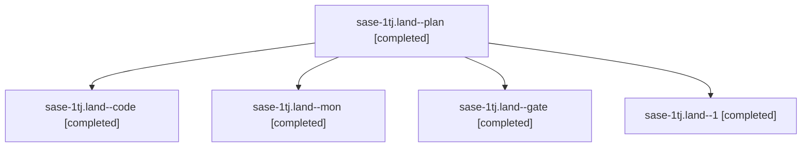

# Session: sase-1tj.land

[Agent Hoods](../README.md) / [bbugyi200](../users/bbugyi200/README.md) / [athena](../users/bbugyi200/machines/athena/README.md) / [sase-1tj](../users/bbugyi200/machines/athena/hoods/sase-1tj/README.md) / sase-1tj.land

Owner: `bbugyi200.athena` · Hood: `sase-1tj` · Members: 5 · Bead: [sase-1tj](https://github.com/sase-org/sase--beads/blob/main/pages/sase-1tj/README.md)

## Lineage

The diagram is an optional enhancement; the ordered table below contains the same lineage in accessible text.

| Role | Agent | State | Model / provider | Timing | Commits | Prompt | Chat |
|---|---|---|---|---|---:|---|---|
| plan | sase-1tj.land--plan | completed | gpt-6-astra / codex | 2026-11-18T17:58:01.577579+00:00 → 2026-11-18T20:18:41.403919+00:00 | 0 | [Prompt](../agents/bbugyi200.athena.sase-1tj.land--plan/prompt.md) | [Chat](../agents/bbugyi200.athena.sase-1tj.land--plan/chat.md) |
| code | sase-1tj.land--code | completed | muse-spark-1.3-contributor / muse | 2026-11-18T18:09:24.227361+00:00 → 2026-11-18T20:18:41.403919+00:00 | 0 | — | [Chat](../agents/bbugyi200.athena.sase-1tj.land--code/chat.md) |
| mon | sase-1tj.land--mon | completed | muse-spark-1.3-contributor / muse | 2026-11-18T18:43:25.750129+00:00 → 2026-11-18T20:20:44.045590+00:00 | 0 | — | [Chat](../agents/bbugyi200.athena.sase-1tj.land--mon/chat.md) |
| gate | sase-1tj.land--gate | completed | gpt-6-astra / codex | 2026-11-18T18:08:52.588026+00:00 → 2026-11-18T18:09:00.963152+00:00 | 0 | — | [Chat](../agents/bbugyi200.athena.sase-1tj.land--gate/chat.md) |
| 1 | sase-1tj.land--1 | completed | muse-spark-1.3-contributor / muse | 2026-11-18T20:20:55.028517+00:00 → 2026-11-18T20:48:51.543333+00:00 | [1](../agents/bbugyi200.athena.sase-1tj.land--1/README.md#commits) | [Prompt](../agents/bbugyi200.athena.sase-1tj.land--1/prompt.md) | [Chat](../agents/bbugyi200.athena.sase-1tj.land--1/chat.md) |

## Commits

| Role | Repo | Commit | Subject | Committed |
|---|---|---|---|---|
| 1 | sase | [`bd86168`](https://github.com/sase-org/sase/commit/bd8616817d90d840b68ba5858bf44af12f9d1573) | feat(finalizer): finish unscanned-writes guard with shared Rust policy | 2026-11-18 15:47:38 EST |

## Neighbors

| Agent | Relation | State |
|---|---|---|
| [sase-1tj.1](../agents/bbugyi200.athena.sase-1tj.1/README.md) | sase-1tj hood | completed |
| [sase-1tj.2](../agents/bbugyi200.athena.sase-1tj.2/README.md) | sase-1tj hood | completed |
| [sase-1tj.3](../agents/bbugyi200.athena.sase-1tj.3/README.md) | sase-1tj hood | completed |
