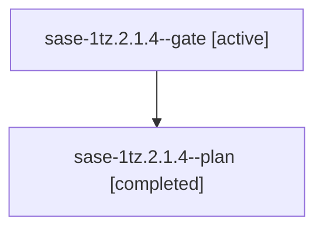

# Session: sase-1tz.2.1.4

[Agent Hoods](../README.md) / [bbugyi200](../users/bbugyi200/README.md) / [athena](../users/bbugyi200/machines/athena/README.md) / [sase-1tz](../users/bbugyi200/machines/athena/hoods/sase-1tz/README.md) / sase-1tz.2.1.4

Owner: `bbugyi200.athena` · Hood: `sase-1tz` · Members: 2 · Bead: [sase-1tz.2.1.4](https://github.com/sase-org/sase--beads/blob/main/pages/sase-1tz/sase-1tz.2.1.4.md)

## Lineage

The diagram is an optional enhancement; the ordered table below contains the same lineage in accessible text.

| Role | Agent | State | Model / provider | Timing | Commits | Prompt | Chat |
|---|---|---|---|---|---:|---|---|
| gate | sase-1tz.2.1.4--gate | active | grok-4.6 / grok | 2026-11-19T17:52:53.606225+00:00 | 0 | — | — |
| plan | sase-1tz.2.1.4--plan | completed | grok-4.6 / grok | 2026-11-19T16:16:05.872734+00:00 → 2026-11-19T17:53:02.972964+00:00 | [1](../agents/bbugyi200.athena.sase-1tz.2.1.4--plan/README.md#commits) | [Prompt](../agents/bbugyi200.athena.sase-1tz.2.1.4--plan/prompt.md) | [Chat](../agents/bbugyi200.athena.sase-1tz.2.1.4--plan/chat.md) |

## Commits

| Role | Repo | Commit | Subject | Committed |
|---|---|---|---|---|
| plan | sase | [`c756511`](https://github.com/sase-org/sase/commit/c756511c1113809840c79d5dda5d25d41b5c164a) | feat(agents-sync): reserve 15s for publisher drain cleanup | 2026-11-19 12:51:37 EST |

## Neighbors

| Agent | Relation | State |
|---|---|---|
| [sase-1tz.2](bbugyi200.athena.sase-1tz.2.md) (session · 3) | ancestor | active 1, completed 2 |
| [sase-1tz.2.1.1](../agents/bbugyi200.athena.sase-1tz.2.1.1/README.md) | sase-1tz.2.1 hood | completed |
| [sase-1tz.2.1.10](../agents/bbugyi200.athena.sase-1tz.2.1.10/README.md) | sase-1tz.2.1 hood | waiting |
| [sase-1tz.2.1.11](../agents/bbugyi200.athena.sase-1tz.2.1.11/README.md) | sase-1tz.2.1 hood | failed |
| [sase-1tz.2.1.12](../agents/bbugyi200.athena.sase-1tz.2.1.12/README.md) | sase-1tz.2.1 hood | completed |
| [sase-1tz.2.1.13](../agents/bbugyi200.athena.sase-1tz.2.1.13/README.md) | sase-1tz.2.1 hood | waiting |
| [sase-1tz.2.1.2](../agents/bbugyi200.athena.sase-1tz.2.1.2/README.md) | sase-1tz.2.1 hood | active |
| [sase-1tz.2.1.3](../agents/bbugyi200.athena.sase-1tz.2.1.3/README.md) | sase-1tz.2.1 hood | active |
| [sase-1tz.2.1.5](../agents/bbugyi200.athena.sase-1tz.2.1.5/README.md) | sase-1tz.2.1 hood | waiting |
| [sase-1tz.2.1.6](../agents/bbugyi200.athena.sase-1tz.2.1.6/README.md) | sase-1tz.2.1 hood | waiting |
| [sase-1tz.2.1.7](../agents/bbugyi200.athena.sase-1tz.2.1.7/README.md) | sase-1tz.2.1 hood | waiting |
| [sase-1tz.2.1.8](../agents/bbugyi200.athena.sase-1tz.2.1.8/README.md) | sase-1tz.2.1 hood | failed |
| [sase-1tz.2.1.9](../agents/bbugyi200.athena.sase-1tz.2.1.9/README.md) | sase-1tz.2.1 hood | waiting |
| [sase-1tz.2.1.land](../agents/bbugyi200.athena.sase-1tz.2.1.land/README.md) | sase-1tz.2.1 hood | waiting |
| [sase-1tz.1](bbugyi200.athena.sase-1tz.1.md) (session · 3) | sase-1tz hood | active 1, completed 2 |
| [sase-1tz.1.1.1](../agents/bbugyi200.athena.sase-1tz.1.1.1/README.md) | sase-1tz hood | completed |
| [sase-1tz.1.1.2](../agents/bbugyi200.athena.sase-1tz.1.1.2/README.md) | sase-1tz hood | completed |
| [sase-1tz.1.1.3](bbugyi200.athena.sase-1tz.1.1.3.md) (session · 3) | sase-1tz hood | completed 3 |
| [sase-1tz.1.1.4](../agents/bbugyi200.athena.sase-1tz.1.1.4/README.md) | sase-1tz hood | completed |
| [sase-1tz.1.1.5](../agents/bbugyi200.athena.sase-1tz.1.1.5/README.md) | sase-1tz hood | completed |
| [sase-1tz.1.1.6](../agents/bbugyi200.athena.sase-1tz.1.1.6/README.md) | sase-1tz hood | completed |
| [sase-1tz.1.1.7](../agents/bbugyi200.athena.sase-1tz.1.1.7/README.md) | sase-1tz hood | completed |
| [sase-1tz.1.1.land](../agents/bbugyi200.athena.sase-1tz.1.1.land/README.md) | sase-1tz hood | completed |
| [sase-1tz.3](../agents/bbugyi200.athena.sase-1tz.3/README.md) | sase-1tz hood | waiting |
| [sase-1tz.4](../agents/bbugyi200.athena.sase-1tz.4/README.md) | sase-1tz hood | waiting |
| [sase-1tz.land](../agents/bbugyi200.athena.sase-1tz.land/README.md) | sase-1tz hood | waiting |
