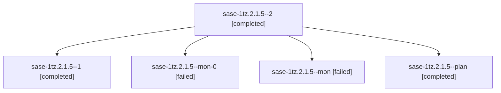

# Session: sase-1tz.2.1.5

[Agent Hoods](../README.md) / [bbugyi200](../users/bbugyi200/README.md) / [athena](../users/bbugyi200/machines/athena/README.md) / [sase-1tz](../users/bbugyi200/machines/athena/hoods/sase-1tz/README.md) / sase-1tz.2.1.5

Owner: `bbugyi200.athena` · Hood: `sase-1tz` · Members: 5 · Bead: [sase-1tz.2.1.5](https://github.com/sase-org/sase--beads/blob/main/pages/sase-1tz/sase-1tz.2.1.5.md)

## Lineage

The diagram is an optional enhancement; the ordered table below contains the same lineage in accessible text.

| Role | Agent | State | Model / provider | Timing | Commits | Prompt | Chat |
|---|---|---|---|---|---:|---|---|
| 2 | sase-1tz.2.1.5--2 | completed | gpt-6-luna / codex | 2026-11-19T23:16:40.039117+00:00 → 2026-11-20T02:03:59.938453+00:00 | [1](../agents/bbugyi200.athena.sase-1tz.2.1.5--2/README.md#commits) | [Prompt](../agents/bbugyi200.athena.sase-1tz.2.1.5--2/prompt.md) | [Chat](../agents/bbugyi200.athena.sase-1tz.2.1.5--2/chat.md) |
| 1 | sase-1tz.2.1.5--1 | completed | gpt-6-luna / codex | 2026-11-19T23:06:16.193701+00:00 → 2026-11-19T23:12:46.981616+00:00 | 0 | [Prompt](../agents/bbugyi200.athena.sase-1tz.2.1.5--1/prompt.md) | [Chat](../agents/bbugyi200.athena.sase-1tz.2.1.5--1/chat.md) |
| mon-0 | sase-1tz.2.1.5--mon-0 | failed | gpt-6-luna / codex | 2026-11-19T23:11:53.060633+00:00 → 2026-11-19T23:16:40.457581+00:00 | 0 | — | [Chat](../agents/bbugyi200.athena.sase-1tz.2.1.5--mon-0/chat.md) |
| mon | sase-1tz.2.1.5--mon | failed | gpt-6-luna / codex | 2026-11-19T22:41:56.545526+00:00 → 2026-11-19T23:05:35.901825+00:00 | 0 | — | [Chat](../agents/bbugyi200.athena.sase-1tz.2.1.5--mon/chat.md) |
| plan | sase-1tz.2.1.5--plan | completed | gpt-6-luna / codex | 2026-11-19T21:41:17.468839+00:00 → 2026-11-19T22:43:28.737706+00:00 | 0 | [Prompt](../agents/bbugyi200.athena.sase-1tz.2.1.5--plan/prompt.md) | [Chat](../agents/bbugyi200.athena.sase-1tz.2.1.5--plan/chat.md) |

## Commits

| Role | Repo | Commit | Subject | Committed |
|---|---|---|---|---|
| 2 | sase | [`fb85972`](https://github.com/sase-org/sase/commit/fb85972f27438a2ceee0304862aaa3446106fb80) | perf(agents-sync): reuse scoped hood inventory | 2026-11-19 21:01:04 EST |

## Neighbors

| Agent | Relation | State |
|---|---|---|
| [sase-1tz.2](bbugyi200.athena.sase-1tz.2.md) (session · 3) | ancestor | active 1, completed 2 |
| [sase-1tz.2.1.1](../agents/bbugyi200.athena.sase-1tz.2.1.1/README.md) | sase-1tz.2.1 hood | completed |
| [sase-1tz.2.1.10](../agents/bbugyi200.athena.sase-1tz.2.1.10/README.md) | sase-1tz.2.1 hood | completed |
| [sase-1tz.2.1.11](../agents/bbugyi200.athena.sase-1tz.2.1.11/README.md) | sase-1tz.2.1 hood | completed |
| [sase-1tz.2.1.12](../agents/bbugyi200.athena.sase-1tz.2.1.12/README.md) | sase-1tz.2.1 hood | completed |
| [sase-1tz.2.1.13](bbugyi200.athena.sase-1tz.2.1.13.md) (session · 2) | sase-1tz.2.1 hood | active 1, completed 1 |
| [sase-1tz.2.1.13](../agents/bbugyi200.athena.sase-1tz.2.1.13/README.md) | sase-1tz.2.1 hood | completed |
| [sase-1tz.2.1.2](../agents/bbugyi200.athena.sase-1tz.2.1.2/README.md) | sase-1tz.2.1 hood | completed |
| [sase-1tz.2.1.3](../agents/bbugyi200.athena.sase-1tz.2.1.3/README.md) | sase-1tz.2.1 hood | completed |
| [sase-1tz.2.1.4](bbugyi200.athena.sase-1tz.2.1.4.md) (session · 4) | sase-1tz.2.1 hood | active 1, completed 2, failed 1 |
| [sase-1tz.2.1.4](../agents/bbugyi200.athena.sase-1tz.2.1.4/README.md) | sase-1tz.2.1 hood | completed |
| [sase-1tz.2.1.6](../agents/bbugyi200.athena.sase-1tz.2.1.6/README.md) | sase-1tz.2.1 hood | completed |
| [sase-1tz.2.1.7](../agents/bbugyi200.athena.sase-1tz.2.1.7/README.md) | sase-1tz.2.1 hood | completed |
| [sase-1tz.2.1.8](../agents/bbugyi200.athena.sase-1tz.2.1.8/README.md) | sase-1tz.2.1 hood | completed |
| [sase-1tz.2.1.9](../agents/bbugyi200.athena.sase-1tz.2.1.9/README.md) | sase-1tz.2.1 hood | completed |
| [sase-1tz.2.1.land](bbugyi200.athena.sase-1tz.2.1.land.md) (session · 3) | sase-1tz.2.1 hood | completed 3 |
| [sase-1tz.1](bbugyi200.athena.sase-1tz.1.md) (session · 3) | sase-1tz hood | active 1, completed 2 |
| [sase-1tz.1.1.1](../agents/bbugyi200.athena.sase-1tz.1.1.1/README.md) | sase-1tz hood | completed |
| [sase-1tz.1.1.2](../agents/bbugyi200.athena.sase-1tz.1.1.2/README.md) | sase-1tz hood | completed |
| [sase-1tz.1.1.3](bbugyi200.athena.sase-1tz.1.1.3.md) (session · 3) | sase-1tz hood | completed 3 |
| [sase-1tz.1.1.4](../agents/bbugyi200.athena.sase-1tz.1.1.4/README.md) | sase-1tz hood | completed |
| [sase-1tz.1.1.5](../agents/bbugyi200.athena.sase-1tz.1.1.5/README.md) | sase-1tz hood | completed |
| [sase-1tz.1.1.6](../agents/bbugyi200.athena.sase-1tz.1.1.6/README.md) | sase-1tz hood | completed |
| [sase-1tz.1.1.7](../agents/bbugyi200.athena.sase-1tz.1.1.7/README.md) | sase-1tz hood | completed |
| [sase-1tz.1.1.land](../agents/bbugyi200.athena.sase-1tz.1.1.land/README.md) | sase-1tz hood | completed |
| [sase-1tz.3](bbugyi200.athena.sase-1tz.3.md) (session · 3) | sase-1tz hood | active 1, completed 2 |
| [sase-1tz.3.1.1](../agents/bbugyi200.athena.sase-1tz.3.1.1/README.md) | sase-1tz hood | active |
| [sase-1tz.3.1.10](../agents/bbugyi200.athena.sase-1tz.3.1.10/README.md) | sase-1tz hood | waiting |
| [sase-1tz.3.1.11](../agents/bbugyi200.athena.sase-1tz.3.1.11/README.md) | sase-1tz hood | completed |
| [sase-1tz.3.1.2](../agents/bbugyi200.athena.sase-1tz.3.1.2/README.md) | sase-1tz hood | completed |
| [sase-1tz.3.1.3](../agents/bbugyi200.athena.sase-1tz.3.1.3/README.md) | sase-1tz hood | waiting |
| [sase-1tz.3.1.4](../agents/bbugyi200.athena.sase-1tz.3.1.4/README.md) | sase-1tz hood | waiting |
| [sase-1tz.3.1.5](bbugyi200.athena.sase-1tz.3.1.5.md) (session · 4) | sase-1tz hood | completed 3, failed 1 |
| [sase-1tz.3.1.6](../agents/bbugyi200.athena.sase-1tz.3.1.6/README.md) | sase-1tz hood | completed |
| [sase-1tz.3.1.7](../agents/bbugyi200.athena.sase-1tz.3.1.7/README.md) | sase-1tz hood | waiting |
| [sase-1tz.3.1.8](../agents/bbugyi200.athena.sase-1tz.3.1.8/README.md) | sase-1tz hood | completed |
| [sase-1tz.3.1.9](../agents/bbugyi200.athena.sase-1tz.3.1.9/README.md) | sase-1tz hood | active |
| [sase-1tz.3.1.land](../agents/bbugyi200.athena.sase-1tz.3.1.land/README.md) | sase-1tz hood | waiting |
| [sase-1tz.4](../agents/bbugyi200.athena.sase-1tz.4/README.md) | sase-1tz hood | waiting |
| [sase-1tz.land](../agents/bbugyi200.athena.sase-1tz.land/README.md) | sase-1tz hood | waiting |
