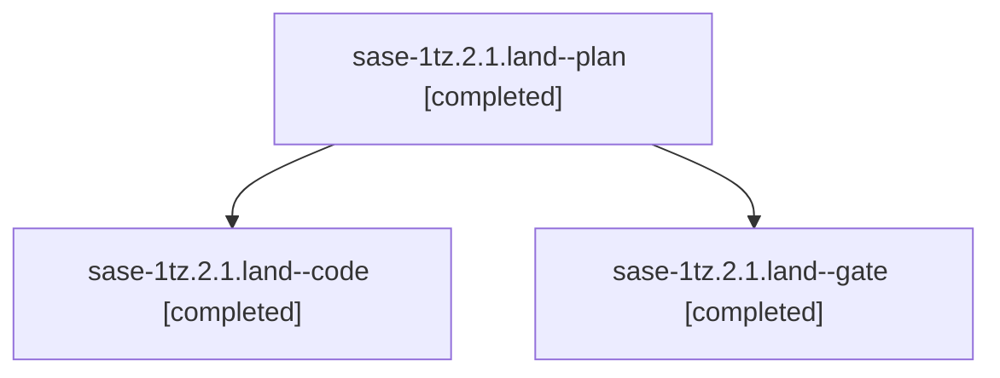

# Session: sase-1tz.2.1.land

[Agent Hoods](../README.md) / [bbugyi200](../users/bbugyi200/README.md) / [athena](../users/bbugyi200/machines/athena/README.md) / [sase-1tz](../users/bbugyi200/machines/athena/hoods/sase-1tz/README.md) / sase-1tz.2.1.land

Owner: `bbugyi200.athena` · Hood: `sase-1tz` · Members: 3 · Bead: [sase-1tz.2.1](https://github.com/sase-org/sase--beads/blob/main/pages/sase-1tz/sase-1tz.2.1.md)

## Lineage

The diagram is an optional enhancement; the ordered table below contains the same lineage in accessible text.

| Role | Agent | State | Model / provider | Timing | Commits | Prompt | Chat |
|---|---|---|---|---|---:|---|---|
| plan | sase-1tz.2.1.land--plan | completed | opus / claude | 2026-11-20T11:41:17.012455+00:00 → 2026-11-20T14:09:24.697817+00:00 | [1](../agents/bbugyi200.athena.sase-1tz.2.1.land--plan/README.md#commits) | [Prompt](../agents/bbugyi200.athena.sase-1tz.2.1.land--plan/prompt.md) | [Chat](../agents/bbugyi200.athena.sase-1tz.2.1.land--plan/chat.md) |
| code | sase-1tz.2.1.land--code | completed | opus / claude | 2026-11-20T13:05:45.459712+00:00 → 2026-11-20T14:09:24.697817+00:00 | [1](../agents/bbugyi200.athena.sase-1tz.2.1.land--code/README.md#commits) | — | [Chat](../agents/bbugyi200.athena.sase-1tz.2.1.land--code/chat.md) |
| gate | sase-1tz.2.1.land--gate | completed | opus / claude | 2026-11-20T13:04:49.137914+00:00 → 2026-11-20T13:04:56.955576+00:00 | 0 | — | [Chat](../agents/bbugyi200.athena.sase-1tz.2.1.land--gate/chat.md) |

## Commits

| Role | Repo | Commit | Subject | Committed |
|---|---|---|---|---|
| plan | sase | [`8cf9d8e`](https://github.com/sase-org/sase/commit/8cf9d8e5465994f9c1a34a5075a4bb7ea0ed9d47) | fix(doctor): keep cause detail in grouped publication issues and review scratch sweep | 2026-11-20 08:03:07 EST |
| code | sase | [`d18b499`](https://github.com/sase-org/sase/commit/d18b499d4d5582e2390da8e9af1f6fb31208f582) | feat(agents-sync): finish publication de-flap, error accounting, and GC pressure gate | 2026-11-20 09:06:32 EST |

## Neighbors

| Agent | Relation | State |
|---|---|---|
| [sase-1tz.2](bbugyi200.athena.sase-1tz.2.md) (session · 3) | ancestor | active 1, completed 2 |
| [sase-1tz.2.1.1](../agents/bbugyi200.athena.sase-1tz.2.1.1/README.md) | sase-1tz.2.1 hood | completed |
| [sase-1tz.2.1.10](../agents/bbugyi200.athena.sase-1tz.2.1.10/README.md) | sase-1tz.2.1 hood | completed |
| [sase-1tz.2.1.11](../agents/bbugyi200.athena.sase-1tz.2.1.11/README.md) | sase-1tz.2.1 hood | completed |
| [sase-1tz.2.1.12](../agents/bbugyi200.athena.sase-1tz.2.1.12/README.md) | sase-1tz.2.1 hood | completed |
| [sase-1tz.2.1.13](bbugyi200.athena.sase-1tz.2.1.13.md) (session · 2) | sase-1tz.2.1 hood | active 1, completed 1 |
| [sase-1tz.2.1.13](../agents/bbugyi200.athena.sase-1tz.2.1.13/README.md) | sase-1tz.2.1 hood | completed |
| [sase-1tz.2.1.2](../agents/bbugyi200.athena.sase-1tz.2.1.2/README.md) | sase-1tz.2.1 hood | completed |
| [sase-1tz.2.1.3](../agents/bbugyi200.athena.sase-1tz.2.1.3/README.md) | sase-1tz.2.1 hood | completed |
| [sase-1tz.2.1.4](bbugyi200.athena.sase-1tz.2.1.4.md) (session · 4) | sase-1tz.2.1 hood | active 1, completed 2, failed 1 |
| [sase-1tz.2.1.4](../agents/bbugyi200.athena.sase-1tz.2.1.4/README.md) | sase-1tz.2.1 hood | completed |
| [sase-1tz.2.1.5](bbugyi200.athena.sase-1tz.2.1.5.md) (session · 5) | sase-1tz.2.1 hood | completed 3, failed 2 |
| [sase-1tz.2.1.6](../agents/bbugyi200.athena.sase-1tz.2.1.6/README.md) | sase-1tz.2.1 hood | completed |
| [sase-1tz.2.1.7](../agents/bbugyi200.athena.sase-1tz.2.1.7/README.md) | sase-1tz.2.1 hood | completed |
| [sase-1tz.2.1.8](../agents/bbugyi200.athena.sase-1tz.2.1.8/README.md) | sase-1tz.2.1 hood | completed |
| [sase-1tz.2.1.9](../agents/bbugyi200.athena.sase-1tz.2.1.9/README.md) | sase-1tz.2.1 hood | completed |
| [sase-1tz.1](bbugyi200.athena.sase-1tz.1.md) (session · 3) | sase-1tz hood | active 1, completed 2 |
| [sase-1tz.1.1.1](../agents/bbugyi200.athena.sase-1tz.1.1.1/README.md) | sase-1tz hood | completed |
| [sase-1tz.1.1.2](../agents/bbugyi200.athena.sase-1tz.1.1.2/README.md) | sase-1tz hood | completed |
| [sase-1tz.1.1.3](bbugyi200.athena.sase-1tz.1.1.3.md) (session · 3) | sase-1tz hood | completed 3 |
| [sase-1tz.1.1.4](../agents/bbugyi200.athena.sase-1tz.1.1.4/README.md) | sase-1tz hood | completed |
| [sase-1tz.1.1.5](../agents/bbugyi200.athena.sase-1tz.1.1.5/README.md) | sase-1tz hood | completed |
| [sase-1tz.1.1.6](../agents/bbugyi200.athena.sase-1tz.1.1.6/README.md) | sase-1tz hood | completed |
| [sase-1tz.1.1.7](../agents/bbugyi200.athena.sase-1tz.1.1.7/README.md) | sase-1tz hood | completed |
| [sase-1tz.1.1.land](../agents/bbugyi200.athena.sase-1tz.1.1.land/README.md) | sase-1tz hood | completed |
| [sase-1tz.3](bbugyi200.athena.sase-1tz.3.md) (session · 3) | sase-1tz hood | active 1, completed 2 |
| [sase-1tz.3.1.1](../agents/bbugyi200.athena.sase-1tz.3.1.1/README.md) | sase-1tz hood | active |
| [sase-1tz.3.1.10](../agents/bbugyi200.athena.sase-1tz.3.1.10/README.md) | sase-1tz hood | waiting |
| [sase-1tz.3.1.11](../agents/bbugyi200.athena.sase-1tz.3.1.11/README.md) | sase-1tz hood | completed |
| [sase-1tz.3.1.2](../agents/bbugyi200.athena.sase-1tz.3.1.2/README.md) | sase-1tz hood | completed |
| [sase-1tz.3.1.3](../agents/bbugyi200.athena.sase-1tz.3.1.3/README.md) | sase-1tz hood | waiting |
| [sase-1tz.3.1.4](../agents/bbugyi200.athena.sase-1tz.3.1.4/README.md) | sase-1tz hood | waiting |
| [sase-1tz.3.1.5](bbugyi200.athena.sase-1tz.3.1.5.md) (session · 4) | sase-1tz hood | completed 3, failed 1 |
| [sase-1tz.3.1.6](../agents/bbugyi200.athena.sase-1tz.3.1.6/README.md) | sase-1tz hood | completed |
| [sase-1tz.3.1.7](../agents/bbugyi200.athena.sase-1tz.3.1.7/README.md) | sase-1tz hood | waiting |
| [sase-1tz.3.1.8](../agents/bbugyi200.athena.sase-1tz.3.1.8/README.md) | sase-1tz hood | completed |
| [sase-1tz.3.1.9](../agents/bbugyi200.athena.sase-1tz.3.1.9/README.md) | sase-1tz hood | active |
| [sase-1tz.3.1.land](../agents/bbugyi200.athena.sase-1tz.3.1.land/README.md) | sase-1tz hood | waiting |
| [sase-1tz.4](../agents/bbugyi200.athena.sase-1tz.4/README.md) | sase-1tz hood | waiting |
| [sase-1tz.land](../agents/bbugyi200.athena.sase-1tz.land/README.md) | sase-1tz hood | waiting |
