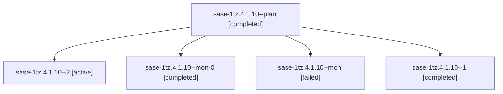

# Session: sase-1tz.4.1.10

[Agent Hoods](../README.md) / [bbugyi200](../users/bbugyi200/README.md) / [athena](../users/bbugyi200/machines/athena/README.md) / [sase-1tz](../users/bbugyi200/machines/athena/hoods/sase-1tz/README.md) / sase-1tz.4.1.10

Owner: `bbugyi200.athena` · Hood: `sase-1tz` · Members: 5 · Bead: [sase-1tz.4.1.10](https://github.com/sase-org/sase--beads/blob/main/pages/sase-1tz/sase-1tz.4.1.10.md)

## Lineage

The diagram is an optional enhancement; the ordered table below contains the same lineage in accessible text.

| Role | Agent | State | Model / provider | Timing | Commits | Prompt | Chat |
|---|---|---|---|---|---:|---|---|
| plan | sase-1tz.4.1.10--plan | completed | opus / claude | 2026-11-20T19:03:38.607586+00:00 → 2026-11-20T21:37:05.167199+00:00 | 0 | [Prompt](../agents/bbugyi200.athena.sase-1tz.4.1.10--plan/prompt.md) | [Chat](../agents/bbugyi200.athena.sase-1tz.4.1.10--plan/chat.md) |
| 2 | sase-1tz.4.1.10--2 | active | opus / claude | 2026-11-20T23:48:31.002535+00:00 | 0 | [Prompt](../agents/bbugyi200.athena.sase-1tz.4.1.10--2/prompt.md) | — |
| mon-0 | sase-1tz.4.1.10--mon-0 | completed | opus / claude | 2026-11-20T22:41:14.107185+00:00 → 2026-11-20T23:48:31.423834+00:00 | [1](../agents/bbugyi200.athena.sase-1tz.4.1.10--mon-0/README.md#commits) | — | [Chat](../agents/bbugyi200.athena.sase-1tz.4.1.10--mon-0/chat.md) |
| mon | sase-1tz.4.1.10--mon | failed | opus / claude | 2026-11-20T21:34:01.319757+00:00 → 2026-11-20T22:38:30.511101+00:00 | 0 | — | [Chat](../agents/bbugyi200.athena.sase-1tz.4.1.10--mon/chat.md) |
| 1 | sase-1tz.4.1.10--1 | completed | opus / claude | 2026-11-20T22:39:00.718956+00:00 → 2026-11-20T22:42:11.184737+00:00 | 0 | [Prompt](../agents/bbugyi200.athena.sase-1tz.4.1.10--1/prompt.md) | [Chat](../agents/bbugyi200.athena.sase-1tz.4.1.10--1/chat.md) |

## Commits

| Role | Repo | Commit | Subject | Committed |
|---|---|---|---|---|
| mon-0 | sase | [`335170e`](https://github.com/sase-org/sase/commit/335170e1cb0b5b2d597fd43994f30eff784ac126) | feat(notifications): quiet file-hook successes, dedup rescues, floor prune nudges | 2026-11-20 18:51:15 EST |

## Neighbors

| Agent | Relation | State |
|---|---|---|
| [sase-1tz.4](bbugyi200.athena.sase-1tz.4.md) (session · 3) | ancestor | active 1, completed 2 |
| [sase-1tz.4.1.1](../agents/bbugyi200.athena.sase-1tz.4.1.1/README.md) | sase-1tz.4.1 hood | completed |
| [sase-1tz.4.1.11](../agents/bbugyi200.athena.sase-1tz.4.1.11/README.md) | sase-1tz.4.1 hood | completed |
| [sase-1tz.4.1.12](../agents/bbugyi200.athena.sase-1tz.4.1.12/README.md) | sase-1tz.4.1 hood | completed |
| [sase-1tz.4.1.13](bbugyi200.athena.sase-1tz.4.1.13.md) (session · 3) | sase-1tz.4.1 hood | completed 3 |
| [sase-1tz.4.1.2](../agents/bbugyi200.athena.sase-1tz.4.1.2/README.md) | sase-1tz.4.1 hood | completed |
| [sase-1tz.4.1.3](../agents/bbugyi200.athena.sase-1tz.4.1.3/README.md) | sase-1tz.4.1 hood | completed |
| [sase-1tz.4.1.4](../agents/bbugyi200.athena.sase-1tz.4.1.4/README.md) | sase-1tz.4.1 hood | completed |
| [sase-1tz.4.1.5](../agents/bbugyi200.athena.sase-1tz.4.1.5/README.md) | sase-1tz.4.1 hood | waiting |
| [sase-1tz.4.1.6](../agents/bbugyi200.athena.sase-1tz.4.1.6/README.md) | sase-1tz.4.1 hood | completed |
| [sase-1tz.4.1.7](../agents/bbugyi200.athena.sase-1tz.4.1.7/README.md) | sase-1tz.4.1 hood | completed |
| [sase-1tz.4.1.8](../agents/bbugyi200.athena.sase-1tz.4.1.8/README.md) | sase-1tz.4.1 hood | completed |
| [sase-1tz.4.1.9](../agents/bbugyi200.athena.sase-1tz.4.1.9/README.md) | sase-1tz.4.1 hood | completed |
| [sase-1tz.4.1.land](../agents/bbugyi200.athena.sase-1tz.4.1.land/README.md) | sase-1tz.4.1 hood | waiting |
| [sase-1tz.1](bbugyi200.athena.sase-1tz.1.md) (session · 3) | sase-1tz hood | active 1, completed 2 |
| [sase-1tz.1.1.1](../agents/bbugyi200.athena.sase-1tz.1.1.1/README.md) | sase-1tz hood | completed |
| [sase-1tz.1.1.2](../agents/bbugyi200.athena.sase-1tz.1.1.2/README.md) | sase-1tz hood | completed |
| [sase-1tz.1.1.3](bbugyi200.athena.sase-1tz.1.1.3.md) (session · 3) | sase-1tz hood | completed 3 |
| [sase-1tz.1.1.4](../agents/bbugyi200.athena.sase-1tz.1.1.4/README.md) | sase-1tz hood | completed |
| [sase-1tz.1.1.5](../agents/bbugyi200.athena.sase-1tz.1.1.5/README.md) | sase-1tz hood | completed |
| [sase-1tz.1.1.6](../agents/bbugyi200.athena.sase-1tz.1.1.6/README.md) | sase-1tz hood | completed |
| [sase-1tz.1.1.7](../agents/bbugyi200.athena.sase-1tz.1.1.7/README.md) | sase-1tz hood | completed |
| [sase-1tz.1.1.land](../agents/bbugyi200.athena.sase-1tz.1.1.land/README.md) | sase-1tz hood | completed |
| [sase-1tz.2](bbugyi200.athena.sase-1tz.2.md) (session · 3) | sase-1tz hood | active 1, completed 2 |
| [sase-1tz.2.1.1](../agents/bbugyi200.athena.sase-1tz.2.1.1/README.md) | sase-1tz hood | completed |
| [sase-1tz.2.1.10](../agents/bbugyi200.athena.sase-1tz.2.1.10/README.md) | sase-1tz hood | completed |
| [sase-1tz.2.1.11](../agents/bbugyi200.athena.sase-1tz.2.1.11/README.md) | sase-1tz hood | completed |
| [sase-1tz.2.1.12](../agents/bbugyi200.athena.sase-1tz.2.1.12/README.md) | sase-1tz hood | completed |
| [sase-1tz.2.1.13](bbugyi200.athena.sase-1tz.2.1.13.md) (session · 2) | sase-1tz hood | active 1, completed 1 |
| [sase-1tz.2.1.13](../agents/bbugyi200.athena.sase-1tz.2.1.13/README.md) | sase-1tz hood | completed |
| [sase-1tz.2.1.2](../agents/bbugyi200.athena.sase-1tz.2.1.2/README.md) | sase-1tz hood | completed |
| [sase-1tz.2.1.3](../agents/bbugyi200.athena.sase-1tz.2.1.3/README.md) | sase-1tz hood | completed |
| [sase-1tz.2.1.4](bbugyi200.athena.sase-1tz.2.1.4.md) (session · 4) | sase-1tz hood | active 1, completed 2, failed 1 |
| [sase-1tz.2.1.4](../agents/bbugyi200.athena.sase-1tz.2.1.4/README.md) | sase-1tz hood | completed |
| [sase-1tz.2.1.5](bbugyi200.athena.sase-1tz.2.1.5.md) (session · 5) | sase-1tz hood | completed 3, failed 2 |
| [sase-1tz.2.1.6](../agents/bbugyi200.athena.sase-1tz.2.1.6/README.md) | sase-1tz hood | completed |
| [sase-1tz.2.1.7](../agents/bbugyi200.athena.sase-1tz.2.1.7/README.md) | sase-1tz hood | completed |
| [sase-1tz.2.1.8](../agents/bbugyi200.athena.sase-1tz.2.1.8/README.md) | sase-1tz hood | completed |
| [sase-1tz.2.1.9](../agents/bbugyi200.athena.sase-1tz.2.1.9/README.md) | sase-1tz hood | completed |
| [sase-1tz.2.1.land](bbugyi200.athena.sase-1tz.2.1.land.md) (session · 3) | sase-1tz hood | completed 3 |
| [sase-1tz.3](bbugyi200.athena.sase-1tz.3.md) (session · 3) | sase-1tz hood | active 1, completed 2 |
| [sase-1tz.3.1.1](../agents/bbugyi200.athena.sase-1tz.3.1.1/README.md) | sase-1tz hood | completed |
| [sase-1tz.3.1.10](../agents/bbugyi200.athena.sase-1tz.3.1.10/README.md) | sase-1tz hood | completed |
| [sase-1tz.3.1.11](../agents/bbugyi200.athena.sase-1tz.3.1.11/README.md) | sase-1tz hood | completed |
| [sase-1tz.3.1.2](../agents/bbugyi200.athena.sase-1tz.3.1.2/README.md) | sase-1tz hood | completed |
| [sase-1tz.3.1.3](../agents/bbugyi200.athena.sase-1tz.3.1.3/README.md) | sase-1tz hood | completed |
| [sase-1tz.3.1.4](../agents/bbugyi200.athena.sase-1tz.3.1.4/README.md) | sase-1tz hood | completed |
| [sase-1tz.3.1.5](bbugyi200.athena.sase-1tz.3.1.5.md) (session · 4) | sase-1tz hood | completed 3, failed 1 |
| [sase-1tz.3.1.6](../agents/bbugyi200.athena.sase-1tz.3.1.6/README.md) | sase-1tz hood | completed |
| [sase-1tz.3.1.7](../agents/bbugyi200.athena.sase-1tz.3.1.7/README.md) | sase-1tz hood | completed |
| [sase-1tz.3.1.8](../agents/bbugyi200.athena.sase-1tz.3.1.8/README.md) | sase-1tz hood | completed |
| [sase-1tz.3.1.9](../agents/bbugyi200.athena.sase-1tz.3.1.9/README.md) | sase-1tz hood | completed |
| [sase-1tz.3.1.land](../agents/bbugyi200.athena.sase-1tz.3.1.land/README.md) | sase-1tz hood | completed |
| [sase-1tz.land](../agents/bbugyi200.athena.sase-1tz.land/README.md) | sase-1tz hood | waiting |
