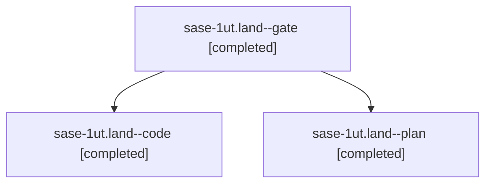

# Session: sase-1ut.land

[Agent Hoods](../README.md) / [bbugyi200](../users/bbugyi200/README.md) / [athena](../users/bbugyi200/machines/athena/README.md) / [sase-1ut](../users/bbugyi200/machines/athena/hoods/sase-1ut/README.md) / sase-1ut.land

Owner: `bbugyi200.athena` · Hood: `sase-1ut` · Members: 3 · Bead: [sase-1ut](https://github.com/sase-org/sase--beads/blob/main/pages/sase-1ut/README.md)

## Lineage



The diagram is an optional enhancement; the ordered table below contains the same lineage in accessible text.

| Role | Agent | State | Model / provider | Timing | Commits | Prompt | Chat |
|---|---|---|---|---|---:|---|---|
| <a id="member-gate"></a>gate | sase-1ut.land--gate | completed | gpt-6-astra / codex | 2026-11-21T15:44:53.628561+00:00 → 2026-11-21T15:45:02.946858+00:00 | 0 | — | [Chat](../agents/bbugyi200.athena.sase-1ut.land--gate/chat.md) |
| <a id="member-code"></a>code | sase-1ut.land--code | completed | muse-spark-1.3-contributor / muse | 2026-11-21T15:45:47.363167+00:00 → 2026-11-21T16:51:06.189297+00:00 | [1](../agents/bbugyi200.athena.sase-1ut.land--code/README.md#commits) | — | [Chat](../agents/bbugyi200.athena.sase-1ut.land--code/chat.md) |
| <a id="member-plan"></a>plan | sase-1ut.land--plan | completed | gpt-6-astra / codex | 2026-11-21T15:34:29.245067+00:00 → 2026-11-21T16:51:06.189297+00:00 | 0 | [Prompt](../agents/bbugyi200.athena.sase-1ut.land--plan/prompt.md) | [Chat](../agents/bbugyi200.athena.sase-1ut.land--plan/chat.md) |

## Commits

| Role | Repo | Commit | Subject | Committed |
|---|---|---|---|---|
| code | sase | [`da2165b`](https://github.com/sase-org/sase/commit/da2165b80fc181ee5f6c8e136436f12fe01ebe6a) | feat(gate-turn): share failure projection, harden dismissal timing and once-per-acceptance recovery | 2026-11-21 11:49:31 EST |

## Variables

| Role | Variable | Value |
|---|---|---|
| plan | `artifacts` | \[{bead: sase-1uk, kind: file, label: sase-1ut landing: 48 epic tests pass and existing sase-1uk retention failure reproduces, path: /home/bryan/.sase/artifacts/agents/gh\_sase-org\_\_sase/20261121092157… |

#### artifacts

**Role:** `plan`

```yaml
- bead: sase-1uk
  kind: file
  label: sase-1ut landing: 48 epic tests pass and existing sase-1uk retention failure reproduces
  path: /home/bryan/.sase/artifacts/agents/gh_sase-org__sase/20261121092157/sase-1ut-focused-tests-66fb4ed28186.txt
  ref: file:explicit:7c7d7cf2b3648dc17dcac646
  source_path: /home/bryan/.local/state/sase/workspaces/sase-org/sase/sase_17/.git/sase-1ut-focused-tests.txt
```

Values are truncated for display; see each member's agent meta.json for the full values.

## Neighbors

| Agent | Relation | State |
|---|---|---|
| [sase-1ut.1](../agents/bbugyi200.athena.sase-1ut.1/README.md) | sase-1ut hood | completed |
| [sase-1ut.2](../agents/bbugyi200.athena.sase-1ut.2/README.md) | sase-1ut hood | completed |
