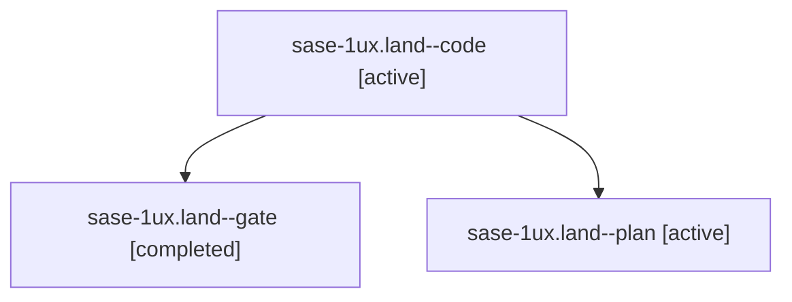

# Session: sase-1ux.land

[Agent Hoods](../README.md) / [bbugyi200](../users/bbugyi200/README.md) / [athena](../users/bbugyi200/machines/athena/README.md) / [sase-1ux](../users/bbugyi200/machines/athena/hoods/sase-1ux/README.md) / sase-1ux.land

Owner: `bbugyi200.athena` · Hood: `sase-1ux` · Members: 3 · Bead: [sase-1ux](https://github.com/sase-org/sase--beads/blob/main/pages/sase-1ux/README.md)

## Lineage

The diagram is an optional enhancement; the ordered table below contains the same lineage in accessible text.

| Role | Agent | State | Model / provider | Timing | Commits | Prompt | Chat |
|---|---|---|---|---|---:|---|---|
| code | sase-1ux.land--code | active | muse-spark-1.3-contributor / muse | 2026-11-22T20:54:57.818936+00:00 | 0 | — | — |
| gate | sase-1ux.land--gate | completed | opus / claude | 2026-11-22T20:54:03.849553+00:00 → 2026-11-22T20:54:12.384635+00:00 | 0 | — | [Chat](../agents/bbugyi200.athena.sase-1ux.land--gate/chat.md) |
| plan | sase-1ux.land--plan | active | opus / claude | 2026-11-22T20:25:13.377400+00:00 | [1](../agents/bbugyi200.athena.sase-1ux.land--plan/README.md#commits) | [Prompt](../agents/bbugyi200.athena.sase-1ux.land--plan/prompt.md) | [Chat](../agents/bbugyi200.athena.sase-1ux.land--plan/chat.md) |

## Commits

| Role | Repo | Commit | Subject | Committed |
|---|---|---|---|---|
| plan | sase | [`4a058c8`](https://github.com/sase-org/sase/commit/4a058c8e98d2ae2fc8668581123d55877554a831) | docs(gates): reword retired shell spellings past the terminology guard | 2026-11-22 15:53:09 EST |

## Neighbors

| Agent | Relation | State |
|---|---|---|
| [sase-1ux.1](../agents/bbugyi200.athena.sase-1ux.1/README.md) | sase-1ux hood | completed |
| [sase-1ux.2](../agents/bbugyi200.athena.sase-1ux.2/README.md) | sase-1ux hood | completed |
| [sase-1ux.3](../agents/bbugyi200.athena.sase-1ux.3/README.md) | sase-1ux hood | completed |
| [sase-1ux.4](../agents/bbugyi200.athena.sase-1ux.4/README.md) | sase-1ux hood | completed |
| [sase-1ux.5](../agents/bbugyi200.athena.sase-1ux.5/README.md) | sase-1ux hood | completed |
