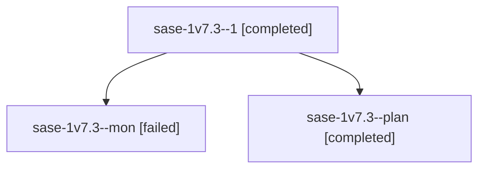

# Session: sase-1v7.3

[Agent Hoods](../README.md) / [bbugyi200](../users/bbugyi200/README.md) / [athena](../users/bbugyi200/machines/athena/README.md) / [sase-1v7](../users/bbugyi200/machines/athena/hoods/sase-1v7/README.md) / sase-1v7.3

Owner: `bbugyi200.athena` · Hood: `sase-1v7` · Members: 3 · Bead: [sase-1v7.3](https://github.com/sase-org/sase--beads/blob/main/pages/sase-1v7/sase-1v7.3.md)

## Lineage

The diagram is an optional enhancement; the ordered table below contains the same lineage in accessible text.

| Role | Agent | State | Model / provider | Timing | Commits | Prompt | Chat |
|---|---|---|---|---|---:|---|---|
| 1 | sase-1v7.3--1 | completed | gpt-6-luna / codex | 2026-11-25T23:58:11.750560+00:00 → 2026-11-26T00:01:21.351223+00:00 | 0 | [Prompt](../agents/bbugyi200.athena.sase-1v7.3--1/prompt.md) | [Chat](../agents/bbugyi200.athena.sase-1v7.3--1/chat.md) |
| mon | sase-1v7.3--mon | failed | gpt-6-luna / codex | 2026-11-25T23:10:49.476804+00:00 → 2026-11-25T23:58:11.831300+00:00 | 0 | — | [Chat](../agents/bbugyi200.athena.sase-1v7.3--mon/chat.md) |
| plan | sase-1v7.3--plan | completed | gpt-6-luna / codex | 2026-11-25T22:37:53.298043+00:00 → 2026-11-25T23:13:20.605468+00:00 | [1](../agents/bbugyi200.athena.sase-1v7.3--plan/README.md#commits) | [Prompt](../agents/bbugyi200.athena.sase-1v7.3--plan/prompt.md) | [Chat](../agents/bbugyi200.athena.sase-1v7.3--plan/chat.md) |

## Commits

| Role | Repo | Commit | Subject | Committed |
|---|---|---|---|---|
| plan | sase | [`8e6818d`](https://github.com/sase-org/sase/commit/8e6818d0a6bc0f6eb1b3fd8071385b152af04752) | feat(tui): show on-demand memory rosters | 2026-11-25 18:12:13 EST |

## Neighbors

| Agent | Relation | State |
|---|---|---|
| [sase-1v7.1](../agents/bbugyi200.athena.sase-1v7.1/README.md) | sase-1v7 hood | completed |
| [sase-1v7.2](../agents/bbugyi200.athena.sase-1v7.2/README.md) | sase-1v7 hood | completed |
| [sase-1v7.4](../agents/bbugyi200.athena.sase-1v7.4/README.md) | sase-1v7 hood | completed |
| [sase-1v7.5](../agents/bbugyi200.athena.sase-1v7.5/README.md) | sase-1v7 hood | completed |
| [sase-1v7.land](bbugyi200.athena.sase-1v7.land.md) (session · 3) | sase-1v7 hood | active 2, completed 1 |
