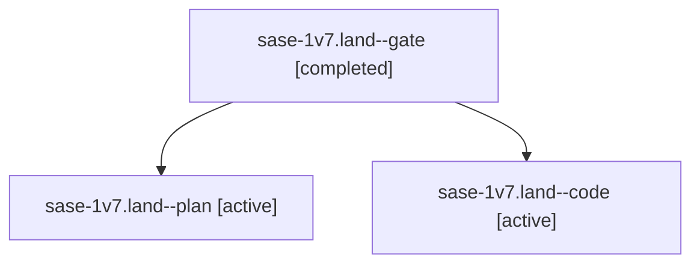

# Session: sase-1v7.land

[Agent Hoods](../README.md) / [bbugyi200](../users/bbugyi200/README.md) / [athena](../users/bbugyi200/machines/athena/README.md) / [sase-1v7](../users/bbugyi200/machines/athena/hoods/sase-1v7/README.md) / sase-1v7.land

Owner: `bbugyi200.athena` · Hood: `sase-1v7` · Members: 3 · Bead: [sase-1v7](https://github.com/sase-org/sase--beads/blob/main/pages/sase-1v7/README.md)

## Lineage

The diagram is an optional enhancement; the ordered table below contains the same lineage in accessible text.

| Role | Agent | State | Model / provider | Timing | Commits | Prompt | Chat |
|---|---|---|---|---|---:|---|---|
| gate | sase-1v7.land--gate | completed | opus / claude | 2026-11-26T00:14:47.740372+00:00 → 2026-11-26T00:14:55.920205+00:00 | 0 | — | [Chat](../agents/bbugyi200.athena.sase-1v7.land--gate/chat.md) |
| plan | sase-1v7.land--plan | active | opus / claude | 2026-11-26T00:01:54.369386+00:00 | 0 | [Prompt](../agents/bbugyi200.athena.sase-1v7.land--plan/prompt.md) | [Chat](../agents/bbugyi200.athena.sase-1v7.land--plan/chat.md) |
| code | sase-1v7.land--code | active | muse-spark-1.3-contributor / muse | 2026-11-26T00:15:37.361767+00:00 | 0 | — | — |

## Neighbors

| Agent | Relation | State |
|---|---|---|
| [sase-1v7.1](../agents/bbugyi200.athena.sase-1v7.1/README.md) | sase-1v7 hood | completed |
| [sase-1v7.2](../agents/bbugyi200.athena.sase-1v7.2/README.md) | sase-1v7 hood | completed |
| [sase-1v7.3](bbugyi200.athena.sase-1v7.3.md) (session · 3) | sase-1v7 hood | completed 2, failed 1 |
| [sase-1v7.4](../agents/bbugyi200.athena.sase-1v7.4/README.md) | sase-1v7 hood | completed |
| [sase-1v7.5](../agents/bbugyi200.athena.sase-1v7.5/README.md) | sase-1v7 hood | completed |
