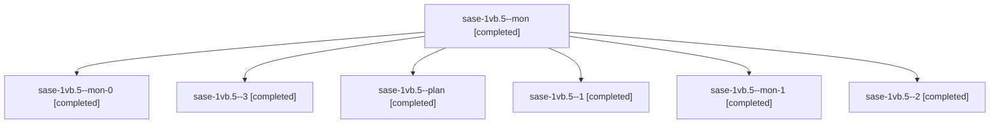

# Session: sase-1vb.5

[Agent Hoods](../README.md) / [bbugyi200](../users/bbugyi200/README.md) / [athena](../users/bbugyi200/machines/athena/README.md) / [sase-1vb](../users/bbugyi200/machines/athena/hoods/sase-1vb/README.md) / sase-1vb.5

Owner: `bbugyi200.athena` · Hood: `sase-1vb` · Members: 7 · Bead: [sase-1vb.5](https://github.com/sase-org/sase--beads/blob/main/pages/sase-1vb/sase-1vb.5.md)

## Lineage

The diagram is an optional enhancement; the ordered table below contains the same lineage in accessible text.

| Role | Agent | State | Model / provider | Timing | Commits | Prompt | Chat |
|---|---|---|---|---|---:|---|---|
| mon | sase-1vb.5--mon | completed | gpt-6-luna / codex | 2026-11-26T13:32:17.492746+00:00 → 2026-11-26T13:44:04.758416+00:00 | 0 | — | [Chat](../agents/bbugyi200.athena.sase-1vb.5--mon/chat.md) |
| mon-0 | sase-1vb.5--mon-0 | completed | gpt-6-luna / codex | 2026-11-26T14:11:20.979885+00:00 → 2026-11-26T14:19:19.341215+00:00 | 0 | — | [Chat](../agents/bbugyi200.athena.sase-1vb.5--mon-0/chat.md) |
| 3 | sase-1vb.5--3 | completed | gpt-6-luna / codex | 2026-11-26T15:00:37.541267+00:00 → 2026-11-26T15:13:25.873456+00:00 | [1](../agents/bbugyi200.athena.sase-1vb.5--3/README.md#commits) | [Prompt](../agents/bbugyi200.athena.sase-1vb.5--3/prompt.md) | [Chat](../agents/bbugyi200.athena.sase-1vb.5--3/chat.md) |
| plan | sase-1vb.5--plan | completed | gpt-6-luna / codex | 2026-11-26T13:26:56.121305+00:00 → 2026-11-26T13:33:01.312680+00:00 | 0 | [Prompt](../agents/bbugyi200.athena.sase-1vb.5--plan/prompt.md) | [Chat](../agents/bbugyi200.athena.sase-1vb.5--plan/chat.md) |
| 1 | sase-1vb.5--1 | completed | gpt-6-luna / codex | 2026-11-26T13:44:04.444866+00:00 → 2026-11-26T14:13:08.361227+00:00 | 0 | [Prompt](../agents/bbugyi200.athena.sase-1vb.5--1/prompt.md) | [Chat](../agents/bbugyi200.athena.sase-1vb.5--1/chat.md) |
| mon-1 | sase-1vb.5--mon-1 | completed | gpt-6-luna / codex | 2026-11-26T14:49:23.748887+00:00 → 2026-11-26T15:00:37.902410+00:00 | 0 | — | [Chat](../agents/bbugyi200.athena.sase-1vb.5--mon-1/chat.md) |
| 2 | sase-1vb.5--2 | completed | gpt-6-luna / codex | 2026-11-26T14:19:18.864410+00:00 → 2026-11-26T14:51:13.040840+00:00 | 0 | [Prompt](../agents/bbugyi200.athena.sase-1vb.5--2/prompt.md) | [Chat](../agents/bbugyi200.athena.sase-1vb.5--2/chat.md) |

## Commits

| Role | Repo | Commit | Subject | Committed |
|---|---|---|---|---|
| 3 | sase | [`1e017d0`](https://github.com/sase-org/sase/commit/1e017d0defae1100988816e246930db21ffdfc84) | test(tui): rebaseline intended November screenshot goldens | 2026-11-26 10:12:01 EST |

## Neighbors

| Agent | Relation | State |
|---|---|---|
| [sase-1vb.1](../agents/bbugyi200.athena.sase-1vb.1/README.md) | sase-1vb hood | completed |
| [sase-1vb.2](../agents/bbugyi200.athena.sase-1vb.2/README.md) | sase-1vb hood | completed |
| [sase-1vb.3](../agents/bbugyi200.athena.sase-1vb.3/README.md) | sase-1vb hood | completed |
| [sase-1vb.4](../agents/bbugyi200.athena.sase-1vb.4/README.md) | sase-1vb hood | completed |
| [sase-1vb.6](bbugyi200.athena.sase-1vb.6.md) (session · 1) | sase-1vb hood | active 1 |
| [sase-1vb.land](../agents/bbugyi200.athena.sase-1vb.land/README.md) | sase-1vb hood | waiting |
