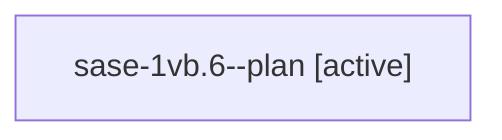

# Session: sase-1vb.6

[Agent Hoods](../README.md) / [bbugyi200](../users/bbugyi200/README.md) / [athena](../users/bbugyi200/machines/athena/README.md) / [sase-1vb](../users/bbugyi200/machines/athena/hoods/sase-1vb/README.md) / sase-1vb.6

Owner: `bbugyi200.athena` · Hood: `sase-1vb` · Members: 1 · Bead: [sase-1vb.6](https://github.com/sase-org/sase--beads/blob/main/pages/sase-1vb/sase-1vb.6.md)

## Lineage

The diagram is an optional enhancement; the ordered table below contains the same lineage in accessible text.

| Role | Agent | State | Model / provider | Timing | Commits | Prompt | Chat |
|---|---|---|---|---|---:|---|---|
| plan | sase-1vb.6--plan | active | gpt-6-luna / codex | 2026-11-26T15:13:48.676301+00:00 | 0 | [Prompt](../agents/bbugyi200.athena.sase-1vb.6--plan/prompt.md) | — |

## Neighbors

| Agent | Relation | State |
|---|---|---|
| [sase-1vb.1](../agents/bbugyi200.athena.sase-1vb.1/README.md) | sase-1vb hood | completed |
| [sase-1vb.2](../agents/bbugyi200.athena.sase-1vb.2/README.md) | sase-1vb hood | completed |
| [sase-1vb.3](../agents/bbugyi200.athena.sase-1vb.3/README.md) | sase-1vb hood | completed |
| [sase-1vb.4](../agents/bbugyi200.athena.sase-1vb.4/README.md) | sase-1vb hood | completed |
| [sase-1vb.5](bbugyi200.athena.sase-1vb.5.md) (session · 7) | sase-1vb hood | completed 7 |
| [sase-1vb.land](../agents/bbugyi200.athena.sase-1vb.land/README.md) | sase-1vb hood | waiting |
