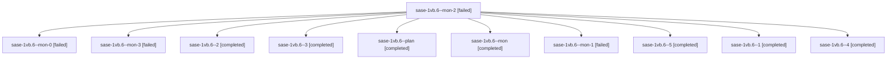

# Session: sase-1vb.6

[Agent Hoods](../README.md) / [bbugyi200](../users/bbugyi200/README.md) / [athena](../users/bbugyi200/machines/athena/README.md) / [sase-1vb](../users/bbugyi200/machines/athena/hoods/sase-1vb/README.md) / sase-1vb.6

Owner: `bbugyi200.athena` · Hood: `sase-1vb` · Members: 11 · Bead: [sase-1vb.6](https://github.com/sase-org/sase--beads/blob/main/pages/sase-1vb/sase-1vb.6.md)

## Lineage

The diagram is an optional enhancement; the ordered table below contains the same lineage in accessible text.

| Role | Agent | State | Model / provider | Timing | Commits | Prompt | Chat |
|---|---|---|---|---|---:|---|---|
| mon-2 | sase-1vb.6--mon-2 | failed | muse-spark-1.3-contributor / muse | 2026-11-26T16:33:18.550176+00:00 → 2026-11-26T16:49:06.417841+00:00 | 0 | — | [Chat](../agents/bbugyi200.athena.sase-1vb.6--mon-2/chat.md) |
| mon-0 | sase-1vb.6--mon-0 | failed | gpt-6-luna / codex | 2026-11-26T15:29:34.202258+00:00 → 2026-11-26T15:51:41.330894+00:00 | 0 | — | [Chat](../agents/bbugyi200.athena.sase-1vb.6--mon-0/chat.md) |
| mon-3 | sase-1vb.6--mon-3 | failed | muse-spark-1.3-contributor / muse | 2026-11-26T16:56:57.102013+00:00 → 2026-11-26T17:23:16.515852+00:00 | 0 | — | [Chat](../agents/bbugyi200.athena.sase-1vb.6--mon-3/chat.md) |
| 2 | sase-1vb.6--2 | completed | gpt-6-luna / codex | 2026-11-26T15:51:40.885501+00:00 → 2026-11-26T15:54:38.079179+00:00 | 0 | [Prompt](../agents/bbugyi200.athena.sase-1vb.6--2/prompt.md) | [Chat](../agents/bbugyi200.athena.sase-1vb.6--2/chat.md) |
| 3 | sase-1vb.6--3 | completed | muse-spark-1.3-contributor / muse | 2026-11-26T16:30:51.632287+00:00 → 2026-11-26T16:33:57.413790+00:00 | 0 | [Prompt](../agents/bbugyi200.athena.sase-1vb.6--3/prompt.md) | [Chat](../agents/bbugyi200.athena.sase-1vb.6--3/chat.md) |
| plan | sase-1vb.6--plan | completed | gpt-6-luna / codex | 2026-11-26T15:13:48.676301+00:00 → 2026-11-26T15:16:31.192758+00:00 | 0 | [Prompt](../agents/bbugyi200.athena.sase-1vb.6--plan/prompt.md) | [Chat](../agents/bbugyi200.athena.sase-1vb.6--plan/chat.md) |
| mon | sase-1vb.6--mon | completed | gpt-6-luna / codex | 2026-11-26T15:15:56.423746+00:00 → 2026-11-26T15:27:39.265322+00:00 | 0 | — | [Chat](../agents/bbugyi200.athena.sase-1vb.6--mon/chat.md) |
| mon-1 | sase-1vb.6--mon-1 | failed | gpt-6-luna / codex | 2026-11-26T15:54:02.053410+00:00 → 2026-11-26T16:30:51.649604+00:00 | 0 | — | [Chat](../agents/bbugyi200.athena.sase-1vb.6--mon-1/chat.md) |
| 5 | sase-1vb.6--5 | completed | gpt-6-luna / codex | 2026-11-26T17:23:16.027828+00:00 → 2026-11-26T17:27:45.031485+00:00 | 0 | [Prompt](../agents/bbugyi200.athena.sase-1vb.6--5/prompt.md) | [Chat](../agents/bbugyi200.athena.sase-1vb.6--5/chat.md) |
| 1 | sase-1vb.6--1 | completed | gpt-6-luna / codex | 2026-11-26T15:27:38.931360+00:00 → 2026-11-26T15:30:15.449584+00:00 | 0 | [Prompt](../agents/bbugyi200.athena.sase-1vb.6--1/prompt.md) | [Chat](../agents/bbugyi200.athena.sase-1vb.6--1/chat.md) |
| 4 | sase-1vb.6--4 | completed | muse-spark-1.3-contributor / muse | 2026-11-26T16:49:06.367618+00:00 → 2026-11-26T16:57:56.766279+00:00 | 0 | [Prompt](../agents/bbugyi200.athena.sase-1vb.6--4/prompt.md) | [Chat](../agents/bbugyi200.athena.sase-1vb.6--4/chat.md) |

## Neighbors

| Agent | Relation | State |
|---|---|---|
| [sase-1vb.1](../agents/bbugyi200.athena.sase-1vb.1/README.md) | sase-1vb hood | completed |
| [sase-1vb.2](../agents/bbugyi200.athena.sase-1vb.2/README.md) | sase-1vb hood | completed |
| [sase-1vb.3](../agents/bbugyi200.athena.sase-1vb.3/README.md) | sase-1vb hood | completed |
| [sase-1vb.4](../agents/bbugyi200.athena.sase-1vb.4/README.md) | sase-1vb hood | completed |
| [sase-1vb.5](bbugyi200.athena.sase-1vb.5.md) (session · 7) | sase-1vb hood | completed 7 |
| [sase-1vb.land](../agents/bbugyi200.athena.sase-1vb.land/README.md) | sase-1vb hood | completed |
