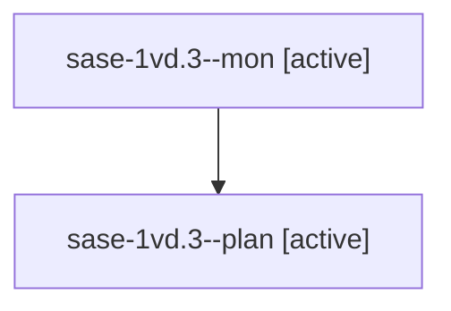

# Session: sase-1vd.3

[Agent Hoods](../README.md) / [bbugyi200](../users/bbugyi200/README.md) / [athena](../users/bbugyi200/machines/athena/README.md) / [sase-1vd](../users/bbugyi200/machines/athena/hoods/sase-1vd/README.md) / sase-1vd.3

Owner: `bbugyi200.athena` · Hood: `sase-1vd` · Members: 2 · Bead: [sase-1vd.3](https://github.com/sase-org/sase--beads/blob/main/pages/sase-1vd/sase-1vd.3.md)

## Lineage

The diagram is an optional enhancement; the ordered table below contains the same lineage in accessible text.

| Role | Agent | State | Model / provider | Timing | Commits | Prompt | Chat |
|---|---|---|---|---|---:|---|---|
| mon | sase-1vd.3--mon | active | muse-spark-1.3-contributor / muse | 2026-11-26T18:02:48.558074+00:00 | 0 | — | — |
| plan | sase-1vd.3--plan | active | muse-spark-1.3-contributor / muse | 2026-11-26T17:45:07.152101+00:00 | 0 | [Prompt](../agents/bbugyi200.athena.sase-1vd.3--plan/prompt.md) | — |

## Commits

| Role | Repo | Commit | Subject | Committed |
|---|---|---|---|---|
| — | sase | [`d88af8a`](https://github.com/sase-org/sase/commit/d88af8a00ac19ebd2d82272ffacb49abce7259df) | feat(ace): add question copy panel behind y | 2026-11-26 14:27:21 EST |

## Neighbors

| Agent | Relation | State |
|---|---|---|
| [sase-1vd.1](../agents/bbugyi200.athena.sase-1vd.1/README.md) | sase-1vd hood | completed |
| [sase-1vd.2](../agents/bbugyi200.athena.sase-1vd.2/README.md) | sase-1vd hood | completed |
| [sase-1vd.4](bbugyi200.athena.sase-1vd.4.md) (session · 3) | sase-1vd hood | completed 2, failed 1 |
| [sase-1vd.5](bbugyi200.athena.sase-1vd.5.md) (session · 3) | sase-1vd hood | completed 2, failed 1 |
| [sase-1vd.6](../agents/bbugyi200.athena.sase-1vd.6/README.md) | sase-1vd hood | completed |
| [sase-1vd.7](bbugyi200.athena.sase-1vd.7.md) (session · 3) | sase-1vd hood | completed 3 |
| [sase-1vd.7](../agents/bbugyi200.athena.sase-1vd.7/README.md) | sase-1vd hood | completed |
| [sase-1vd.land](../agents/bbugyi200.athena.sase-1vd.land/README.md) | sase-1vd hood | waiting |
