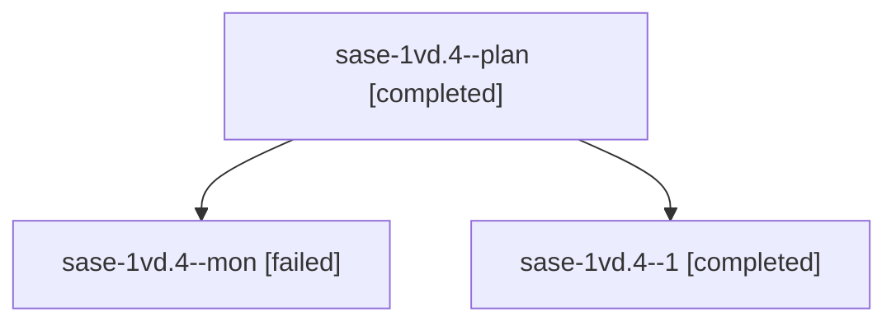

# Session: sase-1vd.4

[Agent Hoods](../README.md) / [bbugyi200](../users/bbugyi200/README.md) / [athena](../users/bbugyi200/machines/athena/README.md) / [sase-1vd](../users/bbugyi200/machines/athena/hoods/sase-1vd/README.md) / sase-1vd.4

Owner: `bbugyi200.athena` · Hood: `sase-1vd` · Members: 3 · Bead: [sase-1vd.4](https://github.com/sase-org/sase--beads/blob/main/pages/sase-1vd/sase-1vd.4.md)

## Lineage

The diagram is an optional enhancement; the ordered table below contains the same lineage in accessible text.

| Role | Agent | State | Model / provider | Timing | Commits | Prompt | Chat |
|---|---|---|---|---|---:|---|---|
| plan | sase-1vd.4--plan | completed | muse-spark-1.3-contributor / muse | 2026-11-26T19:43:03.692993+00:00 → 2026-11-26T20:15:59.857019+00:00 | 0 | [Prompt](../agents/bbugyi200.athena.sase-1vd.4--plan/prompt.md) | [Chat](../agents/bbugyi200.athena.sase-1vd.4--plan/chat.md) |
| mon | sase-1vd.4--mon | failed | muse-spark-1.3-contributor / muse | 2026-11-26T20:12:38.239987+00:00 → 2026-11-26T20:54:38.157217+00:00 | 0 | — | [Chat](../agents/bbugyi200.athena.sase-1vd.4--mon/chat.md) |
| 1 | sase-1vd.4--1 | completed | muse-spark-1.3-contributor / muse | 2026-11-26T20:54:37.985693+00:00 → 2026-11-26T21:00:34.428043+00:00 | [1](../agents/bbugyi200.athena.sase-1vd.4--1/README.md#commits) | [Prompt](../agents/bbugyi200.athena.sase-1vd.4--1/prompt.md) | [Chat](../agents/bbugyi200.athena.sase-1vd.4--1/chat.md) |

## Commits

| Role | Repo | Commit | Subject | Committed |
|---|---|---|---|---|
| 1 | sase | [`758745c`](https://github.com/sase-org/sase/commit/758745cb400d7846cd630ee0285e4a58a1036ec3) | feat(ace): show copy progress cues on the question pane | 2026-11-26 15:59:37 EST |

## Neighbors

| Agent | Relation | State |
|---|---|---|
| [sase-1vd.1](../agents/bbugyi200.athena.sase-1vd.1/README.md) | sase-1vd hood | completed |
| [sase-1vd.2](../agents/bbugyi200.athena.sase-1vd.2/README.md) | sase-1vd hood | completed |
| [sase-1vd.3](bbugyi200.athena.sase-1vd.3.md) (session · 2) | sase-1vd hood | active 2 |
| [sase-1vd.3](../agents/bbugyi200.athena.sase-1vd.3/README.md) | sase-1vd hood | completed |
| [sase-1vd.5](../agents/bbugyi200.athena.sase-1vd.5/README.md) | sase-1vd hood | waiting |
| [sase-1vd.6](../agents/bbugyi200.athena.sase-1vd.6/README.md) | sase-1vd hood | completed |
| [sase-1vd.7](../agents/bbugyi200.athena.sase-1vd.7/README.md) | sase-1vd hood | waiting |
| [sase-1vd.land](../agents/bbugyi200.athena.sase-1vd.land/README.md) | sase-1vd hood | waiting |
