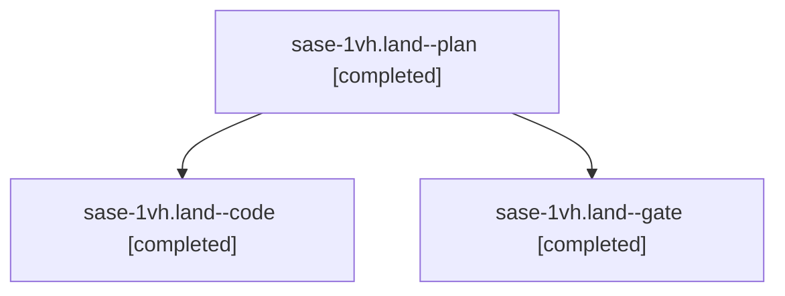

# Session: sase-1vh.land

[Agent Hoods](../README.md) / [bbugyi200](../users/bbugyi200/README.md) / [athena](../users/bbugyi200/machines/athena/README.md) / [sase-1vh](../users/bbugyi200/machines/athena/hoods/sase-1vh/README.md) / sase-1vh.land

Owner: `bbugyi200.athena` · Hood: `sase-1vh` · Members: 3 · Bead: [sase-1vh](https://github.com/sase-org/sase--beads/blob/main/pages/sase-1vh/README.md)

## Lineage

The diagram is an optional enhancement; the ordered table below contains the same lineage in accessible text.

| Role | Agent | State | Model / provider | Timing | Commits | Prompt | Chat |
|---|---|---|---|---|---:|---|---|
| plan | sase-1vh.land--plan | completed | gpt-6-astra / codex | 2026-11-26T21:24:55.087255+00:00 → 2026-11-26T21:55:52.605926+00:00 | 0 | [Prompt](../agents/bbugyi200.athena.sase-1vh.land--plan/prompt.md) | [Chat](../agents/bbugyi200.athena.sase-1vh.land--plan/chat.md) |
| code | sase-1vh.land--code | completed | gpt-6-luna / codex | 2026-11-26T21:35:36.193565+00:00 → 2026-11-26T21:55:52.605926+00:00 | [1](../agents/bbugyi200.athena.sase-1vh.land--code/README.md#commits) | — | [Chat](../agents/bbugyi200.athena.sase-1vh.land--code/chat.md) |
| gate | sase-1vh.land--gate | completed | gpt-6-astra / codex | 2026-11-26T21:33:02.518453+00:00 → 2026-11-26T21:33:14.636286+00:00 | 0 | — | [Chat](../agents/bbugyi200.athena.sase-1vh.land--gate/chat.md) |

## Commits

| Role | Repo | Commit | Subject | Committed |
|---|---|---|---|---|
| code | sase | [`7e9861a`](https://github.com/sase-org/sase/commit/7e9861ac4de136aad52aea34495bd0caf367754b) | fix(agent-runner): log each busy lookup retry | 2026-11-26 16:54:08 EST |

## Neighbors

| Agent | Relation | State |
|---|---|---|
| [sase-1vh.1](../agents/bbugyi200.athena.sase-1vh.1/README.md) | sase-1vh hood | completed |
| [sase-1vh.2](../agents/bbugyi200.athena.sase-1vh.2/README.md) | sase-1vh hood | completed |
| [sase-1vh.3](../agents/bbugyi200.athena.sase-1vh.3/README.md) | sase-1vh hood | completed |
