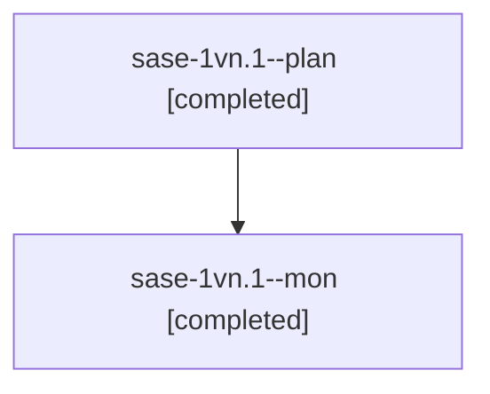

# Session: sase-1vn.1

[Agent Hoods](../README.md) / [bbugyi200](../users/bbugyi200/README.md) / [athena](../users/bbugyi200/machines/athena/README.md) / [sase-1vn](../users/bbugyi200/machines/athena/hoods/sase-1vn/README.md) / sase-1vn.1

Owner: `bbugyi200.athena` · Hood: `sase-1vn` · Members: 2 · Bead: [sase-1vn.1](https://github.com/sase-org/sase--beads/blob/main/pages/sase-1vn/sase-1vn.1.md)

## Lineage

The diagram is an optional enhancement; the ordered table below contains the same lineage in accessible text.

| Role | Agent | State | Model / provider | Timing | Commits | Prompt | Chat |
|---|---|---|---|---|---:|---|---|
| plan | sase-1vn.1--plan | completed | grok-4.6 / grok | 2026-11-27T15:23:53.856246+00:00 → 2026-11-27T15:32:27.899109+00:00 | 0 | [Prompt](../agents/bbugyi200.athena.sase-1vn.1--plan/prompt.md) | [Chat](../agents/bbugyi200.athena.sase-1vn.1--plan/chat.md) |
| mon | sase-1vn.1--mon | completed | grok-4.6 / grok | 2026-11-27T15:31:03.296488+00:00 → 2026-11-27T15:42:46.189980+00:00 | [1](../agents/bbugyi200.athena.sase-1vn.1--mon/README.md#commits) | — | [Chat](../agents/bbugyi200.athena.sase-1vn.1--mon/chat.md) |

## Commits

| Role | Repo | Commit | Subject | Committed |
|---|---|---|---|---|
| mon | sase | [`f079628`](https://github.com/sase-org/sase/commit/f07962869753f885da90cb754bb8f282f51e36e7) | fix: restore rebase-import certification and screenshot --window ownership | 2026-11-27 10:41:58 EST |

## Neighbors

| Agent | Relation | State |
|---|---|---|
| [sase-1vn.2](bbugyi200.athena.sase-1vn.2.md) (session · 7) | sase-1vn hood | completed 5, failed 2 |
| [sase-1vn.3](bbugyi200.athena.sase-1vn.3.md) (session · 3) | sase-1vn hood | active 1, completed 2 |
| [sase-1vn.3.1.1](../agents/bbugyi200.athena.sase-1vn.3.1.1/README.md) | sase-1vn hood | completed |
| [sase-1vn.3.1.2](../agents/bbugyi200.athena.sase-1vn.3.1.2/README.md) | sase-1vn hood | active |
| [sase-1vn.3.1.land](../agents/bbugyi200.athena.sase-1vn.3.1.land/README.md) | sase-1vn hood | waiting |
| [sase-1vn.4](../agents/bbugyi200.athena.sase-1vn.4/README.md) | sase-1vn hood | waiting |
| [sase-1vn.land](../agents/bbugyi200.athena.sase-1vn.land/README.md) | sase-1vn hood | waiting |
