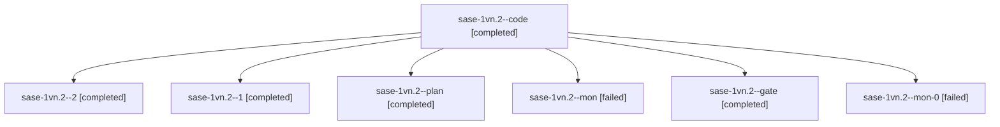

# Session: sase-1vn.2

[Agent Hoods](../README.md) / [bbugyi200](../users/bbugyi200/README.md) / [athena](../users/bbugyi200/machines/athena/README.md) / [sase-1vn](../users/bbugyi200/machines/athena/hoods/sase-1vn/README.md) / sase-1vn.2

Owner: `bbugyi200.athena` · Hood: `sase-1vn` · Members: 7 · Bead: [sase-1vn.2](https://github.com/sase-org/sase--beads/blob/main/pages/sase-1vn/sase-1vn.2.md)

## Lineage



The diagram is an optional enhancement; the ordered table below contains the same lineage in accessible text.

| Role | Agent | State | Model / provider | Timing | Commits | Prompt | Chat |
|---|---|---|---|---|---:|---|---|
| <a id="member-code"></a>code | sase-1vn.2--code | completed | gpt-6-luna / codex | 2026-11-27T15:51:10.905216+00:00 → 2026-11-27T16:41:45.423401+00:00 | 0 | — | [Chat](../agents/bbugyi200.athena.sase-1vn.2--code/chat.md) |
| <a id="member-2"></a>2 | sase-1vn.2--2 | completed | gpt-6-luna / codex | 2026-11-27T21:03:11.108463+00:00 → 2026-11-27T21:32:32.635872+00:00 | [1](../agents/bbugyi200.athena.sase-1vn.2--2/README.md#commits) | [Prompt](../agents/bbugyi200.athena.sase-1vn.2--2/prompt.md) | [Chat](../agents/bbugyi200.athena.sase-1vn.2--2/chat.md) |
| <a id="member-1"></a>1 | sase-1vn.2--1 | completed | gpt-6-luna / codex | 2026-11-27T18:16:04.283723+00:00 → 2026-11-27T19:14:56.696864+00:00 | 0 | [Prompt](../agents/bbugyi200.athena.sase-1vn.2--1/prompt.md) | [Chat](../agents/bbugyi200.athena.sase-1vn.2--1/chat.md) |
| <a id="member-plan"></a>plan | sase-1vn.2--plan | completed | gpt-6-astra / codex | 2026-11-27T15:43:05.897267+00:00 → 2026-11-27T16:41:45.423401+00:00 | 0 | [Prompt](../agents/bbugyi200.athena.sase-1vn.2--plan/prompt.md) | [Chat](../agents/bbugyi200.athena.sase-1vn.2--plan/chat.md) |
| <a id="member-mon"></a>mon | sase-1vn.2--mon | failed | gpt-6-luna / codex | 2026-11-27T16:40:03.052074+00:00 → 2026-11-27T18:16:04.606326+00:00 | 0 | — | [Chat](../agents/bbugyi200.athena.sase-1vn.2--mon/chat.md) |
| <a id="member-gate"></a>gate | sase-1vn.2--gate | completed | gpt-6-astra / codex | 2026-11-27T15:50:20.361821+00:00 → 2026-11-27T15:50:29.102560+00:00 | 0 | — | [Chat](../agents/bbugyi200.athena.sase-1vn.2--gate/chat.md) |
| <a id="member-mon-0"></a>mon-0 | sase-1vn.2--mon-0 | failed | gpt-6-luna / codex | 2026-11-27T19:13:59.995439+00:00 → 2026-11-27T21:03:11.247282+00:00 | 0 | — | [Chat](../agents/bbugyi200.athena.sase-1vn.2--mon-0/chat.md) |

## Commits

| Role | Repo | Commit | Subject | Committed |
|---|---|---|---|---|
| 2 | sase | [`1b46158`](https://github.com/sase-org/sase/commit/1b461588eb33d6ce70f0c4414ce3fcd483e8f905) | test(test-cost): rebaseline suite budgets and retain telemetry records | 2026-11-27 16:31:31 EST |

## Variables

| Role | Variable | Value |
|---|---|---|
| 1 | `artifacts` | \[{bead: sase-1vn.2, kind: file, label: test-cost baseline raw recording 2026-11-27, path: /home/bryan/.sase/artifacts/agents/gh\_sase-org\_\_sase/20261127131516/20261127T181443Z-2685200-632f2a244598.jso… |
| 2 | `artifacts` | \[{bead: sase-1vn.2, kind: file, label: Full check-full isolated test-cost recording 2026-11-27, path: /home/bryan/.sase/artifacts/agents/gh\_sase-org\_\_sase/20261127160214/20261127T205911Z-2221428-5992… |

#### artifacts

**Role:** `1`

```yaml
- bead: sase-1vn.2
  kind: file
  label: test-cost baseline raw recording 2026-11-27
  path: /home/bryan/.sase/artifacts/agents/gh_sase-org__sase/20261127131516/20261127T181443Z-2685200-632f2a244598.json
  ref: file:explicit:f2f774fd30fcf4bccf90defa
  source_path: /home/bryan/.local/state/sase/workspaces/sase-org/sase/sase_11/.pytest_cache/sase-test-cost-rebaseline-20261127-6QJxsl/20261127T181443Z-2685200.json
- bead: sase-1vn.2
  kind: file
  label: test-cost baseline monitor log 2026-11-27
  path: /home/bryan/.sase/artifacts/agents/gh_sase-org__sase/20261127131516/monitor-a98d347b3229.log
  ref: file:explicit:1a88240988579736c6140252
  source_path: /home/bryan/.local/state/sase/workspaces/sase-org/sase/sase_11/.pytest_cache/sase-test-cost-rebaseline-20261127-6QJxsl/monitor.log
- bead: sase-1vn.2
  kind: file
  label: isolated test-cost budget suggestion 2026-11-27
  path: /home/bryan/.sase/artifacts/agents/gh_sase-org__sase/20261127131516/suggestion-8f9441cdc08f.txt
  ref: file:explicit:0bee5068b45f2a8d14dd6fc1
  source_path: /home/bryan/.local/state/sase/workspaces/sase-org/sase/sase_11/.pytest_cache/sase-test-cost-rebaseline-20261127-6QJxsl/suggestion.txt
- bead: sase-1vn.2
  kind: file
  label: test-cost 15-percent-headroom suggestions 2026-11-27
  path: /home/bryan/.sase/artifacts/agents/gh_sase-org__sase/20261127131516/suggestion-headroom-615a4964461b.txt
  ref: file:explicit:81365da9fcfee7f81c0cfd0d
  source_path: /home/bryan/.local/state/sase/workspaces/sase-org/sase/sase_11/.pytest_cache/sase-test-cost-rebaseline-20261127-6QJxsl/suggestion-headroom.txt
```

#### artifacts

**Role:** `2`

```yaml
- bead: sase-1vn.2
  kind: file
  label: Full check-full isolated test-cost recording 2026-11-27
  path: /home/bryan/.sase/artifacts/agents/gh_sase-org__sase/20261127160214/20261127T205911Z-2221428-599211dbf96a.json
  ref: file:explicit:0c6bf85783f13300e8d3c47c
  source_path: /home/bryan/.local/state/sase/workspaces/sase-org/sase/sase_11/.pytest_cache/sase-test-cost-check-full-20261127-z4P6vR/20261127T205911Z-2221428.json
- bead: sase-1vn.2
  kind: file
  label: Complete check-full monitor log 62r1026bwztg
  path: /home/bryan/.sase/artifacts/agents/gh_sase-org__sase/20261127160214/monitor-62895e50cc3e.log
  ref: file:explicit:1fa482f4cf347ac59b28ab35
  source_path: /home/bryan/.local/state/sase/workspaces/sase-org/sase/sase_11/.pytest_cache/sase-test-cost-check-full-20261127-z4P6vR/monitor.log
```

Values are truncated for display; see each member's agent meta.json for the full values.

## Neighbors

| Agent | Relation | State |
|---|---|---|
| [sase-1vn.1](bbugyi200.athena.sase-1vn.1.md) (session · 2) | sase-1vn hood | completed 2 |
| [sase-1vn.3](bbugyi200.athena.sase-1vn.3.md) (session · 3) | sase-1vn hood | active 1, completed 2 |
| [sase-1vn.3.1.1](../agents/bbugyi200.athena.sase-1vn.3.1.1/README.md) | sase-1vn hood | completed |
| [sase-1vn.3.1.2](../agents/bbugyi200.athena.sase-1vn.3.1.2/README.md) | sase-1vn hood | completed |
| [sase-1vn.3.1.land](bbugyi200.athena.sase-1vn.3.1.land.md) (session · 3) | sase-1vn hood | completed 3 |
| [sase-1vn.4](../agents/bbugyi200.athena.sase-1vn.4/README.md) | sase-1vn hood | waiting |
| [sase-1vn.land](../agents/bbugyi200.athena.sase-1vn.land/README.md) | sase-1vn hood | waiting |
