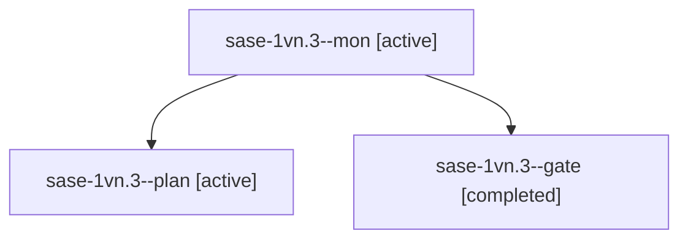

# Session: sase-1vn.3

[Agent Hoods](../README.md) / [bbugyi200](../users/bbugyi200/README.md) / [athena](../users/bbugyi200/machines/athena/README.md) / [sase-1vn](../users/bbugyi200/machines/athena/hoods/sase-1vn/README.md) / sase-1vn.3

Owner: `bbugyi200.athena` · Hood: `sase-1vn` · Members: 3 · Bead: [sase-1vn.3](https://github.com/sase-org/sase--beads/blob/main/pages/sase-1vn/sase-1vn.3.md)

## Lineage

The diagram is an optional enhancement; the ordered table below contains the same lineage in accessible text.

| Role | Agent | State | Model / provider | Timing | Commits | Prompt | Chat |
|---|---|---|---|---|---:|---|---|
| mon | sase-1vn.3--mon | active | gpt-6-astra / codex | 2026-11-27T21:41:25.496957+00:00 | 0 | — | — |
| plan | sase-1vn.3--plan | active | gpt-6-astra / codex | 2026-11-27T21:32:51.049240+00:00 → 2026-11-27T21:41:38.472668+00:00 | 0 | [Prompt](../agents/bbugyi200.athena.sase-1vn.3--plan/prompt.md) | [Chat](../agents/bbugyi200.athena.sase-1vn.3--plan/chat.md) |
| gate | sase-1vn.3--gate | completed | gpt-6-astra / codex | 2026-11-27T21:40:55.521559+00:00 → 2026-11-27T21:41:28.288504+00:00 | 0 | — | [Chat](../agents/bbugyi200.athena.sase-1vn.3--gate/chat.md) |

## Neighbors

| Agent | Relation | State |
|---|---|---|
| [sase-1vn.1](bbugyi200.athena.sase-1vn.1.md) (session · 2) | sase-1vn hood | completed 2 |
| [sase-1vn.2](bbugyi200.athena.sase-1vn.2.md) (session · 7) | sase-1vn hood | completed 5, failed 2 |
| [sase-1vn.4](../agents/bbugyi200.athena.sase-1vn.4/README.md) | sase-1vn hood | waiting |
| [sase-1vn.land](../agents/bbugyi200.athena.sase-1vn.land/README.md) | sase-1vn hood | waiting |
