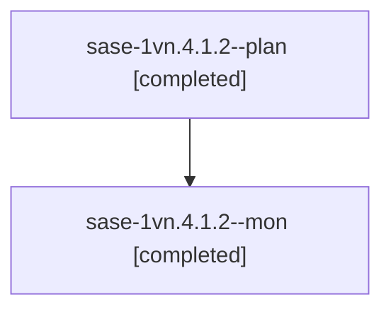

# Session: sase-1vn.4.1.2

[Agent Hoods](../README.md) / [bbugyi200](../users/bbugyi200/README.md) / [athena](../users/bbugyi200/machines/athena/README.md) / [sase-1vn](../users/bbugyi200/machines/athena/hoods/sase-1vn/README.md) / sase-1vn.4.1.2

Owner: `bbugyi200.athena` · Hood: `sase-1vn` · Members: 2 · Bead: [sase-1vn.4.1.2](https://github.com/sase-org/sase--beads/blob/main/pages/sase-1vn/sase-1vn.4.1.2.md)

## Lineage



The diagram is an optional enhancement; the ordered table below contains the same lineage in accessible text.

| Role | Agent | State | Model / provider | Timing | Commits | Prompt | Chat |
|---|---|---|---|---|---:|---|---|
| <a id="member-plan"></a>plan | sase-1vn.4.1.2--plan | completed | muse-spark-1.3-contributor / muse | 2026-11-28T02:02:09.446418+00:00 → 2026-11-28T03:19:45.914473+00:00 | [1](../agents/bbugyi200.athena.sase-1vn.4.1.2--plan/README.md#commits) | [Prompt](../agents/bbugyi200.athena.sase-1vn.4.1.2--plan/prompt.md) | [Chat](../agents/bbugyi200.athena.sase-1vn.4.1.2--plan/chat.md) |
| <a id="member-mon"></a>mon | sase-1vn.4.1.2--mon | completed | muse-spark-1.3-contributor / muse | 2026-11-28T02:17:02.102889+00:00 → 2026-11-28T03:19:50.553653+00:00 | 0 | — | [Chat](../agents/bbugyi200.athena.sase-1vn.4.1.2--mon/chat.md) |

## Commits

| Role | Repo | Commit | Subject | Committed |
|---|---|---|---|---|
| plan | sase | [`96e87d5`](https://github.com/sase-org/sase/commit/96e87d598425639b43fd066bd51d5e9b0fd3526e) | feat(bead): add read-only zombie-plan report and TUI integration | 2026-11-27 22:18:35 EST |

## Variables

| Role | Variable | Value |
|---|---|---|
| plan | `artifacts` | \[{bead: sase-1vn.4, kind: markdown, label: Zombie live inventory 2026-11-28 (sase-1vn.4.1.2), path: /home/bryan/.sase/artifacts/agents/gh\_sase-org\_\_sase/20261127201900/zombie\_inventory\_sase\_1vn412-b5… |

#### artifacts

**Role:** `plan`

```yaml
- bead: sase-1vn.4
  kind: markdown
  label: Zombie live inventory 2026-11-28 (sase-1vn.4.1.2)
  path: /home/bryan/.sase/artifacts/agents/gh_sase-org__sase/20261127201900/zombie_inventory_sase_1vn412-b5b38a24bf71.md
  ref: file:explicit:95fcc65660f2a5ea7525e495
  source_path: /tmp/zombie_inventory_sase_1vn412.md
```

Values are truncated for display; see each member's agent meta.json for the full values.

## Neighbors

| Agent | Relation | State |
|---|---|---|
| [sase-1vn.4](bbugyi200.athena.sase-1vn.4.md) (session · 3) | ancestor | active 1, completed 2 |
| [sase-1vn.4.1.1](../agents/bbugyi200.athena.sase-1vn.4.1.1/README.md) | sase-1vn.4.1 hood | completed |
| [sase-1vn.4.1.3](../agents/bbugyi200.athena.sase-1vn.4.1.3/README.md) | sase-1vn.4.1 hood | completed |
| [sase-1vn.4.1.4](bbugyi200.athena.sase-1vn.4.1.4.md) (session · 3) | sase-1vn.4.1 hood | completed 3 |
| [sase-1vn.4.1.5](../agents/bbugyi200.athena.sase-1vn.4.1.5/README.md) | sase-1vn.4.1 hood | completed |
| [sase-1vn.4.1.land](../agents/bbugyi200.athena.sase-1vn.4.1.land/README.md) | sase-1vn.4.1 hood | completed |
| [sase-1vn.1](bbugyi200.athena.sase-1vn.1.md) (session · 2) | sase-1vn hood | completed 2 |
| [sase-1vn.2](bbugyi200.athena.sase-1vn.2.md) (session · 7) | sase-1vn hood | completed 5, failed 2 |
| [sase-1vn.3](bbugyi200.athena.sase-1vn.3.md) (session · 3) | sase-1vn hood | active 1, completed 2 |
| [sase-1vn.3.1.1](../agents/bbugyi200.athena.sase-1vn.3.1.1/README.md) | sase-1vn hood | completed |
| [sase-1vn.3.1.2](../agents/bbugyi200.athena.sase-1vn.3.1.2/README.md) | sase-1vn hood | completed |
| [sase-1vn.3.1.land](bbugyi200.athena.sase-1vn.3.1.land.md) (session · 3) | sase-1vn hood | completed 3 |
| [sase-1vn.land](bbugyi200.athena.sase-1vn.land.md) (session · 5) | sase-1vn hood | completed 5 |
