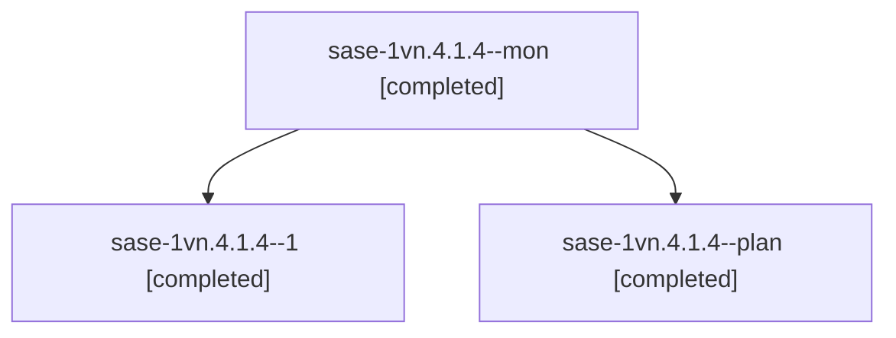

# Session: sase-1vn.4.1.4

[Agent Hoods](../README.md) / [bbugyi200](../users/bbugyi200/README.md) / [athena](../users/bbugyi200/machines/athena/README.md) / [sase-1vn](../users/bbugyi200/machines/athena/hoods/sase-1vn/README.md) / sase-1vn.4.1.4

Owner: `bbugyi200.athena` · Hood: `sase-1vn` · Members: 3 · Bead: [sase-1vn.4.1.4](https://github.com/sase-org/sase--beads/blob/main/pages/sase-1vn/sase-1vn.4.1.4.md)

## Lineage

The diagram is an optional enhancement; the ordered table below contains the same lineage in accessible text.

| Role | Agent | State | Model / provider | Timing | Commits | Prompt | Chat |
|---|---|---|---|---|---:|---|---|
| mon | sase-1vn.4.1.4--mon | completed | muse-spark-1.3-contributor / muse | 2026-11-28T05:33:15.690694+00:00 → 2026-11-28T05:46:33.639417+00:00 | 0 | — | [Chat](../agents/bbugyi200.athena.sase-1vn.4.1.4--mon/chat.md) |
| 1 | sase-1vn.4.1.4--1 | completed | muse-spark-1.3-contributor / muse | 2026-11-28T05:46:33.117451+00:00 → 2026-11-28T05:52:27.309509+00:00 | [1](../agents/bbugyi200.athena.sase-1vn.4.1.4--1/README.md#commits) | [Prompt](../agents/bbugyi200.athena.sase-1vn.4.1.4--1/prompt.md) | [Chat](../agents/bbugyi200.athena.sase-1vn.4.1.4--1/chat.md) |
| plan | sase-1vn.4.1.4--plan | completed | muse-spark-1.3-contributor / muse | 2026-11-28T04:50:21.468763+00:00 → 2026-11-28T05:36:49.245637+00:00 | 0 | [Prompt](../agents/bbugyi200.athena.sase-1vn.4.1.4--plan/prompt.md) | [Chat](../agents/bbugyi200.athena.sase-1vn.4.1.4--plan/chat.md) |

## Commits

| Role | Repo | Commit | Subject | Committed |
|---|---|---|---|---|
| 1 | sase | [`a62aafb`](https://github.com/sase-org/sase/commit/a62aafb71899cc6d95dc0ef74ef4ec320bc493ef) | feat(bead): add idempotent land-only recovery launch submission | 2026-11-28 00:51:24 EST |

## Neighbors

| Agent | Relation | State |
|---|---|---|
| [sase-1vn.4](bbugyi200.athena.sase-1vn.4.md) (session · 3) | ancestor | active 1, completed 2 |
| [sase-1vn.4.1.1](../agents/bbugyi200.athena.sase-1vn.4.1.1/README.md) | sase-1vn.4.1 hood | completed |
| [sase-1vn.4.1.2](bbugyi200.athena.sase-1vn.4.1.2.md) (session · 2) | sase-1vn.4.1 hood | completed 2 |
| [sase-1vn.4.1.3](../agents/bbugyi200.athena.sase-1vn.4.1.3/README.md) | sase-1vn.4.1 hood | completed |
| [sase-1vn.4.1.5](../agents/bbugyi200.athena.sase-1vn.4.1.5/README.md) | sase-1vn.4.1 hood | waiting |
| [sase-1vn.4.1.land](../agents/bbugyi200.athena.sase-1vn.4.1.land/README.md) | sase-1vn.4.1 hood | waiting |
| [sase-1vn.1](bbugyi200.athena.sase-1vn.1.md) (session · 2) | sase-1vn hood | completed 2 |
| [sase-1vn.2](bbugyi200.athena.sase-1vn.2.md) (session · 7) | sase-1vn hood | completed 5, failed 2 |
| [sase-1vn.3](bbugyi200.athena.sase-1vn.3.md) (session · 3) | sase-1vn hood | active 1, completed 2 |
| [sase-1vn.3.1.1](../agents/bbugyi200.athena.sase-1vn.3.1.1/README.md) | sase-1vn hood | completed |
| [sase-1vn.3.1.2](../agents/bbugyi200.athena.sase-1vn.3.1.2/README.md) | sase-1vn hood | completed |
| [sase-1vn.3.1.land](bbugyi200.athena.sase-1vn.3.1.land.md) (session · 3) | sase-1vn hood | completed 3 |
| [sase-1vn.land](../agents/bbugyi200.athena.sase-1vn.land/README.md) | sase-1vn hood | waiting |
