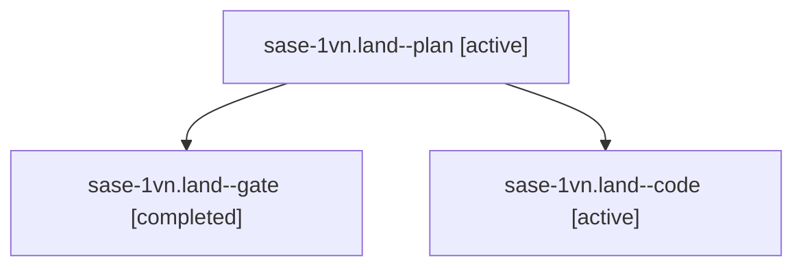

# Session: sase-1vn.land

[Agent Hoods](../README.md) / [bbugyi200](../users/bbugyi200/README.md) / [athena](../users/bbugyi200/machines/athena/README.md) / [sase-1vn](../users/bbugyi200/machines/athena/hoods/sase-1vn/README.md) / sase-1vn.land

Owner: `bbugyi200.athena` · Hood: `sase-1vn` · Members: 3 · Bead: [sase-1vn](https://github.com/sase-org/sase--beads/blob/main/pages/sase-1vn/README.md)

## Lineage

The diagram is an optional enhancement; the ordered table below contains the same lineage in accessible text.

| Role | Agent | State | Model / provider | Timing | Commits | Prompt | Chat |
|---|---|---|---|---|---:|---|---|
| plan | sase-1vn.land--plan | active | opus / claude | 2026-11-28T07:26:06.915507+00:00 | 0 | [Prompt](../agents/bbugyi200.athena.sase-1vn.land--plan/prompt.md) | [Chat](../agents/bbugyi200.athena.sase-1vn.land--plan/chat.md) |
| gate | sase-1vn.land--gate | completed | opus / claude | 2026-11-28T07:42:45.685552+00:00 → 2026-11-28T07:42:55.446340+00:00 | 0 | — | [Chat](../agents/bbugyi200.athena.sase-1vn.land--gate/chat.md) |
| code | sase-1vn.land--code | active | muse-spark-1.3-contributor / muse | 2026-11-28T07:43:44.479132+00:00 | 0 | — | — |

## Neighbors

| Agent | Relation | State |
|---|---|---|
| [sase-1vn.1](bbugyi200.athena.sase-1vn.1.md) (session · 2) | sase-1vn hood | completed 2 |
| [sase-1vn.2](bbugyi200.athena.sase-1vn.2.md) (session · 7) | sase-1vn hood | completed 5, failed 2 |
| [sase-1vn.3](bbugyi200.athena.sase-1vn.3.md) (session · 3) | sase-1vn hood | active 1, completed 2 |
| [sase-1vn.3.1.1](../agents/bbugyi200.athena.sase-1vn.3.1.1/README.md) | sase-1vn hood | completed |
| [sase-1vn.3.1.2](../agents/bbugyi200.athena.sase-1vn.3.1.2/README.md) | sase-1vn hood | completed |
| [sase-1vn.3.1.land](bbugyi200.athena.sase-1vn.3.1.land.md) (session · 3) | sase-1vn hood | completed 3 |
| [sase-1vn.4](bbugyi200.athena.sase-1vn.4.md) (session · 3) | sase-1vn hood | active 1, completed 2 |
| [sase-1vn.4.1.1](../agents/bbugyi200.athena.sase-1vn.4.1.1/README.md) | sase-1vn hood | completed |
| [sase-1vn.4.1.2](bbugyi200.athena.sase-1vn.4.1.2.md) (session · 2) | sase-1vn hood | completed 2 |
| [sase-1vn.4.1.3](../agents/bbugyi200.athena.sase-1vn.4.1.3/README.md) | sase-1vn hood | completed |
| [sase-1vn.4.1.4](bbugyi200.athena.sase-1vn.4.1.4.md) (session · 3) | sase-1vn hood | completed 3 |
| [sase-1vn.4.1.5](../agents/bbugyi200.athena.sase-1vn.4.1.5/README.md) | sase-1vn hood | completed |
| [sase-1vn.4.1.land](../agents/bbugyi200.athena.sase-1vn.4.1.land/README.md) | sase-1vn hood | completed |
