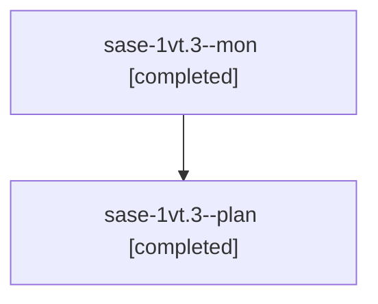

# Session: sase-1vt.3

[Agent Hoods](../README.md) / [bbugyi200](../users/bbugyi200/README.md) / [athena](../users/bbugyi200/machines/athena/README.md) / [sase-1vt](../users/bbugyi200/machines/athena/hoods/sase-1vt/README.md) / sase-1vt.3

Owner: `bbugyi200.athena` · Hood: `sase-1vt` · Members: 2 · Bead: [sase-1vt.3](https://github.com/sase-org/sase--beads/blob/main/pages/sase-1vt/sase-1vt.3.md)

## Lineage

The diagram is an optional enhancement; the ordered table below contains the same lineage in accessible text.

| Role | Agent | State | Model / provider | Timing | Commits | Prompt | Chat |
|---|---|---|---|---|---:|---|---|
| mon | sase-1vt.3--mon | completed | grok-4.6 / grok | 2026-11-27T21:34:55.404127+00:00 → 2026-11-27T22:00:46.625758+00:00 | [1](../agents/bbugyi200.athena.sase-1vt.3--mon/README.md#commits) | — | [Chat](../agents/bbugyi200.athena.sase-1vt.3--mon/chat.md) |
| plan | sase-1vt.3--plan | completed | grok-4.6 / grok | 2026-11-27T20:31:18.593944+00:00 → 2026-11-27T21:36:33.192907+00:00 | 0 | [Prompt](../agents/bbugyi200.athena.sase-1vt.3--plan/prompt.md) | [Chat](../agents/bbugyi200.athena.sase-1vt.3--plan/chat.md) |

## Commits

| Role | Repo | Commit | Subject | Committed |
|---|---|---|---|---|
| mon | sase | [`1cde333`](https://github.com/sase-org/sase/commit/1cde33380898f86324dd520f7d65e8aaedf28a05) | feat(bead): refresh the store before epic mint and reject foreign plan links | 2026-11-27 16:59:49 EST |

## Neighbors

| Agent | Relation | State |
|---|---|---|
| [sase-1vt.1](../agents/bbugyi200.athena.sase-1vt.1/README.md) | sase-1vt hood | completed |
| [sase-1vt.2](../agents/bbugyi200.athena.sase-1vt.2/README.md) | sase-1vt hood | completed |
| [sase-1vt.4](../agents/bbugyi200.athena.sase-1vt.4/README.md) | sase-1vt hood | completed |
| [sase-1vt.5](../agents/bbugyi200.athena.sase-1vt.5/README.md) | sase-1vt hood | completed |
| [sase-1vt.land](../agents/bbugyi200.athena.sase-1vt.land/README.md) | sase-1vt hood | waiting |
