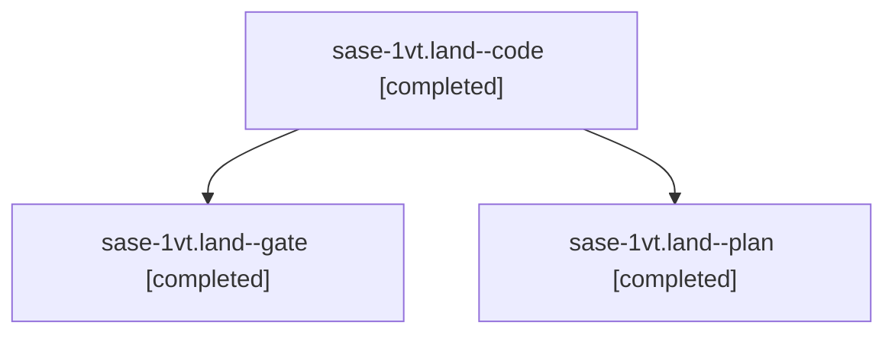

# Session: sase-1vt.land

[Agent Hoods](../README.md) / [bbugyi200](../users/bbugyi200/README.md) / [athena](../users/bbugyi200/machines/athena/README.md) / [sase-1vt](../users/bbugyi200/machines/athena/hoods/sase-1vt/README.md) / sase-1vt.land

Owner: `bbugyi200.athena` · Hood: `sase-1vt` · Members: 3 · Bead: [sase-1vt](https://github.com/sase-org/sase--beads/blob/main/pages/sase-1vt/README.md)

## Lineage

The diagram is an optional enhancement; the ordered table below contains the same lineage in accessible text.

| Role | Agent | State | Model / provider | Timing | Commits | Prompt | Chat |
|---|---|---|---|---|---:|---|---|
| code | sase-1vt.land--code | completed | muse-spark-1.3-contributor / muse | 2026-11-27T23:48:38.639454+00:00 → 2026-11-28T00:12:20.308743+00:00 | [1](../agents/bbugyi200.athena.sase-1vt.land--code/README.md#commits) | — | [Chat](../agents/bbugyi200.athena.sase-1vt.land--code/chat.md) |
| gate | sase-1vt.land--gate | completed | opus / claude | 2026-11-27T23:47:35.277448+00:00 → 2026-11-27T23:47:49.421213+00:00 | 0 | — | [Chat](../agents/bbugyi200.athena.sase-1vt.land--gate/chat.md) |
| plan | sase-1vt.land--plan | completed | opus / claude | 2026-11-27T23:31:27.486358+00:00 → 2026-11-28T00:12:20.308743+00:00 | 0 | [Prompt](../agents/bbugyi200.athena.sase-1vt.land--plan/prompt.md) | [Chat](../agents/bbugyi200.athena.sase-1vt.land--plan/chat.md) |

## Commits

| Role | Repo | Commit | Subject | Committed |
|---|---|---|---|---|
| code | sase | [`61d9554`](https://github.com/sase-org/sase/commit/61d955445c4bb3662bb2244d29dff0f5ee8fe1e8) | fix(bead): land resilient epic launches with cause-first labels and sandboxed replay | 2026-11-27 19:10:21 EST |

## Neighbors

| Agent | Relation | State |
|---|---|---|
| [sase-1vt.1](../agents/bbugyi200.athena.sase-1vt.1/README.md) | sase-1vt hood | completed |
| [sase-1vt.2](../agents/bbugyi200.athena.sase-1vt.2/README.md) | sase-1vt hood | completed |
| [sase-1vt.3](bbugyi200.athena.sase-1vt.3.md) (session · 2) | sase-1vt hood | completed 2 |
| [sase-1vt.4](../agents/bbugyi200.athena.sase-1vt.4/README.md) | sase-1vt hood | completed |
| [sase-1vt.5](../agents/bbugyi200.athena.sase-1vt.5/README.md) | sase-1vt hood | completed |
