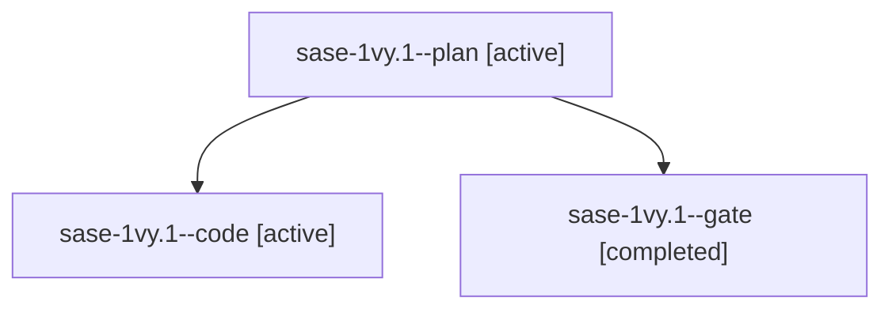

# Session: sase-1vy.1

[Agent Hoods](../README.md) / [bbugyi200](../users/bbugyi200/README.md) / [athena](../users/bbugyi200/machines/athena/README.md) / [sase-1vy](../users/bbugyi200/machines/athena/hoods/sase-1vy/README.md) / sase-1vy.1

Owner: `bbugyi200.athena` · Hood: `sase-1vy` · Members: 3 · Bead: [sase-1vy.1](https://github.com/sase-org/sase--beads/blob/main/pages/sase-1vy/sase-1vy.1.md)

## Lineage

The diagram is an optional enhancement; the ordered table below contains the same lineage in accessible text.

| Role | Agent | State | Model / provider | Timing | Commits | Prompt | Chat |
|---|---|---|---|---|---:|---|---|
| plan | sase-1vy.1--plan | active | gpt-6-astra / codex | 2026-11-28T08:16:36.531179+00:00 | 0 | [Prompt](../agents/bbugyi200.athena.sase-1vy.1--plan/prompt.md) | [Chat](../agents/bbugyi200.athena.sase-1vy.1--plan/chat.md) |
| code | sase-1vy.1--code | active | grok-4.6 / grok | 2026-11-28T08:24:34.040177+00:00 | 0 | — | — |
| gate | sase-1vy.1--gate | completed | gpt-6-astra / codex | 2026-11-28T08:23:47.205574+00:00 → 2026-11-28T08:23:54.381843+00:00 | 0 | — | [Chat](../agents/bbugyi200.athena.sase-1vy.1--gate/chat.md) |

## Neighbors

| Agent | Relation | State |
|---|---|---|
| [sase-1vy.2](../agents/bbugyi200.athena.sase-1vy.2/README.md) | sase-1vy hood | waiting |
| [sase-1vy.3](../agents/bbugyi200.athena.sase-1vy.3/README.md) | sase-1vy hood | waiting |
| [sase-1vy.4](../agents/bbugyi200.athena.sase-1vy.4/README.md) | sase-1vy hood | waiting |
| [sase-1vy.5](../agents/bbugyi200.athena.sase-1vy.5/README.md) | sase-1vy hood | waiting |
| [sase-1vy.land](../agents/bbugyi200.athena.sase-1vy.land/README.md) | sase-1vy hood | waiting |
