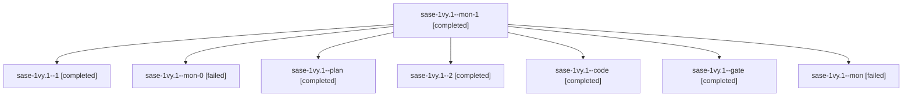

# Session: sase-1vy.1

[Agent Hoods](../README.md) / [bbugyi200](../users/bbugyi200/README.md) / [athena](../users/bbugyi200/machines/athena/README.md) / [sase-1vy](../users/bbugyi200/machines/athena/hoods/sase-1vy/README.md) / sase-1vy.1

Owner: `bbugyi200.athena` · Hood: `sase-1vy` · Members: 8 · Bead: [sase-1vy.1](https://github.com/sase-org/sase--beads/blob/main/pages/sase-1vy/sase-1vy.1.md)

## Lineage

The diagram is an optional enhancement; the ordered table below contains the same lineage in accessible text.

| Role | Agent | State | Model / provider | Timing | Commits | Prompt | Chat |
|---|---|---|---|---|---:|---|---|
| mon-1 | sase-1vy.1--mon-1 | completed | grok-4.6 / grok | 2026-11-28T09:53:54.519209+00:00 → 2026-11-28T10:15:29.587467+00:00 | [1](../agents/bbugyi200.athena.sase-1vy.1--mon-1/README.md#commits) | — | [Chat](../agents/bbugyi200.athena.sase-1vy.1--mon-1/chat.md) |
| 1 | sase-1vy.1--1 | completed | grok-4.6 / grok | 2026-11-28T09:14:44.129502+00:00 → 2026-11-28T09:26:32.515533+00:00 | 0 | [Prompt](../agents/bbugyi200.athena.sase-1vy.1--1/prompt.md) | [Chat](../agents/bbugyi200.athena.sase-1vy.1--1/chat.md) |
| mon-0 | sase-1vy.1--mon-0 | failed | grok-4.6 / grok | 2026-11-28T09:24:35.547237+00:00 → 2026-11-28T09:46:35.085953+00:00 | 0 | — | [Chat](../agents/bbugyi200.athena.sase-1vy.1--mon-0/chat.md) |
| plan | sase-1vy.1--plan | completed | gpt-6-astra / codex | 2026-11-28T08:16:36.531179+00:00 → 2026-11-28T08:53:53.604862+00:00 | 0 | [Prompt](../agents/bbugyi200.athena.sase-1vy.1--plan/prompt.md) | [Chat](../agents/bbugyi200.athena.sase-1vy.1--plan/chat.md) |
| 2 | sase-1vy.1--2 | completed | grok-4.6 / grok | 2026-11-28T09:46:34.875098+00:00 → 2026-11-28T09:55:12.412957+00:00 | 0 | [Prompt](../agents/bbugyi200.athena.sase-1vy.1--2/prompt.md) | [Chat](../agents/bbugyi200.athena.sase-1vy.1--2/chat.md) |
| code | sase-1vy.1--code | completed | grok-4.6 / grok | 2026-11-28T08:24:34.040177+00:00 → 2026-11-28T08:53:53.604862+00:00 | 0 | — | [Chat](../agents/bbugyi200.athena.sase-1vy.1--code/chat.md) |
| gate | sase-1vy.1--gate | completed | gpt-6-astra / codex | 2026-11-28T08:23:47.205574+00:00 → 2026-11-28T08:23:54.381843+00:00 | 0 | — | [Chat](../agents/bbugyi200.athena.sase-1vy.1--gate/chat.md) |
| mon | sase-1vy.1--mon | failed | grok-4.6 / grok | 2026-11-28T08:52:02.614593+00:00 → 2026-11-28T09:14:44.314322+00:00 | 0 | — | [Chat](../agents/bbugyi200.athena.sase-1vy.1--mon/chat.md) |

## Commits

| Role | Repo | Commit | Subject | Committed |
|---|---|---|---|---|
| mon-1 | sase | [`42255c3`](https://github.com/sase-org/sase/commit/42255c3cce19e85ac18053d9b92921168c67c5c4) | fix(tui): drain header enrichment before config token refresh | 2026-11-28 05:14:42 EST |

## Neighbors

| Agent | Relation | State |
|---|---|---|
| [sase-1vy.2](../agents/bbugyi200.athena.sase-1vy.2/README.md) | sase-1vy hood | completed |
| [sase-1vy.3](bbugyi200.athena.sase-1vy.3.md) (session · 5) | sase-1vy hood | completed 5 |
| [sase-1vy.4](bbugyi200.athena.sase-1vy.4.md) (session · 3) | sase-1vy hood | active 2, completed 1 |
| [sase-1vy.5](../agents/bbugyi200.athena.sase-1vy.5/README.md) | sase-1vy hood | waiting |
| [sase-1vy.land](../agents/bbugyi200.athena.sase-1vy.land/README.md) | sase-1vy hood | waiting |
