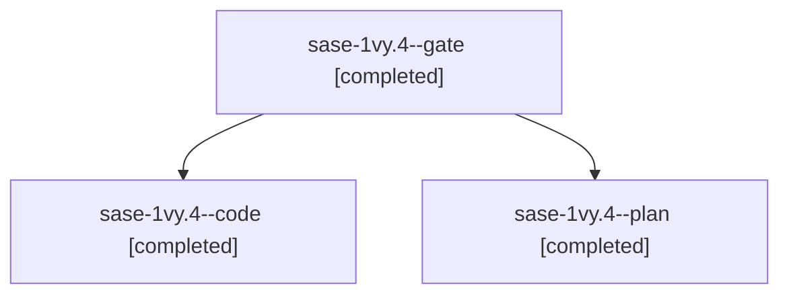

# Session: sase-1vy.4

[Agent Hoods](../README.md) / [bbugyi200](../users/bbugyi200/README.md) / [athena](../users/bbugyi200/machines/athena/README.md) / [sase-1vy](../users/bbugyi200/machines/athena/hoods/sase-1vy/README.md) / sase-1vy.4

Owner: `bbugyi200.athena` · Hood: `sase-1vy` · Members: 3 · Bead: [sase-1vy.4](https://github.com/sase-org/sase--beads/blob/main/pages/sase-1vy/sase-1vy.4.md)

## Lineage

The diagram is an optional enhancement; the ordered table below contains the same lineage in accessible text.

| Role | Agent | State | Model / provider | Timing | Commits | Prompt | Chat |
|---|---|---|---|---|---:|---|---|
| gate | sase-1vy.4--gate | completed | gpt-6-astra / codex | 2026-11-28T11:42:26.596832+00:00 → 2026-11-28T11:42:35.600182+00:00 | 0 | — | [Chat](../agents/bbugyi200.athena.sase-1vy.4--gate/chat.md) |
| code | sase-1vy.4--code | completed | gpt-6-luna / codex | 2026-11-28T11:43:32.304976+00:00 → 2026-11-28T12:09:08.819622+00:00 | [1](../agents/bbugyi200.athena.sase-1vy.4--code/README.md#commits) | — | [Chat](../agents/bbugyi200.athena.sase-1vy.4--code/chat.md) |
| plan | sase-1vy.4--plan | completed | gpt-6-astra / codex | 2026-11-28T11:37:16.238404+00:00 → 2026-11-28T12:09:08.819622+00:00 | 0 | [Prompt](../agents/bbugyi200.athena.sase-1vy.4--plan/prompt.md) | [Chat](../agents/bbugyi200.athena.sase-1vy.4--plan/chat.md) |

## Commits

| Role | Repo | Commit | Subject | Committed |
|---|---|---|---|---|
| code | sase | [`53acb95`](https://github.com/sase-org/sase/commit/53acb952ef758d42bffd592857c76183135d6e5c) | test(git-lock): make stale-lock caller tests deterministic | 2026-11-28 07:07:56 EST |

## Neighbors

| Agent | Relation | State |
|---|---|---|
| [sase-1vy.1](bbugyi200.athena.sase-1vy.1.md) (session · 8) | sase-1vy hood | completed 6, failed 2 |
| [sase-1vy.2](../agents/bbugyi200.athena.sase-1vy.2/README.md) | sase-1vy hood | completed |
| [sase-1vy.3](bbugyi200.athena.sase-1vy.3.md) (session · 5) | sase-1vy hood | completed 5 |
| [sase-1vy.5](bbugyi200.athena.sase-1vy.5.md) (session · 4) | sase-1vy hood | active 3, completed 1 |
| [sase-1vy.land](../agents/bbugyi200.athena.sase-1vy.land/README.md) | sase-1vy hood | waiting |
