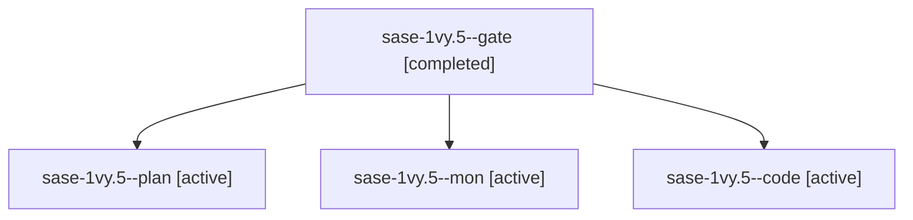

# Session: sase-1vy.5

[Agent Hoods](../README.md) / [bbugyi200](../users/bbugyi200/README.md) / [athena](../users/bbugyi200/machines/athena/README.md) / [sase-1vy](../users/bbugyi200/machines/athena/hoods/sase-1vy/README.md) / sase-1vy.5

Owner: `bbugyi200.athena` · Hood: `sase-1vy` · Members: 4 · Bead: [sase-1vy.5](https://github.com/sase-org/sase--beads/blob/main/pages/sase-1vy/sase-1vy.5.md)

## Lineage

The diagram is an optional enhancement; the ordered table below contains the same lineage in accessible text.

| Role | Agent | State | Model / provider | Timing | Commits | Prompt | Chat |
|---|---|---|---|---|---:|---|---|
| gate | sase-1vy.5--gate | completed | gpt-6-astra / codex | 2026-11-28T12:17:24.882640+00:00 → 2026-11-28T12:17:33.878731+00:00 | 0 | — | [Chat](../agents/bbugyi200.athena.sase-1vy.5--gate/chat.md) |
| plan | sase-1vy.5--plan | active | gpt-6-astra / codex | 2026-11-28T12:10:19.507495+00:00 | 0 | [Prompt](../agents/bbugyi200.athena.sase-1vy.5--plan/prompt.md) | [Chat](../agents/bbugyi200.athena.sase-1vy.5--plan/chat.md) |
| mon | sase-1vy.5--mon | active | muse-spark-1.3-contributor / muse | 2026-11-28T12:23:57.066666+00:00 | 0 | — | — |
| code | sase-1vy.5--code | active | muse-spark-1.3-contributor / muse | 2026-11-28T12:18:14.496738+00:00 | 0 | — | — |

## Neighbors

| Agent | Relation | State |
|---|---|---|
| [sase-1vy.1](bbugyi200.athena.sase-1vy.1.md) (session · 8) | sase-1vy hood | completed 6, failed 2 |
| [sase-1vy.2](../agents/bbugyi200.athena.sase-1vy.2/README.md) | sase-1vy hood | completed |
| [sase-1vy.3](bbugyi200.athena.sase-1vy.3.md) (session · 5) | sase-1vy hood | completed 5 |
| [sase-1vy.4](bbugyi200.athena.sase-1vy.4.md) (session · 3) | sase-1vy hood | completed 3 |
| [sase-1vy.land](../agents/bbugyi200.athena.sase-1vy.land/README.md) | sase-1vy hood | waiting |
