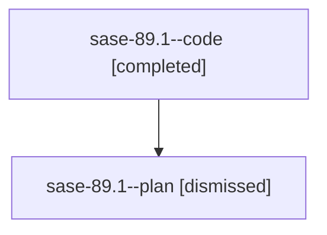

# Session: sase-89.1

[Agent Hoods](../README.md) / [bbugyi200](../users/bbugyi200/README.md) / [athena](../users/bbugyi200/machines/athena/README.md) / [sase-89](../users/bbugyi200/machines/athena/hoods/sase-89/README.md) / sase-89.1

Owner: `bbugyi200.athena` · Hood: `sase-89` · Members: 2 · Bead: [sase-89.1](https://github.com/sase-org/sase--beads/blob/main/pages/sase-89/sase-89.1.md)

## Lineage

The diagram is an optional enhancement; the ordered table below contains the same lineage in accessible text.

| Role | Agent | State | Model / provider | Timing | Commits | Prompt | Chat |
|---|---|---|---|---|---:|---|---|
| code | sase-89.1--code | completed | gpt-5.6-sol / codex | 2026-07-20T16:50:57.844929+00:00 | [1](../agents/bbugyi200.athena.sase-89.1--code/README.md#commits) | — | [Chat](../agents/bbugyi200.athena.sase-89.1--code/chat.md) |
| plan | sase-89.1--plan | dismissed | gpt-5.6-sol / codex | 2026-07-20T12:46:44.393276 → 2026-07-20T13:08:14.952123 | 0 | [Prompt](../agents/bbugyi200.athena.sase-89.1--plan/prompt.md) | [Chat](../agents/bbugyi200.athena.sase-89.1--plan/chat.md) |

## Commits

| Role | Repo | Commit | Subject | Committed |
|---|---|---|---|---|
| code | — | `2efe42a` | feat(projects): add immutable display snapshots (sase-89.1) | 2026-07-20 13:08:03 EDT |

## Neighbors

| Agent | Relation | State |
|---|---|---|
| [sase-89.2](bbugyi200.athena.sase-89.2.md) (session · 2) | sase-89 hood | completed 1, dismissed 1 |
| [sase-89.3](bbugyi200.athena.sase-89.3.md) (session · 2) | sase-89 hood | completed 1, dismissed 1 |
| [sase-89.4](bbugyi200.athena.sase-89.4.md) (session · 2) | sase-89 hood | completed 1, dismissed 1 |
| [sase-89.land](../agents/bbugyi200.athena.sase-89.land/README.md) | sase-89 hood | dismissed |
