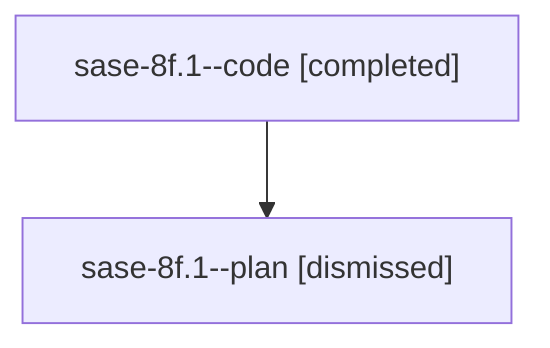

# Session: sase-8f.1

[Agent Hoods](../README.md) / [bbugyi200](../users/bbugyi200/README.md) / [athena](../users/bbugyi200/machines/athena/README.md) / [sase-8f](../users/bbugyi200/machines/athena/hoods/sase-8f/README.md) / sase-8f.1

Owner: `bbugyi200.athena` · Hood: `sase-8f` · Members: 2 · Bead: [sase-8f.1](https://github.com/sase-org/sase--beads/blob/main/pages/sase-8f/sase-8f.1.md)

## Lineage

The diagram is an optional enhancement; the ordered table below contains the same lineage in accessible text.

| Role | Agent | State | Model / provider | Timing | Commits | Prompt | Chat |
|---|---|---|---|---|---:|---|---|
| code | sase-8f.1--code | completed | gpt-5.6-sol / codex | 2026-07-20T19:53:29.485756+00:00 | [1](../agents/bbugyi200.athena.sase-8f.1--code/README.md#commits) | — | [Chat](../agents/bbugyi200.athena.sase-8f.1--code/chat.md) |
| plan | sase-8f.1--plan | dismissed | gpt-5.6-sol / codex | 2026-07-20T15:49:05.881929 → 2026-07-20T16:21:51.301055 | 0 | [Prompt](../agents/bbugyi200.athena.sase-8f.1--plan/prompt.md) | [Chat](../agents/bbugyi200.athena.sase-8f.1--plan/chat.md) |

## Commits

| Role | Repo | Commit | Subject | Committed |
|---|---|---|---|---|
| code | — | `0ed5505` | feat(beads): expose atomic agent launch claims (sase-8f.1) | 2026-07-20 16:21:27 EDT |

## Neighbors

| Agent | Relation | State |
|---|---|---|
| [sase-8f.2](bbugyi200.athena.sase-8f.2.md) (session · 2) | sase-8f hood | completed 1, dismissed 1 |
| [sase-8f.3](bbugyi200.athena.sase-8f.3.md) (session · 2) | sase-8f hood | completed 1, dismissed 1 |
| [sase-8f.land](../agents/bbugyi200.athena.sase-8f.land/README.md) | sase-8f hood | dismissed |
