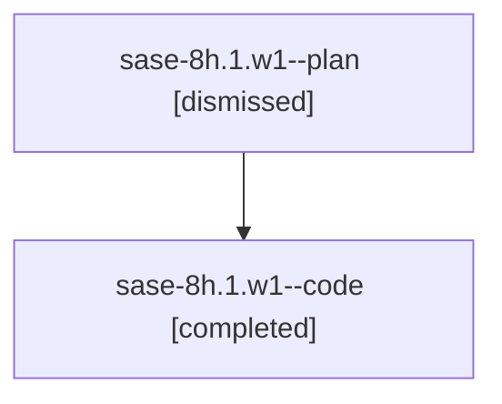

# Session: sase-8h.1.w1

[Agent Hoods](../README.md) / [bbugyi200](../users/bbugyi200/README.md) / [athena](../users/bbugyi200/machines/athena/README.md) / [sase-8h](../users/bbugyi200/machines/athena/hoods/sase-8h/README.md) / sase-8h.1.w1

Owner: `bbugyi200.athena` · Hood: `sase-8h` · Members: 2

## Lineage

The diagram is an optional enhancement; the ordered table below contains the same lineage in accessible text.

| Role | Agent | State | Model / provider | Timing | Commits | Prompt | Chat |
|---|---|---|---|---|---:|---|---|
| plan | sase-8h.1.w1--plan | dismissed | claude-fable-5 / claude | 2026-07-21T10:39:20.532294 → 2026-07-21T11:12:12.079048 | 0 | [Prompt](../agents/bbugyi200.athena.sase-8h.1.w1--plan/prompt.md) | [Chat](../agents/bbugyi200.athena.sase-8h.1.w1--plan/chat.md) |
| code | sase-8h.1.w1--code | completed | gpt-5.6-sol / codex | 2026-07-21T14:53:56.930520+00:00 | [1](../agents/bbugyi200.athena.sase-8h.1.w1--code/README.md#commits) | — | [Chat](../agents/bbugyi200.athena.sase-8h.1.w1--code/chat.md) |

## Commits

| Role | Repo | Commit | Subject | Committed |
|---|---|---|---|---|
| code | — | `3e06256` | fix: preserve proposal associations from agent metadata | 2026-07-21 11:12:00 EDT |

## Neighbors

| Agent | Relation | State |
|---|---|---|
| [sase-8h.1](bbugyi200.athena.sase-8h.1.md) (session · 2) | ancestor | completed 1, dismissed 1 |
| [sase-8h.2](bbugyi200.athena.sase-8h.2.md) (session · 2) | sase-8h hood | completed 1, dismissed 1 |
| [sase-8h.3](bbugyi200.athena.sase-8h.3.md) (session · 2) | sase-8h hood | completed 1, dismissed 1 |
| [sase-8h.land](../agents/bbugyi200.athena.sase-8h.land/README.md) | sase-8h hood | dismissed |
