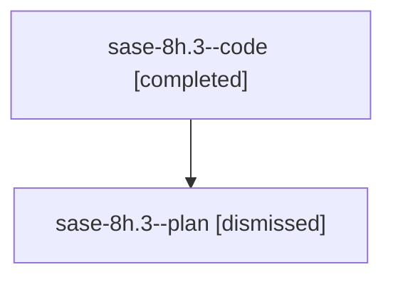

# Session: sase-8h.3

[Agent Hoods](../README.md) / [bbugyi200](../users/bbugyi200/README.md) / [athena](../users/bbugyi200/machines/athena/README.md) / [sase-8h](../users/bbugyi200/machines/athena/hoods/sase-8h/README.md) / sase-8h.3

Owner: `bbugyi200.athena` · Hood: `sase-8h` · Members: 2 · Bead: [sase-8h.3](https://github.com/sase-org/sase--beads/blob/main/pages/sase-8h/sase-8h.3.md)

## Lineage

The diagram is an optional enhancement; the ordered table below contains the same lineage in accessible text.

| Role | Agent | State | Model / provider | Timing | Commits | Prompt | Chat |
|---|---|---|---|---|---:|---|---|
| code | sase-8h.3--code | completed | gpt-5.6-sol / codex | 2026-07-21T15:23:13.831945+00:00 | 0 | — | [Chat](../agents/bbugyi200.athena.sase-8h.3--code/chat.md) |
| plan | sase-8h.3--plan | dismissed | gpt-5.6-sol / codex | 2026-07-21T11:19:06.087194 → 2026-07-21T12:18:30.479478 | 0 | [Prompt](../agents/bbugyi200.athena.sase-8h.3--plan/prompt.md) | [Chat](../agents/bbugyi200.athena.sase-8h.3--plan/chat.md) |

## Commits

| Role | Repo | Commit | Subject | Committed |
|---|---|---|---|---|
| — | — | `54e8736` | fix(ace): report capped commit results truthfully (sase-8h.3) | 2026-07-21 12:17:45 EDT |

## Neighbors

| Agent | Relation | State |
|---|---|---|
| [sase-8h.1](bbugyi200.athena.sase-8h.1.md) (session · 2) | sase-8h hood | completed 1, dismissed 1 |
| [sase-8h.1.w1](bbugyi200.athena.sase-8h.1.w1.md) (session · 2) | sase-8h hood | completed 1, dismissed 1 |
| [sase-8h.2](bbugyi200.athena.sase-8h.2.md) (session · 2) | sase-8h hood | completed 1, dismissed 1 |
| [sase-8h.land](../agents/bbugyi200.athena.sase-8h.land/README.md) | sase-8h hood | dismissed |
