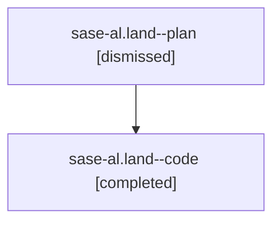

# Session: sase-al.land

[Agent Hoods](../README.md) / [bbugyi200](../users/bbugyi200/README.md) / [athena](../users/bbugyi200/machines/athena/README.md) / [sase-al](../users/bbugyi200/machines/athena/hoods/sase-al/README.md) / sase-al.land

Owner: `bbugyi200.athena` · Hood: `sase-al` · Members: 2 · Bead: [sase-al](https://github.com/sase-org/sase--beads/blob/main/pages/sase-al/README.md)

## Lineage

The diagram is an optional enhancement; the ordered table below contains the same lineage in accessible text.

| Role | Agent | State | Model / provider | Timing | Commits | Prompt | Chat |
|---|---|---|---|---|---:|---|---|
| plan | sase-al.land--plan | dismissed | gpt-5.6-sol / codex | 2026-07-28T18:47:22.571184 → 2026-07-29T00:52:44.937666 | 0 | [Prompt](../agents/bbugyi200.athena.sase-al.land--plan/prompt.md) | [Chat](../agents/bbugyi200.athena.sase-al.land--plan/chat.md) |
| code | sase-al.land--code | completed | gpt-5.6-sol / codex | 2026-07-28T22:57:04.750982+00:00 | [4](../agents/bbugyi200.athena.sase-al.land--code/README.md#commits) | — | [Chat](../agents/bbugyi200.athena.sase-al.land--code/chat.md) |

## Commits

| Role | Repo | Commit | Subject | Committed |
|---|---|---|---|---|
| code | — | `41a01b3` | ci: emit valid split SDD store record | 2026-07-28 19:12:14 EDT |
| code | — | `887999f` | fix(ci): stabilize full matrix isolation | 2026-07-28 21:50:44 EDT |
| code | — | `14b30c4` | test: make task help aliases version-neutral | 2026-07-28 22:53:58 EDT |
| code | — | `07aaac0` | test: identify final deep archive request | 2026-07-28 23:49:12 EDT |

## Neighbors

| Agent | Relation | State |
|---|---|---|
| [sase-al.1](../agents/bbugyi200.athena.sase-al.1/README.md) | sase-al hood | dismissed |
| [sase-al.2](../agents/bbugyi200.athena.sase-al.2/README.md) | sase-al hood | dismissed |
