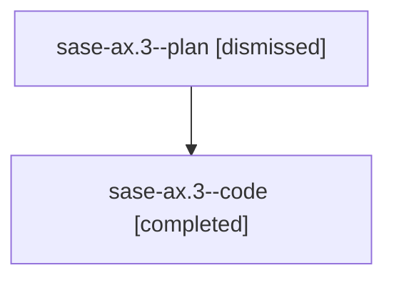

# Session: sase-ax.3

[Agent Hoods](../README.md) / [bbugyi200](../users/bbugyi200/README.md) / [athena](../users/bbugyi200/machines/athena/README.md) / [sase-ax](../users/bbugyi200/machines/athena/hoods/sase-ax/README.md) / sase-ax.3

Owner: `bbugyi200.athena` · Hood: `sase-ax` · Members: 2 · Bead: [sase-ax.3](https://github.com/sase-org/sase--beads/blob/main/pages/sase-ax/sase-ax.3.md)

## Lineage

The diagram is an optional enhancement; the ordered table below contains the same lineage in accessible text.

| Role | Agent | State | Model / provider | Timing | Commits | Prompt | Chat |
|---|---|---|---|---|---:|---|---|
| plan | sase-ax.3--plan | dismissed | gpt-5.6-sol / codex | 2026-07-29T17:36:53.445659 → 2026-07-29T18:51:38.953886 | 0 | [Prompt](../agents/bbugyi200.athena.sase-ax.3--plan/prompt.md) | [Chat](../agents/bbugyi200.athena.sase-ax.3--plan/chat.md) |
| code | sase-ax.3--code | completed | gpt-5.6-sol / codex | 2026-07-29T21:41:44.554573+00:00 | [1](../agents/bbugyi200.athena.sase-ax.3--code/README.md#commits) | — | [Chat](../agents/bbugyi200.athena.sase-ax.3--code/chat.md) |

## Commits

| Role | Repo | Commit | Subject | Committed |
|---|---|---|---|---|
| code | — | `30e2ed3` | feat(cli): add artifact read commands | 2026-07-29 18:50:18 EDT |

## Neighbors

| Agent | Relation | State |
|---|---|---|
| [sase-ax.3.w0](../agents/bbugyi200.athena.sase-ax.3.w0/README.md) | descendant | dismissed |
| [sase-ax.1](../agents/bbugyi200.athena.sase-ax.1/README.md) | sase-ax hood | dismissed |
| [sase-ax.2](../agents/bbugyi200.athena.sase-ax.2/README.md) | sase-ax hood | dismissed |
| [sase-ax.4](../agents/bbugyi200.athena.sase-ax.4/README.md) | sase-ax hood | dismissed |
| [sase-ax.land](bbugyi200.athena.sase-ax.land.md) (session · 2) | sase-ax hood | completed 1, dismissed 1 |
