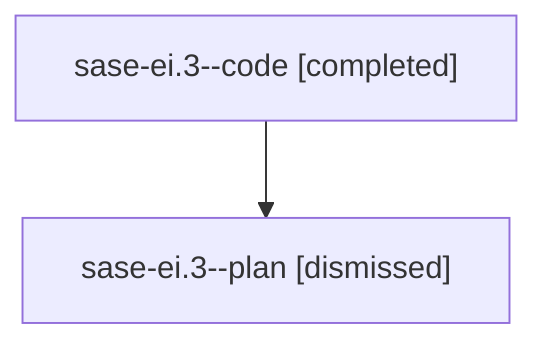

# Session: sase-ei.3

[Agent Hoods](../README.md) / [bbugyi200](../users/bbugyi200/README.md) / [athena](../users/bbugyi200/machines/athena/README.md) / [sase-ei](../users/bbugyi200/machines/athena/hoods/sase-ei/README.md) / sase-ei.3

Owner: `bbugyi200.athena` · Hood: `sase-ei` · Members: 2 · Bead: [sase-ei.3](https://github.com/sase-org/sase--beads/blob/main/pages/sase-ei/sase-ei.3.md)

## Lineage

The diagram is an optional enhancement; the ordered table below contains the same lineage in accessible text.

| Role | Agent | State | Model / provider | Timing | Commits | Prompt | Chat |
|---|---|---|---|---|---:|---|---|
| code | sase-ei.3--code | completed | gpt-5.5 / codex | 2026-08-03T12:06:27.592602+00:00 | [1](../agents/bbugyi200.athena.sase-ei.3--code/README.md#commits) | — | [Chat](../agents/bbugyi200.athena.sase-ei.3--code/chat.md) |
| plan | sase-ei.3--plan | dismissed | gpt-5.6-sol / codex | 2026-08-03T08:01:34.193983 → 2026-08-03T09:30:16.378578 | 0 | [Prompt](../agents/bbugyi200.athena.sase-ei.3--plan/prompt.md) | [Chat](../agents/bbugyi200.athena.sase-ei.3--plan/chat.md) |

## Commits

| Role | Repo | Commit | Subject | Committed |
|---|---|---|---|---|
| code | — | `b4db947` | feat(agent-names): migrate historical agent identities | 2026-08-03 09:29:25 EDT |

## Neighbors

| Agent | Relation | State |
|---|---|---|
| [sase-ei.1](bbugyi200.athena.sase-ei.1.md) (session · 2) | sase-ei hood | completed 1, dismissed 1 |
| [sase-ei.2](../agents/bbugyi200.athena.sase-ei.2/README.md) | sase-ei hood | dismissed |
| [sase-ei.4](bbugyi200.athena.sase-ei.4.md) (session · 2) | sase-ei hood | active 1, dismissed 1 |
| [sase-ei.5](../agents/bbugyi200.athena.sase-ei.5/README.md) | sase-ei hood | dismissed |
| [sase-ei.land](../agents/bbugyi200.athena.sase-ei.land/README.md) | sase-ei hood | dismissed |
