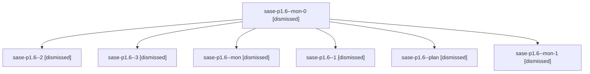

# Session: sase-p1.6

[Agent Hoods](../README.md) / [bbugyi200](../users/bbugyi200/README.md) / [athena](../users/bbugyi200/machines/athena/README.md) / [sase-p1](../users/bbugyi200/machines/athena/hoods/sase-p1/README.md) / sase-p1.6

Owner: `bbugyi200.athena` · Hood: `sase-p1` · Members: 7 · Bead: [sase-p1.6](https://github.com/sase-org/sase--beads/blob/main/pages/sase-p1/sase-p1.6.md)

## Lineage

The diagram is an optional enhancement; the ordered table below contains the same lineage in accessible text.

| Role | Agent | State | Model / provider | Timing | Commits | Prompt | Chat |
|---|---|---|---|---|---:|---|---|
| mon-0 | sase-p1.6--mon-0 | dismissed | grok-4.6 / grok | 2026-08-17T22:19:53 | 0 | — | — |
| 2 | sase-p1.6--2 | dismissed | grok-4.6 / grok | 2026-08-17T22:22:02 | 0 | [Prompt](../agents/bbugyi200.athena.sase-p1.6--2/prompt.md) | [Chat](../agents/bbugyi200.athena.sase-p1.6--2/chat.md) |
| 3 | sase-p1.6--3 | dismissed | grok-4.6 / grok | 2026-08-17T22:37:36 | 0 | [Prompt](../agents/bbugyi200.athena.sase-p1.6--3/prompt.md) | — |
| mon | sase-p1.6--mon | dismissed | grok-4.6 / grok | 2026-08-17T22:09:44 | 0 | — | — |
| 1 | sase-p1.6--1 | dismissed | grok-4.6 / grok | 2026-08-17T22:12:33 | 0 | [Prompt](../agents/bbugyi200.athena.sase-p1.6--1/prompt.md) | [Chat](../agents/bbugyi200.athena.sase-p1.6--1/chat.md) |
| plan | sase-p1.6--plan | dismissed | grok-4.6 / grok | 2026-08-17T18:34:40 | 0 | [Prompt](../agents/bbugyi200.athena.sase-p1.6--plan/prompt.md) | [Chat](../agents/bbugyi200.athena.sase-p1.6--plan/chat.md) |
| mon-1 | sase-p1.6--mon-1 | dismissed | grok-4.6 / grok | 2026-08-17T22:27:36 | 0 | — | — |

## Commits

| Role | Repo | Commit | Subject | Committed |
|---|---|---|---|---|
| — | — | `42f0db0` | feat(tui): add glossary panel add and delete surfaces | 2026-08-17 22:45:43 EDT |

## Neighbors

| Agent | Relation | State |
|---|---|---|
| [sase-p1.1](../agents/bbugyi200.athena.sase-p1.1/README.md) | sase-p1 hood | dismissed |
| [sase-p1.2](../agents/bbugyi200.athena.sase-p1.2/README.md) | sase-p1 hood | dismissed |
| [sase-p1.3](../agents/bbugyi200.athena.sase-p1.3/README.md) | sase-p1 hood | dismissed |
| [sase-p1.4](bbugyi200.athena.sase-p1.4.md) (session · 9) | sase-p1 hood | dismissed 9 |
| [sase-p1.5](../agents/bbugyi200.athena.sase-p1.5/README.md) | sase-p1 hood | dismissed |
| [sase-p1.7](../agents/bbugyi200.athena.sase-p1.7/README.md) | sase-p1 hood | dismissed |
| [sase-p1.8](../agents/bbugyi200.athena.sase-p1.8/README.md) | sase-p1 hood | dismissed |
| [sase-p1.land](../agents/bbugyi200.athena.sase-p1.land/README.md) | sase-p1 hood | dismissed |
