# Session: sase-um.9.5.4

[Agent Hoods](../README.md) / [bbugyi200](../users/bbugyi200/README.md) / [athena](../users/bbugyi200/machines/athena/README.md) / [sase-um](../users/bbugyi200/machines/athena/hoods/sase-um/README.md) / sase-um.9.5.4

Owner: `bbugyi200.athena` · Hood: `sase-um` · Members: 17 · Bead: [sase-um.9.5.4](https://github.com/sase-org/sase--beads/blob/main/pages/sase-um/sase-um.9.5.4.md)

## Lineage

```mermaid
flowchart TD
  n0["sase-um.9.5.4--6 [dismissed]"]
  n1["sase-um.9.5.4--mon-6 [dismissed]"]
  n0 --> n1
  n2["sase-um.9.5.4--mon-3 [dismissed]"]
  n0 --> n2
  n3["sase-um.9.5.4--2 [dismissed]"]
  n0 --> n3
  n4["sase-um.9.5.4--mon [dismissed]"]
  n0 --> n4
  n5["sase-um.9.5.4--1 [dismissed]"]
  n0 --> n5
  n6["sase-um.9.5.4--7 [dismissed]"]
  n0 --> n6
  n7["sase-um.9.5.4--4 [dismissed]"]
  n0 --> n7
  n8["sase-um.9.5.4--5 [dismissed]"]
  n0 --> n8
  n9["sase-um.9.5.4--3 [dismissed]"]
  n0 --> n9
  n10["sase-um.9.5.4--mon-0 [dismissed]"]
  n0 --> n10
  n11["sase-um.9.5.4--mon-1 [dismissed]"]
  n0 --> n11
  n12["sase-um.9.5.4--mon-4 [active]"]
  n0 --> n12
  n13["sase-um.9.5.4--mon-5 [active]"]
  n0 --> n13
  n14["sase-um.9.5.4--8 [active]"]
  n0 --> n14
  n15["sase-um.9.5.4--mon-2 [active]"]
  n0 --> n15
  n16["sase-um.9.5.4--plan [active]"]
  n0 --> n16
```

The diagram is an optional enhancement; the ordered table below contains the same lineage in accessible text.

| Role | Agent | State | Model / provider | Timing | Commits | Prompt | Chat |
|---|---|---|---|---|---:|---|---|
| 6 | sase-um.9.5.4--6 | dismissed | grok-4.6 / grok | 2026-08-29T08:56:30.196751 → 2026-08-29T09:20:12.198351 | [1](../agents/bbugyi200.athena.sase-um.9.5.4--6/README.md#commits) | [Prompt](../agents/bbugyi200.athena.sase-um.9.5.4--6/prompt.md) | [Chat](../agents/bbugyi200.athena.sase-um.9.5.4--6/chat.md) |
| mon-6 | sase-um.9.5.4--mon-6 | dismissed | grok-4.6 / grok | 2026-08-29T12:04:47.057430 → 2026-08-29T13:25:30.332000 | 0 | — | [Chat](../agents/bbugyi200.athena.sase-um.9.5.4--mon-6/chat.md) |
| mon-3 | sase-um.9.5.4--mon-3 | dismissed | grok-4.6 / grok | 2026-08-29T05:03:15.414304 → 2026-08-29T06:38:44.038757 | 0 | — | [Chat](../agents/bbugyi200.athena.sase-um.9.5.4--mon-3/chat.md) |
| 2 | sase-um.9.5.4--2 | dismissed | grok-4.6 / grok | 2026-08-29T00:10:32.535026 → 2026-08-29T00:15:45.305066 | 0 | [Prompt](../agents/bbugyi200.athena.sase-um.9.5.4--2/prompt.md) | [Chat](../agents/bbugyi200.athena.sase-um.9.5.4--2/chat.md) |
| mon | sase-um.9.5.4--mon | dismissed | grok-4.6 / grok | 2026-08-28T23:47:38.218336 → 2026-08-28T23:50:28.913285 | 0 | — | [Chat](../agents/bbugyi200.athena.sase-um.9.5.4--mon/chat.md) |
| 1 | sase-um.9.5.4--1 | dismissed | grok-4.6 / grok | 2026-08-28T23:51:11.615504 → 2026-08-29T00:07:16.541609 | [1](../agents/bbugyi200.athena.sase-um.9.5.4--1/README.md#commits) | [Prompt](../agents/bbugyi200.athena.sase-um.9.5.4--1/prompt.md) | [Chat](../agents/bbugyi200.athena.sase-um.9.5.4--1/chat.md) |
| 7 | sase-um.9.5.4--7 | dismissed | grok-4.6 / grok | 2026-08-29T10:56:36.897984 → 2026-08-29T12:05:10.558977 | [1](../agents/bbugyi200.athena.sase-um.9.5.4--7/README.md#commits) | [Prompt](../agents/bbugyi200.athena.sase-um.9.5.4--7/prompt.md) | [Chat](../agents/bbugyi200.athena.sase-um.9.5.4--7/chat.md) |
| 4 | sase-um.9.5.4--4 | dismissed | grok-4.6 / grok | 2026-08-29T04:45:23.062447 → 2026-08-29T05:03:27.063655 | [1](../agents/bbugyi200.athena.sase-um.9.5.4--4/README.md#commits) | [Prompt](../agents/bbugyi200.athena.sase-um.9.5.4--4/prompt.md) | [Chat](../agents/bbugyi200.athena.sase-um.9.5.4--4/chat.md) |
| 5 | sase-um.9.5.4--5 | dismissed | grok-4.6 / grok | 2026-08-29T06:39:25.715923 → 2026-08-29T07:19:46.283169 | [1](../agents/bbugyi200.athena.sase-um.9.5.4--5/README.md#commits) | [Prompt](../agents/bbugyi200.athena.sase-um.9.5.4--5/prompt.md) | [Chat](../agents/bbugyi200.athena.sase-um.9.5.4--5/chat.md) |
| 3 | sase-um.9.5.4--3 | dismissed | grok-4.6 / grok | 2026-08-29T02:17:42.799314 → 2026-08-29T03:11:04.437483 | [1](../agents/bbugyi200.athena.sase-um.9.5.4--3/README.md#commits) | [Prompt](../agents/bbugyi200.athena.sase-um.9.5.4--3/prompt.md) | [Chat](../agents/bbugyi200.athena.sase-um.9.5.4--3/chat.md) |
| mon-0 | sase-um.9.5.4--mon-0 | dismissed | grok-4.6 / grok | 2026-08-29T00:07:06.252983 → 2026-08-29T00:09:49.339719 | 0 | — | [Chat](../agents/bbugyi200.athena.sase-um.9.5.4--mon-0/chat.md) |
| mon-1 | sase-um.9.5.4--mon-1 | dismissed | grok-4.6 / grok | 2026-08-29T00:15:36.682531 → 2026-08-29T02:17:00.502757 | 0 | — | [Chat](../agents/bbugyi200.athena.sase-um.9.5.4--mon-1/chat.md) |
| mon-4 | sase-um.9.5.4--mon-4 | active | grok-4.6 / grok | 2026-08-29T11:19:17.496861+00:00 | 0 | — | [Chat](../agents/bbugyi200.athena.sase-um.9.5.4--mon-4/chat.md) |
| mon-5 | sase-um.9.5.4--mon-5 | active | grok-4.6 / grok | 2026-08-29T13:19:51.201264+00:00 | 0 | — | [Chat](../agents/bbugyi200.athena.sase-um.9.5.4--mon-5/chat.md) |
| 8 | sase-um.9.5.4--8 | active | grok-4.6 / grok | 2026-08-29T17:26:10.737093+00:00 | 0 | [Prompt](../agents/bbugyi200.athena.sase-um.9.5.4--8/prompt.md) | [Chat](../agents/bbugyi200.athena.sase-um.9.5.4--8/chat.md) |
| mon-2 | sase-um.9.5.4--mon-2 | active | grok-4.6 / grok | 2026-08-29T07:10:54.447696+00:00 | 0 | — | [Chat](../agents/bbugyi200.athena.sase-um.9.5.4--mon-2/chat.md) |
| plan | sase-um.9.5.4--plan | active | grok-4.6 / grok | 2026-08-29T03:07:43.812837+00:00 | [1](../agents/bbugyi200.athena.sase-um.9.5.4--plan/README.md#commits) | [Prompt](../agents/bbugyi200.athena.sase-um.9.5.4--plan/prompt.md) | [Chat](../agents/bbugyi200.athena.sase-um.9.5.4--plan/chat.md) |

## Commits

| Role | Repo | Commit | Subject | Committed |
|---|---|---|---|---|
| plan | — | `e856c68` | fix(ace): reflow panel tabs after layout settles | 2026-08-28 23:43:28 EDT |
| 1 | — | `49d6c41` | test(agents-sync): harden cross-machine clone against auto-gc races | 2026-08-29 00:02:49 EDT |
| 3 | — | `c1a5b36` | fix(pipe): inherit the parent model when a successor has no %model | 2026-08-29 03:04:20 EDT |
| 4 | — | `ca7692e` | test(agent): stub pid\_is\_thread so fixture PIDs survive host TID collisions | 2026-08-29 04:57:19 EDT |
| 5 | — | `4a8b835` | test(ace): wait for TUI settle in CI-flaky flags and plugin tests | 2026-08-29 07:14:17 EDT |
| 6 | — | `60043de` | test(ace): capture only the sase-update restart poll timer | 2026-08-29 09:14:16 EDT |
| 7 | — | `25565fc` | fix(ci): ratchet core 0.32.16 and harden archive-start waits | 2026-08-29 11:59:33 EDT |

## Neighbors

| Agent | Relation | State |
|---|---|---|
| [sase-um.9.5.1](../agents/bbugyi200.athena.sase-um.9.5.1/README.md) | sase-um.9.5 hood | dismissed |
| [sase-um.9.5.2](../agents/bbugyi200.athena.sase-um.9.5.2/README.md) | sase-um.9.5 hood | dismissed |
| [sase-um.9.5.3](bbugyi200.athena.sase-um.9.5.3.md) (session · 3) | sase-um.9.5 hood | active 1, dismissed 2 |
| [sase-um.9.5.5](bbugyi200.athena.sase-um.9.5.5.md) (session · 3) | sase-um.9.5 hood | active 1, dismissed 2 |
| [sase-um.9.5.land](../agents/bbugyi200.athena.sase-um.9.5.land/README.md) | sase-um.9.5 hood | dismissed |
| [sase-um.9.1](bbugyi200.athena.sase-um.9.1.md) (session · 3) | sase-um.9 hood | completed 1, dismissed 2 |
| [sase-um.9.2](../agents/bbugyi200.athena.sase-um.9.2/README.md) | sase-um.9 hood | dismissed |
| [sase-um.9.3](../agents/bbugyi200.athena.sase-um.9.3/README.md) | sase-um.9 hood | dismissed |
| [sase-um.9.4](bbugyi200.athena.sase-um.9.4.md) (session · 5) | sase-um.9 hood | dismissed 5 |
| [sase-um.9.land](bbugyi200.athena.sase-um.9.land.md) (session · 3) | sase-um.9 hood | active 1, dismissed 2 |
| [sase-um.1](bbugyi200.athena.sase-um.1.md) (session · 2) | sase-um hood | completed 1, dismissed 1 |
| [sase-um.2](bbugyi200.athena.sase-um.2.md) (session · 2) | sase-um hood | active 1, completed 1 |
| [sase-um.3](../agents/bbugyi200.athena.sase-um.3/README.md) | sase-um hood | dismissed |
| [sase-um.4](../agents/bbugyi200.athena.sase-um.4/README.md) | sase-um hood | dismissed |
| [sase-um.5](bbugyi200.athena.sase-um.5.md) (session · 2) | sase-um hood | dismissed 2 |
| [sase-um.5.1.1](../agents/bbugyi200.athena.sase-um.5.1.1/README.md) | sase-um hood | dismissed |
| [sase-um.5.1.2](../agents/bbugyi200.athena.sase-um.5.1.2/README.md) | sase-um hood | dismissed |
| [sase-um.5.1.3](bbugyi200.athena.sase-um.5.1.3.md) (session · 67) | sase-um hood | active 15, dismissed 52 |
| [sase-um.5.1.3](../agents/bbugyi200.athena.sase-um.5.1.3/README.md) | sase-um hood | completed |
| [sase-um.5.1.land](bbugyi200.athena.sase-um.5.1.land.md) (session · 7) | sase-um hood | active 1, dismissed 6 |
| [sase-um.6](../agents/bbugyi200.athena.sase-um.6/README.md) | sase-um hood | dismissed |
| [sase-um.7](../agents/bbugyi200.athena.sase-um.7/README.md) | sase-um hood | dismissed |
| [sase-um.8](../agents/bbugyi200.athena.sase-um.8/README.md) | sase-um hood | dismissed |
| [sase-um.land](bbugyi200.athena.sase-um.land.md) (session · 3) | sase-um hood | dismissed 3 |
