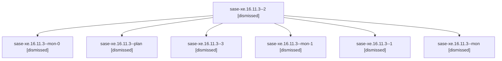

# Session: sase-xe.16.11.3

[Agent Hoods](../README.md) / [bbugyi200](../users/bbugyi200/README.md) / [athena](../users/bbugyi200/machines/athena/README.md) / [sase-xe](../users/bbugyi200/machines/athena/hoods/sase-xe/README.md) / sase-xe.16.11.3

Owner: `bbugyi200.athena` · Hood: `sase-xe` · Members: 7 · Bead: [sase-xe.16.11.3](https://github.com/sase-org/sase--beads/blob/main/pages/sase-xe/sase-xe.16.11.3.md)

## Lineage

The diagram is an optional enhancement; the ordered table below contains the same lineage in accessible text.

| Role | Agent | State | Model / provider | Timing | Commits | Prompt | Chat |
|---|---|---|---|---|---:|---|---|
| 2 | sase-xe.16.11.3--2 | dismissed | sonnet / claude | 2026-09-09T08:16:55.943666 → 2026-09-09T08:29:05.823713 | 0 | [Prompt](../agents/bbugyi200.athena.sase-xe.16.11.3--2/prompt.md) | [Chat](../agents/bbugyi200.athena.sase-xe.16.11.3--2/chat.md) |
| mon-0 | sase-xe.16.11.3--mon-0 | dismissed | sonnet / claude | 2026-09-09T07:54:41.146916 → 2026-09-09T08:14:45.903351 | 0 | — | [Chat](../agents/bbugyi200.athena.sase-xe.16.11.3--mon-0/chat.md) |
| plan | sase-xe.16.11.3--plan | dismissed | sonnet / claude | 2026-09-09T05:37:11.306095 → 2026-09-09T07:03:40.093144 | 0 | [Prompt](../agents/bbugyi200.athena.sase-xe.16.11.3--plan/prompt.md) | [Chat](../agents/bbugyi200.athena.sase-xe.16.11.3--plan/chat.md) |
| 3 | sase-xe.16.11.3--3 | dismissed | sonnet / claude | 2026-09-09T08:49:39.118652 → 2026-09-09T09:25:47.830897 | [1](../agents/bbugyi200.athena.sase-xe.16.11.3--3/README.md#commits) | [Prompt](../agents/bbugyi200.athena.sase-xe.16.11.3--3/prompt.md) | [Chat](../agents/bbugyi200.athena.sase-xe.16.11.3--3/chat.md) |
| mon-1 | sase-xe.16.11.3--mon-1 | dismissed | sonnet / claude | 2026-09-09T08:28:45.242696 → 2026-09-09T08:48:06.928701 | 0 | — | [Chat](../agents/bbugyi200.athena.sase-xe.16.11.3--mon-1/chat.md) |
| 1 | sase-xe.16.11.3--1 | dismissed | sonnet / claude | 2026-09-09T07:08:46.131371 → 2026-09-09T07:54:57.482035 | 0 | [Prompt](../agents/bbugyi200.athena.sase-xe.16.11.3--1/prompt.md) | [Chat](../agents/bbugyi200.athena.sase-xe.16.11.3--1/chat.md) |
| mon | sase-xe.16.11.3--mon | dismissed | sonnet / claude | 2026-09-09T07:02:14.843341 → 2026-09-09T07:07:01.833528 | 0 | — | [Chat](../agents/bbugyi200.athena.sase-xe.16.11.3--mon/chat.md) |

## Commits

| Role | Repo | Commit | Subject | Committed |
|---|---|---|---|---|
| 3 | — | `d015f48` | fix(dispatch): clarify replayed-bootstrap 409 handling and prove it with real gateway + Fleet fault tests | 2026-09-09 09:19:51 EDT |

## Neighbors

| Agent | Relation | State |
|---|---|---|
| [sase-xe.16.11.1](../agents/bbugyi200.athena.sase-xe.16.11.1/README.md) | sase-xe.16.11 hood | dismissed |
| [sase-xe.16.11.2](../agents/bbugyi200.athena.sase-xe.16.11.2/README.md) | sase-xe.16.11 hood | dismissed |
| [sase-xe.16.11.4](../agents/bbugyi200.athena.sase-xe.16.11.4/README.md) | sase-xe.16.11 hood | dismissed |
| [sase-xe.16.11.5](../agents/bbugyi200.athena.sase-xe.16.11.5/README.md) | sase-xe.16.11 hood | dismissed |
| [sase-xe.16.11.6.1](../agents/bbugyi200.athena.sase-xe.16.11.6.1/README.md) | sase-xe.16.11 hood | dismissed |
| [sase-xe.16.11.6.2](../agents/bbugyi200.athena.sase-xe.16.11.6.2/README.md) | sase-xe.16.11 hood | dismissed |
| [sase-xe.16.11.6.3](../agents/bbugyi200.athena.sase-xe.16.11.6.3/README.md) | sase-xe.16.11 hood | dismissed |
| [sase-xe.16.11.6.4](../agents/bbugyi200.athena.sase-xe.16.11.6.4/README.md) | sase-xe.16.11 hood | dismissed |
| [sase-xe.16.11.6.5](../agents/bbugyi200.athena.sase-xe.16.11.6.5/README.md) | sase-xe.16.11 hood | dismissed |
| [sase-xe.16.11.6.6](../agents/bbugyi200.athena.sase-xe.16.11.6.6/README.md) | sase-xe.16.11 hood | dismissed |
| [sase-xe.16.11.6.land](../agents/bbugyi200.athena.sase-xe.16.11.6.land/README.md) | sase-xe.16.11 hood | dismissed |
| [sase-xe.16.11.7.1](../agents/bbugyi200.athena.sase-xe.16.11.7.1/README.md) | sase-xe.16.11 hood | dismissed |
| [sase-xe.16.11.7.10](../agents/bbugyi200.athena.sase-xe.16.11.7.10/README.md) | sase-xe.16.11 hood | dismissed |
| [sase-xe.16.11.7.11](../agents/bbugyi200.athena.sase-xe.16.11.7.11/README.md) | sase-xe.16.11 hood | dismissed |
| [sase-xe.16.11.7.12](../agents/bbugyi200.athena.sase-xe.16.11.7.12/README.md) | sase-xe.16.11 hood | dismissed |
| [sase-xe.16.11.7.13](../agents/bbugyi200.athena.sase-xe.16.11.7.13/README.md) | sase-xe.16.11 hood | dismissed |
| [sase-xe.16.11.7.14.1](bbugyi200.athena.sase-xe.16.11.7.14.1.md) (session · 3) | sase-xe.16.11 hood | completed 1, dismissed 2 |
| [sase-xe.16.11.7.14.2](../agents/bbugyi200.athena.sase-xe.16.11.7.14.2/README.md) | sase-xe.16.11 hood | dismissed |
| [sase-xe.16.11.7.14.3](../agents/bbugyi200.athena.sase-xe.16.11.7.14.3/README.md) | sase-xe.16.11 hood | dismissed |
| [sase-xe.16.11.7.14.4](../agents/bbugyi200.athena.sase-xe.16.11.7.14.4/README.md) | sase-xe.16.11 hood | dismissed |
| [sase-xe.16.11.7.14.5](bbugyi200.athena.sase-xe.16.11.7.14.5.md) (session · 4) | sase-xe.16.11 hood | active 1, completed 1, dismissed 2 |
| [sase-xe.16.11.7.14.6.1](bbugyi200.athena.sase-xe.16.11.7.14.6.1.md) (session · 7) | sase-xe.16.11 hood | dismissed 7 |
| [sase-xe.16.11.7.14.6.2](../agents/bbugyi200.athena.sase-xe.16.11.7.14.6.2/README.md) | sase-xe.16.11 hood | dismissed |
| [sase-xe.16.11.7.14.6.3](bbugyi200.athena.sase-xe.16.11.7.14.6.3.md) (session · 3) | sase-xe.16.11 hood | completed 1, dismissed 2 |
| [sase-xe.16.11.7.14.6.4](../agents/bbugyi200.athena.sase-xe.16.11.7.14.6.4/README.md) | sase-xe.16.11 hood | dismissed |
| [sase-xe.16.11.7.14.6.4.f0](bbugyi200.athena.sase-xe.16.11.7.14.6.4.f0.md) (session · 9) | sase-xe.16.11 hood | completed 4, dismissed 1, failed 4 |
| [sase-xe.16.11.7.14.6.5](../agents/bbugyi200.athena.sase-xe.16.11.7.14.6.5/README.md) | sase-xe.16.11 hood | dismissed |
| [sase-xe.16.11.7.14.6.6](bbugyi200.athena.sase-xe.16.11.7.14.6.6.md) (session · 7) | sase-xe.16.11 hood | dismissed 6, failed 1 |
| [sase-xe.16.11.7.14.6.7.1](../agents/bbugyi200.athena.sase-xe.16.11.7.14.6.7.1/README.md) | sase-xe.16.11 hood | dismissed |
| [sase-xe.16.11.7.14.6.7.2](../agents/bbugyi200.athena.sase-xe.16.11.7.14.6.7.2/README.md) | sase-xe.16.11 hood | dismissed |
| [sase-xe.16.11.7.14.6.7.3](../agents/bbugyi200.athena.sase-xe.16.11.7.14.6.7.3/README.md) | sase-xe.16.11 hood | dismissed |
| [sase-xe.16.11.7.14.6.7.4](../agents/bbugyi200.athena.sase-xe.16.11.7.14.6.7.4/README.md) | sase-xe.16.11 hood | dismissed |
| [sase-xe.16.11.7.14.6.7.5](../agents/bbugyi200.athena.sase-xe.16.11.7.14.6.7.5/README.md) | sase-xe.16.11 hood | dismissed |
| [sase-xe.16.11.7.14.6.7.6](../agents/bbugyi200.athena.sase-xe.16.11.7.14.6.7.6/README.md) | sase-xe.16.11 hood | dismissed |
| [sase-xe.16.11.7.14.6.7.land](../agents/bbugyi200.athena.sase-xe.16.11.7.14.6.7.land/README.md) | sase-xe.16.11 hood | dismissed |
| [sase-xe.16.11.7.14.6.land](../agents/bbugyi200.athena.sase-xe.16.11.7.14.6.land/README.md) | sase-xe.16.11 hood | dismissed |
| [sase-xe.16.11.7.14.land](bbugyi200.athena.sase-xe.16.11.7.14.land.md) (session · 3) | sase-xe.16.11 hood | dismissed 3 |
| [sase-xe.16.11.7.2](../agents/bbugyi200.athena.sase-xe.16.11.7.2/README.md) | sase-xe.16.11 hood | dismissed |
| [sase-xe.16.11.7.3](../agents/bbugyi200.athena.sase-xe.16.11.7.3/README.md) | sase-xe.16.11 hood | dismissed |
| [sase-xe.16.11.7.4](../agents/bbugyi200.athena.sase-xe.16.11.7.4/README.md) | sase-xe.16.11 hood | dismissed |
| [sase-xe.16.11.7.5](../agents/bbugyi200.athena.sase-xe.16.11.7.5/README.md) | sase-xe.16.11 hood | dismissed |
| [sase-xe.16.11.7.6](../agents/bbugyi200.athena.sase-xe.16.11.7.6/README.md) | sase-xe.16.11 hood | dismissed |
| [sase-xe.16.11.7.7](../agents/bbugyi200.athena.sase-xe.16.11.7.7/README.md) | sase-xe.16.11 hood | dismissed |
| [sase-xe.16.11.7.8](../agents/bbugyi200.athena.sase-xe.16.11.7.8/README.md) | sase-xe.16.11 hood | dismissed |
| [sase-xe.16.11.7.9](../agents/bbugyi200.athena.sase-xe.16.11.7.9/README.md) | sase-xe.16.11 hood | dismissed |
| [sase-xe.16.11.7.land](../agents/bbugyi200.athena.sase-xe.16.11.7.land/README.md) | sase-xe.16.11 hood | dismissed |
| [sase-xe.16.11.land](bbugyi200.athena.sase-xe.16.11.land.md) (session · 3) | sase-xe.16.11 hood | dismissed 3 |
| [sase-xe.16.11.land.w0](../agents/bbugyi200.athena.sase-xe.16.11.land.w0/README.md) | sase-xe.16.11 hood | dismissed |
| [sase-xe.16.11.land.w1](../agents/bbugyi200.athena.sase-xe.16.11.land.w1/README.md) | sase-xe.16.11 hood | dismissed |
| [sase-xe.16.1](bbugyi200.athena.sase-xe.16.1.md) (session · 3) | sase-xe.16 hood | completed 1, dismissed 2 |
| [sase-xe.16.10](bbugyi200.athena.sase-xe.16.10.md) (session · 6) | sase-xe.16 hood | active 2, completed 1, dismissed 2, failed 1 |
| [sase-xe.16.2](../agents/bbugyi200.athena.sase-xe.16.2/README.md) | sase-xe.16 hood | dismissed |
| [sase-xe.16.3](../agents/bbugyi200.athena.sase-xe.16.3/README.md) | sase-xe.16 hood | dismissed |
| [sase-xe.16.4](../agents/bbugyi200.athena.sase-xe.16.4/README.md) | sase-xe.16 hood | dismissed |
| [sase-xe.16.5](../agents/bbugyi200.athena.sase-xe.16.5/README.md) | sase-xe.16 hood | dismissed |
| [sase-xe.16.6](bbugyi200.athena.sase-xe.16.6.md) (session · 3) | sase-xe.16 hood | completed 1, dismissed 2 |
| [sase-xe.16.7](../agents/bbugyi200.athena.sase-xe.16.7/README.md) | sase-xe.16 hood | dismissed |
| [sase-xe.16.8](../agents/bbugyi200.athena.sase-xe.16.8/README.md) | sase-xe.16 hood | dismissed |
| [sase-xe.16.8.f0](bbugyi200.athena.sase-xe.16.8.f0.md) (session · 11) | sase-xe.16 hood | completed 5, dismissed 1, failed 5 |
| [sase-xe.16.9](bbugyi200.athena.sase-xe.16.9.md) (session · 3) | sase-xe.16 hood | completed 1, dismissed 2 |
| [sase-xe.16.land](bbugyi200.athena.sase-xe.16.land.md) (session · 5) | sase-xe.16 hood | dismissed 5 |
| [sase-xe.1](../agents/bbugyi200.athena.sase-xe.1/README.md) | sase-xe hood | dismissed |
| [sase-xe.10](bbugyi200.athena.sase-xe.10.md) (session · 3) | sase-xe hood | completed 1, dismissed 2 |
| [sase-xe.10](../agents/bbugyi200.athena.sase-xe.10/README.md) | sase-xe hood | waiting |
| [sase-xe.11](bbugyi200.athena.sase-xe.11.md) (session · 3) | sase-xe hood | completed 1, dismissed 2 |
| [sase-xe.12](bbugyi200.athena.sase-xe.12.md) (session · 3) | sase-xe hood | completed 1, dismissed 2 |
| [sase-xe.13](bbugyi200.athena.sase-xe.13.md) (session · 3) | sase-xe hood | completed 1, dismissed 2 |
| [sase-xe.13](../agents/bbugyi200.athena.sase-xe.13/README.md) | sase-xe hood | waiting |
| [sase-xe.14](bbugyi200.athena.sase-xe.14.md) (session · 3) | sase-xe hood | completed 1, dismissed 2 |
| [sase-xe.14.f0](bbugyi200.athena.sase-xe.14.f0.md) (session · 5) | sase-xe hood | completed 1, dismissed 1, failed 3 |
| [sase-xe.15](bbugyi200.athena.sase-xe.15.md) (session · 6) | sase-xe hood | active 1, completed 2, dismissed 1, failed 2 |
| [sase-xe.15](../agents/bbugyi200.athena.sase-xe.15/README.md) | sase-xe hood | waiting |
| [sase-xe.2](bbugyi200.athena.sase-xe.2.md) (session · 3) | sase-xe hood | active 1, dismissed 1, failed 1 |
| [sase-xe.3](../agents/bbugyi200.athena.sase-xe.3/README.md) | sase-xe hood | dismissed |
| [sase-xe.4](bbugyi200.athena.sase-xe.4.md) (session · 3) | sase-xe hood | completed 1, dismissed 2 |
| [sase-xe.5](bbugyi200.athena.sase-xe.5.md) (session · 3) | sase-xe hood | completed 1, dismissed 2 |
| [sase-xe.5](../agents/bbugyi200.athena.sase-xe.5/README.md) | sase-xe hood | waiting |
| [sase-xe.6](../agents/bbugyi200.athena.sase-xe.6/README.md) | sase-xe hood | dismissed |
| [sase-xe.7](bbugyi200.athena.sase-xe.7.md) (session · 3) | sase-xe hood | dismissed 2, failed 1 |
| [sase-xe.7.f0](../agents/bbugyi200.athena.sase-xe.7.f0/README.md) | sase-xe hood | dismissed |
| [sase-xe.8](bbugyi200.athena.sase-xe.8.md) (session · 3) | sase-xe hood | completed 1, dismissed 2 |
| [sase-xe.8](../agents/bbugyi200.athena.sase-xe.8/README.md) | sase-xe hood | waiting |
| [sase-xe.9](../agents/bbugyi200.athena.sase-xe.9/README.md) | sase-xe hood | dismissed |
| [sase-xe.land](bbugyi200.athena.sase-xe.land.md) (session · 3) | sase-xe hood | dismissed 3 |
| [sase-xe.land](../agents/bbugyi200.athena.sase-xe.land/README.md) | sase-xe hood | waiting |
