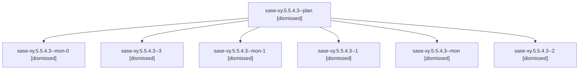

# Session: sase-xy.5.5.4.3

[Agent Hoods](../README.md) / [bbugyi200](../users/bbugyi200/README.md) / [athena](../users/bbugyi200/machines/athena/README.md) / [sase-xy](../users/bbugyi200/machines/athena/hoods/sase-xy/README.md) / sase-xy.5.5.4.3

Owner: `bbugyi200.athena` · Hood: `sase-xy` · Members: 7 · Bead: [sase-xy.5.5.4.3](https://github.com/sase-org/sase--beads/blob/main/pages/sase-xy/sase-xy.5.5.4.3.md)

## Lineage

The diagram is an optional enhancement; the ordered table below contains the same lineage in accessible text.

| Role | Agent | State | Model / provider | Timing | Commits | Prompt | Chat |
|---|---|---|---|---|---:|---|---|
| plan | sase-xy.5.5.4.3--plan | dismissed | gpt-5.5 / codex | 2026-09-07T23:52:09.280743 → 2026-09-07T23:58:29.709204 | 0 | [Prompt](../agents/bbugyi200.athena.sase-xy.5.5.4.3--plan/prompt.md) | [Chat](../agents/bbugyi200.athena.sase-xy.5.5.4.3--plan/chat.md) |
| mon-0 | sase-xy.5.5.4.3--mon-0 | dismissed | gpt-5.5 / codex | 2026-09-08T00:06:19.209703 → 2026-09-08T00:18:19.658438 | 0 | — | [Chat](../agents/bbugyi200.athena.sase-xy.5.5.4.3--mon-0/chat.md) |
| 3 | sase-xy.5.5.4.3--3 | dismissed | gpt-5.5 / codex | 2026-09-08T01:08:50.678131 → 2026-09-08T01:13:48.460813 | [1](../agents/bbugyi200.athena.sase-xy.5.5.4.3--3/README.md#commits) | [Prompt](../agents/bbugyi200.athena.sase-xy.5.5.4.3--3/prompt.md) | [Chat](../agents/bbugyi200.athena.sase-xy.5.5.4.3--3/chat.md) |
| mon-1 | sase-xy.5.5.4.3--mon-1 | dismissed | gpt-5.5 / codex | 2026-09-08T00:46:13.462456 → 2026-09-08T01:07:16.693048 | 0 | — | [Chat](../agents/bbugyi200.athena.sase-xy.5.5.4.3--mon-1/chat.md) |
| 1 | sase-xy.5.5.4.3--1 | dismissed | gpt-5.5 / codex | 2026-09-08T00:03:02.053142 → 2026-09-08T00:06:27.573144 | 0 | [Prompt](../agents/bbugyi200.athena.sase-xy.5.5.4.3--1/prompt.md) | [Chat](../agents/bbugyi200.athena.sase-xy.5.5.4.3--1/chat.md) |
| mon | sase-xy.5.5.4.3--mon | dismissed | gpt-5.5 / codex | 2026-09-07T23:58:21.979911 → 2026-09-08T00:01:26.269098 | 0 | — | [Chat](../agents/bbugyi200.athena.sase-xy.5.5.4.3--mon/chat.md) |
| 2 | sase-xy.5.5.4.3--2 | dismissed | gpt-5.5 / codex | 2026-09-08T00:19:56.009148 → 2026-09-08T00:46:24.521139 | 0 | [Prompt](../agents/bbugyi200.athena.sase-xy.5.5.4.3--2/prompt.md) | [Chat](../agents/bbugyi200.athena.sase-xy.5.5.4.3--2/chat.md) |

## Commits

| Role | Repo | Commit | Subject | Committed |
|---|---|---|---|---|
| 3 | — | `ce3d670` | chore(deps): ratchet sase-core-rs to 0.32.42 | 2026-09-08 01:11:21 EDT |

## Neighbors

| Agent | Relation | State |
|---|---|---|
| [sase-xy.5.5.4.1](../agents/bbugyi200.athena.sase-xy.5.5.4.1/README.md) | sase-xy.5.5.4 hood | dismissed |
| [sase-xy.5.5.4.2](../agents/bbugyi200.athena.sase-xy.5.5.4.2/README.md) | sase-xy.5.5.4 hood | dismissed |
| [sase-xy.5.5.4.land](bbugyi200.athena.sase-xy.5.5.4.land.md) (session · 3) | sase-xy.5.5.4 hood | dismissed 3 |
| [sase-xy.5.5.1](../agents/bbugyi200.athena.sase-xy.5.5.1/README.md) | sase-xy.5.5 hood | dismissed |
| [sase-xy.5.5.2](../agents/bbugyi200.athena.sase-xy.5.5.2/README.md) | sase-xy.5.5 hood | dismissed |
| [sase-xy.5.5.3](bbugyi200.athena.sase-xy.5.5.3.md) (session · 3) | sase-xy.5.5 hood | dismissed 3 |
| [sase-xy.5.5.land](bbugyi200.athena.sase-xy.5.5.land.md) (session · 3) | sase-xy.5.5 hood | dismissed 3 |
| [sase-xy.5.1](../agents/bbugyi200.athena.sase-xy.5.1/README.md) | sase-xy.5 hood | dismissed |
| [sase-xy.5.2](../agents/bbugyi200.athena.sase-xy.5.2/README.md) | sase-xy.5 hood | dismissed |
| [sase-xy.5.3](../agents/bbugyi200.athena.sase-xy.5.3/README.md) | sase-xy.5 hood | dismissed |
| [sase-xy.5.4](../agents/bbugyi200.athena.sase-xy.5.4/README.md) | sase-xy.5 hood | dismissed |
| [sase-xy.5.land](bbugyi200.athena.sase-xy.5.land.md) (session · 3) | sase-xy.5 hood | dismissed 3 |
| [sase-xy.1](../agents/bbugyi200.athena.sase-xy.1/README.md) | sase-xy hood | dismissed |
| [sase-xy.2](../agents/bbugyi200.athena.sase-xy.2/README.md) | sase-xy hood | dismissed |
| [sase-xy.3](../agents/bbugyi200.athena.sase-xy.3/README.md) | sase-xy hood | dismissed |
| [sase-xy.4.1](../agents/bbugyi200.athena.sase-xy.4.1/README.md) | sase-xy hood | dismissed |
| [sase-xy.4.2](../agents/bbugyi200.athena.sase-xy.4.2/README.md) | sase-xy hood | dismissed |
| [sase-xy.4.land](bbugyi200.athena.sase-xy.4.land.md) (session · 3) | sase-xy hood | dismissed 3 |
| [sase-xy.land](bbugyi200.athena.sase-xy.land.md) (session · 3) | sase-xy hood | dismissed 3 |
