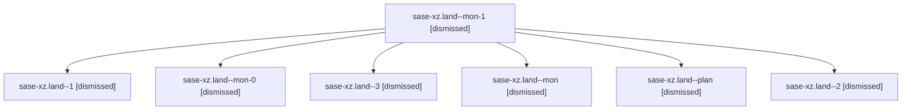

# Session: sase-xz.land

[Agent Hoods](../README.md) / [bbugyi200](../users/bbugyi200/README.md) / [athena](../users/bbugyi200/machines/athena/README.md) / [sase-xz](../users/bbugyi200/machines/athena/hoods/sase-xz/README.md) / sase-xz.land

Owner: `bbugyi200.athena` · Hood: `sase-xz` · Members: 7 · Bead: [sase-xz](https://github.com/sase-org/sase--beads/blob/main/pages/sase-xz/README.md)

## Lineage

The diagram is an optional enhancement; the ordered table below contains the same lineage in accessible text.

| Role | Agent | State | Model / provider | Timing | Commits | Prompt | Chat |
|---|---|---|---|---|---:|---|---|
| mon-1 | sase-xz.land--mon-1 | dismissed | opus / claude | 2026-09-07T17:51:32.226214 → 2026-09-07T18:59:34.228098 | 0 | — | [Chat](../agents/bbugyi200.athena.sase-xz.land--mon-1/chat.md) |
| 1 | sase-xz.land--1 | dismissed | opus / claude | 2026-09-07T16:38:07.146823 → 2026-09-07T16:40:10.206820 | 0 | [Prompt](../agents/bbugyi200.athena.sase-xz.land--1/prompt.md) | [Chat](../agents/bbugyi200.athena.sase-xz.land--1/chat.md) |
| mon-0 | sase-xz.land--mon-0 | dismissed | opus / claude | 2026-09-07T16:40:00.810681 → 2026-09-07T17:36:27.770627 | 0 | — | [Chat](../agents/bbugyi200.athena.sase-xz.land--mon-0/chat.md) |
| 3 | sase-xz.land--3 | dismissed | opus / claude | 2026-09-07T19:01:38.812866 → 2026-09-07T19:35:37.032255 | 0 | [Prompt](../agents/bbugyi200.athena.sase-xz.land--3/prompt.md) | [Chat](../agents/bbugyi200.athena.sase-xz.land--3/chat.md) |
| mon | sase-xz.land--mon | dismissed | opus / claude | 2026-09-07T16:11:02.364365 → 2026-09-07T16:36:14.493445 | 0 | — | [Chat](../agents/bbugyi200.athena.sase-xz.land--mon/chat.md) |
| plan | sase-xz.land--plan | dismissed | opus / claude | 2026-09-07T15:54:37.843452 → 2026-09-07T16:11:13.116337 | 0 | [Prompt](../agents/bbugyi200.athena.sase-xz.land--plan/prompt.md) | [Chat](../agents/bbugyi200.athena.sase-xz.land--plan/chat.md) |
| 2 | sase-xz.land--2 | dismissed | opus / claude | 2026-09-07T17:38:01.255137 → 2026-09-07T17:51:48.585479 | 0 | [Prompt](../agents/bbugyi200.athena.sase-xz.land--2/prompt.md) | [Chat](../agents/bbugyi200.athena.sase-xz.land--2/chat.md) |

## Commits

| Role | Repo | Commit | Subject | Committed |
|---|---|---|---|---|
| — | — | `ddbd1b1` | test: raise the parser\_create CPU ceiling and own two more flake nodes | 2026-09-07 19:31:04 EDT |

## Neighbors

| Agent | Relation | State |
|---|---|---|
| [sase-xz.1](../agents/bbugyi200.athena.sase-xz.1/README.md) | sase-xz hood | dismissed |
| [sase-xz.2](../agents/bbugyi200.athena.sase-xz.2/README.md) | sase-xz hood | dismissed |
| [sase-xz.3](../agents/bbugyi200.athena.sase-xz.3/README.md) | sase-xz hood | dismissed |
| [sase-xz.4](../agents/bbugyi200.athena.sase-xz.4/README.md) | sase-xz hood | dismissed |
