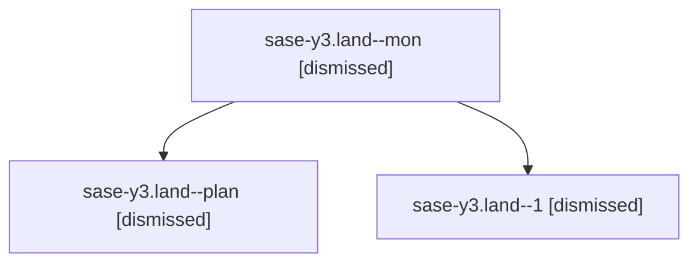

# Session: sase-y3.land

[Agent Hoods](../README.md) / [bbugyi200](../users/bbugyi200/README.md) / [athena](../users/bbugyi200/machines/athena/README.md) / [sase-y3](../users/bbugyi200/machines/athena/hoods/sase-y3/README.md) / sase-y3.land

Owner: `bbugyi200.athena` · Hood: `sase-y3` · Members: 3 · Bead: [sase-y3](https://github.com/sase-org/sase--beads/blob/main/pages/sase-y3/README.md)

## Lineage

The diagram is an optional enhancement; the ordered table below contains the same lineage in accessible text.

| Role | Agent | State | Model / provider | Timing | Commits | Prompt | Chat |
|---|---|---|---|---|---:|---|---|
| mon | sase-y3.land--mon | dismissed | opus / claude | 2026-09-08T08:18:08.274436 → 2026-09-08T08:43:59.258418 | 0 | — | [Chat](../agents/bbugyi200.athena.sase-y3.land--mon/chat.md) |
| plan | sase-y3.land--plan | dismissed | opus / claude | 2026-09-08T07:51:52.207220 → 2026-09-08T08:18:44.126122 | 0 | [Prompt](../agents/bbugyi200.athena.sase-y3.land--plan/prompt.md) | [Chat](../agents/bbugyi200.athena.sase-y3.land--plan/chat.md) |
| 1 | sase-y3.land--1 | dismissed | opus / claude | 2026-09-08T08:45:33.289795 → 2026-09-08T09:00:47.591931 | [1](../agents/bbugyi200.athena.sase-y3.land--1/README.md#commits) | [Prompt](../agents/bbugyi200.athena.sase-y3.land--1/prompt.md) | [Chat](../agents/bbugyi200.athena.sase-y3.land--1/chat.md) |

## Commits

| Role | Repo | Commit | Subject | Committed |
|---|---|---|---|---|
| 1 | — | `2edf986` | feat(sdd): route machine artifact-link writes to hidden host-owned clones | 2026-09-08 08:55:45 EDT |

## Neighbors

| Agent | Relation | State |
|---|---|---|
| [sase-y3.1](../agents/bbugyi200.athena.sase-y3.1/README.md) | sase-y3 hood | dismissed |
| [sase-y3.2](../agents/bbugyi200.athena.sase-y3.2/README.md) | sase-y3 hood | dismissed |
| [sase-y3.3](bbugyi200.athena.sase-y3.3.md) (session · 2) | sase-y3 hood | dismissed 1, failed 1 |
| [sase-y3.4](bbugyi200.athena.sase-y3.4.md) (session · 3) | sase-y3 hood | dismissed 3 |
