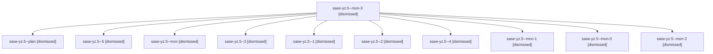

# Session: sase-yz.5

[Agent Hoods](../README.md) / [bbugyi200](../users/bbugyi200/README.md) / [athena](../users/bbugyi200/machines/athena/README.md) / [sase-yz](../users/bbugyi200/machines/athena/hoods/sase-yz/README.md) / sase-yz.5

Owner: `bbugyi200.athena` · Hood: `sase-yz` · Members: 11 · Bead: [sase-yz.5](https://github.com/sase-org/sase--beads/blob/main/pages/sase-yz/sase-yz.5.md)

## Lineage

The diagram is an optional enhancement; the ordered table below contains the same lineage in accessible text.

| Role | Agent | State | Model / provider | Timing | Commits | Prompt | Chat |
|---|---|---|---|---|---:|---|---|
| mon-3 | sase-yz.5--mon-3 | dismissed | grok-4.6 / grok | 2026-09-10T04:53:59.811694 → 2026-09-10T05:16:23.343830 | 0 | — | [Chat](../agents/bbugyi200.athena.sase-yz.5--mon-3/chat.md) |
| plan | sase-yz.5--plan | dismissed | gpt-5.5 / codex | 2026-09-09T22:59:15.479450 → 2026-09-09T23:13:59.343455 | 0 | [Prompt](../agents/bbugyi200.athena.sase-yz.5--plan/prompt.md) | [Chat](../agents/bbugyi200.athena.sase-yz.5--plan/chat.md) |
| 5 | sase-yz.5--5 | dismissed | grok-4.6 / grok | 2026-09-10T05:17:55.515663 → 2026-09-10T05:26:24.552433 | [1](../agents/bbugyi200.athena.sase-yz.5--5/README.md#commits) | [Prompt](../agents/bbugyi200.athena.sase-yz.5--5/prompt.md) | [Chat](../agents/bbugyi200.athena.sase-yz.5--5/chat.md) |
| mon | sase-yz.5--mon | dismissed | gpt-5.5 / codex | 2026-09-09T23:13:32.415994 → 2026-09-09T23:58:58.655607 | 0 | — | [Chat](../agents/bbugyi200.athena.sase-yz.5--mon/chat.md) |
| 3 | sase-yz.5--3 | dismissed | gpt-5.5 / codex | 2026-09-10T02:35:48.121945 → 2026-09-10T02:41:51.629314 | 0 | [Prompt](../agents/bbugyi200.athena.sase-yz.5--3/prompt.md) | [Chat](../agents/bbugyi200.athena.sase-yz.5--3/chat.md) |
| 1 | sase-yz.5--1 | dismissed | gpt-5.5 / codex | 2026-09-10T00:00:46.493124 → 2026-09-10T00:29:59.835732 | 0 | [Prompt](../agents/bbugyi200.athena.sase-yz.5--1/prompt.md) | [Chat](../agents/bbugyi200.athena.sase-yz.5--1/chat.md) |
| 2 | sase-yz.5--2 | dismissed | gpt-5.5 / codex | 2026-09-10T01:46:37.448185 → 2026-09-10T01:49:16.994769 | 0 | [Prompt](../agents/bbugyi200.athena.sase-yz.5--2/prompt.md) | [Chat](../agents/bbugyi200.athena.sase-yz.5--2/chat.md) |
| 4 | sase-yz.5--4 | dismissed | grok-4.6 / grok | 2026-09-10T04:38:53.317147 → 2026-09-10T04:54:17.152374 | 0 | [Prompt](../agents/bbugyi200.athena.sase-yz.5--4/prompt.md) | [Chat](../agents/bbugyi200.athena.sase-yz.5--4/chat.md) |
| mon-1 | sase-yz.5--mon-1 | dismissed | gpt-5.5 / codex | 2026-09-10T01:49:01.230733 → 2026-09-10T02:33:29.208826 | 0 | — | [Chat](../agents/bbugyi200.athena.sase-yz.5--mon-1/chat.md) |
| mon-0 | sase-yz.5--mon-0 | dismissed | gpt-5.5 / codex | 2026-09-10T00:29:30.725951 → 2026-09-10T01:44:36.464449 | 0 | — | [Chat](../agents/bbugyi200.athena.sase-yz.5--mon-0/chat.md) |
| mon-2 | sase-yz.5--mon-2 | dismissed | gpt-5.5 / codex | 2026-09-10T02:41:25.021204 → 2026-09-10T04:37:21.116320 | 0 | — | [Chat](../agents/bbugyi200.athena.sase-yz.5--mon-2/chat.md) |

## Commits

| Role | Repo | Commit | Subject | Committed |
|---|---|---|---|---|
| 5 | — | `5aef515` | docs(usage): document collector health and land health-verify | 2026-09-10 05:23:57 EDT |

## Neighbors

| Agent | Relation | State |
|---|---|---|
| [sase-yz.1](../agents/bbugyi200.athena.sase-yz.1/README.md) | sase-yz hood | dismissed |
| [sase-yz.2](bbugyi200.athena.sase-yz.2.md) (session · 11) | sase-yz hood | dismissed 11 |
| [sase-yz.3](../agents/bbugyi200.athena.sase-yz.3/README.md) | sase-yz hood | dismissed |
| [sase-yz.4](../agents/bbugyi200.athena.sase-yz.4/README.md) | sase-yz hood | dismissed |
| [sase-yz.land](../agents/bbugyi200.athena.sase-yz.land/README.md) | sase-yz hood | waiting |
