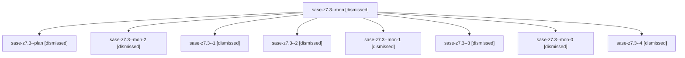

# Session: sase-z7.3

[Agent Hoods](../README.md) / [bbugyi200](../users/bbugyi200/README.md) / [athena](../users/bbugyi200/machines/athena/README.md) / [sase-z7](../users/bbugyi200/machines/athena/hoods/sase-z7/README.md) / sase-z7.3

Owner: `bbugyi200.athena` · Hood: `sase-z7` · Members: 9 · Bead: [sase-z7.3](https://github.com/sase-org/sase--beads/blob/main/pages/sase-z7/sase-z7.3.md)

## Lineage

The diagram is an optional enhancement; the ordered table below contains the same lineage in accessible text.

| Role | Agent | State | Model / provider | Timing | Commits | Prompt | Chat |
|---|---|---|---|---|---:|---|---|
| mon | sase-z7.3--mon | dismissed | sonnet / claude | 2026-09-10T15:02:53.761797 → 2026-09-10T15:02:57.694709 | 0 | — | [Chat](../agents/bbugyi200.athena.sase-z7.3--mon/chat.md) |
| plan | sase-z7.3--plan | dismissed | sonnet / claude | 2026-09-10T14:21:33.599824 → 2026-09-10T15:03:15.538523 | 0 | [Prompt](../agents/bbugyi200.athena.sase-z7.3--plan/prompt.md) | [Chat](../agents/bbugyi200.athena.sase-z7.3--plan/chat.md) |
| mon-2 | sase-z7.3--mon-2 | dismissed | opus / claude | 2026-09-10T15:18:35.058744 → 2026-09-10T15:29:44.500727 | 0 | — | [Chat](../agents/bbugyi200.athena.sase-z7.3--mon-2/chat.md) |
| 1 | sase-z7.3--1 | dismissed | opus / claude | 2026-09-10T15:06:00.950766 → 2026-09-10T15:07:28.378521 | 0 | [Prompt](../agents/bbugyi200.athena.sase-z7.3--1/prompt.md) | [Chat](../agents/bbugyi200.athena.sase-z7.3--1/chat.md) |
| 2 | sase-z7.3--2 | dismissed | opus / claude | 2026-09-10T15:10:11.077689 → 2026-09-10T15:11:34.431311 | 0 | [Prompt](../agents/bbugyi200.athena.sase-z7.3--2/prompt.md) | [Chat](../agents/bbugyi200.athena.sase-z7.3--2/chat.md) |
| mon-1 | sase-z7.3--mon-1 | dismissed | opus / claude | 2026-09-10T15:11:19.111813 → 2026-09-10T15:12:54.151734 | 0 | — | [Chat](../agents/bbugyi200.athena.sase-z7.3--mon-1/chat.md) |
| 3 | sase-z7.3--3 | dismissed | opus / claude | 2026-09-10T15:15:43.853707 → 2026-09-10T15:18:52.175223 | 0 | [Prompt](../agents/bbugyi200.athena.sase-z7.3--3/prompt.md) | [Chat](../agents/bbugyi200.athena.sase-z7.3--3/chat.md) |
| mon-0 | sase-z7.3--mon-0 | dismissed | opus / claude | 2026-09-10T15:07:11.165820 → 2026-09-10T15:07:25.625691 | 0 | — | [Chat](../agents/bbugyi200.athena.sase-z7.3--mon-0/chat.md) |
| 4 | sase-z7.3--4 | dismissed | opus / claude | 2026-09-10T15:32:34.255436 → 2026-09-10T16:20:16.703150 | [1](../agents/bbugyi200.athena.sase-z7.3--4/README.md#commits) | [Prompt](../agents/bbugyi200.athena.sase-z7.3--4/prompt.md) | [Chat](../agents/bbugyi200.athena.sase-z7.3--4/chat.md) |

## Commits

| Role | Repo | Commit | Subject | Committed |
|---|---|---|---|---|
| 4 | — | `1ef9c09` | feat(ace): render compact provider usage window badges | 2026-09-10 16:17:34 EDT |

## Neighbors

| Agent | Relation | State |
|---|---|---|
| [sase-z7.1](../agents/bbugyi200.athena.sase-z7.1/README.md) | sase-z7 hood | dismissed |
| [sase-z7.2](../agents/bbugyi200.athena.sase-z7.2/README.md) | sase-z7 hood | dismissed |
| [sase-z7.land](../agents/bbugyi200.athena.sase-z7.land/README.md) | sase-z7 hood | dismissed |
