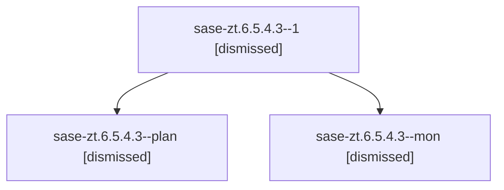

# Session: sase-zt.6.5.4.3

[Agent Hoods](../README.md) / [bbugyi200](../users/bbugyi200/README.md) / [athena](../users/bbugyi200/machines/athena/README.md) / [sase-zt](../users/bbugyi200/machines/athena/hoods/sase-zt/README.md) / sase-zt.6.5.4.3

Owner: `bbugyi200.athena` · Hood: `sase-zt` · Members: 3 · Bead: [sase-zt.6.5.4.3](https://github.com/sase-org/sase--beads/blob/main/pages/sase-zt/sase-zt.6.5.4.3.md)

## Lineage

The diagram is an optional enhancement; the ordered table below contains the same lineage in accessible text.

| Role | Agent | State | Model / provider | Timing | Commits | Prompt | Chat |
|---|---|---|---|---|---:|---|---|
| 1 | sase-zt.6.5.4.3--1 | dismissed | sonnet / claude | 2026-09-14T01:26:28.175821 → 2026-09-14T01:31:47.163838 | [1](../agents/bbugyi200.athena.sase-zt.6.5.4.3--1/README.md#commits) | [Prompt](../agents/bbugyi200.athena.sase-zt.6.5.4.3--1/prompt.md) | [Chat](../agents/bbugyi200.athena.sase-zt.6.5.4.3--1/chat.md) |
| plan | sase-zt.6.5.4.3--plan | dismissed | gpt-5.5 / codex | 2026-09-13T23:50:34.444346 → 2026-09-14T01:00:14.522078 | 0 | [Prompt](../agents/bbugyi200.athena.sase-zt.6.5.4.3--plan/prompt.md) | [Chat](../agents/bbugyi200.athena.sase-zt.6.5.4.3--plan/chat.md) |
| mon | sase-zt.6.5.4.3--mon | dismissed | gpt-5.5 / codex | 2026-09-14T00:59:52.075215 → 2026-09-14T01:25:26.435379 | 0 | — | [Chat](../agents/bbugyi200.athena.sase-zt.6.5.4.3--mon/chat.md) |

## Commits

| Role | Repo | Commit | Subject | Committed |
|---|---|---|---|---|
| 1 | — | `74d532a` | fix(ace,axe,gates): complete drain, remote, and full landing acceptance | 2026-09-14 01:28:43 EDT |

## Neighbors

| Agent | Relation | State |
|---|---|---|
| [sase-zt.6.5.4.1](../agents/bbugyi200.athena.sase-zt.6.5.4.1/README.md) | sase-zt.6.5.4 hood | dismissed |
| [sase-zt.6.5.4.2](../agents/bbugyi200.athena.sase-zt.6.5.4.2/README.md) | sase-zt.6.5.4 hood | dismissed |
| [sase-zt.6.5.4.land](../agents/bbugyi200.athena.sase-zt.6.5.4.land/README.md) | sase-zt.6.5.4 hood | dismissed |
| [sase-zt.6.5.1](../agents/bbugyi200.athena.sase-zt.6.5.1/README.md) | sase-zt.6.5 hood | dismissed |
| [sase-zt.6.5.2](bbugyi200.athena.sase-zt.6.5.2.md) (session · 5) | sase-zt.6.5 hood | dismissed 5 |
| [sase-zt.6.5.3](bbugyi200.athena.sase-zt.6.5.3.md) (session · 10) | sase-zt.6.5 hood | dismissed 10 |
| [sase-zt.6.5.land](bbugyi200.athena.sase-zt.6.5.land.md) (session · 3) | sase-zt.6.5 hood | dismissed 3 |
| [sase-zt.6.1](../agents/bbugyi200.athena.sase-zt.6.1/README.md) | sase-zt.6 hood | dismissed |
| [sase-zt.6.2](../agents/bbugyi200.athena.sase-zt.6.2/README.md) | sase-zt.6 hood | dismissed |
| [sase-zt.6.3](../agents/bbugyi200.athena.sase-zt.6.3/README.md) | sase-zt.6 hood | dismissed |
| [sase-zt.6.4](../agents/bbugyi200.athena.sase-zt.6.4/README.md) | sase-zt.6 hood | dismissed |
| [sase-zt.6.land](bbugyi200.athena.sase-zt.6.land.md) (session · 3) | sase-zt.6 hood | dismissed 3 |
| [sase-zt.1](../agents/bbugyi200.athena.sase-zt.1/README.md) | sase-zt hood | dismissed |
| [sase-zt.2](../agents/bbugyi200.athena.sase-zt.2/README.md) | sase-zt hood | dismissed |
| [sase-zt.3](../agents/bbugyi200.athena.sase-zt.3/README.md) | sase-zt hood | dismissed |
| [sase-zt.4](../agents/bbugyi200.athena.sase-zt.4/README.md) | sase-zt hood | dismissed |
| [sase-zt.5](bbugyi200.athena.sase-zt.5.md) (session · 4) | sase-zt hood | dismissed 4 |
| [sase-zt.land](bbugyi200.athena.sase-zt.land.md) (session · 3) | sase-zt hood | dismissed 3 |
