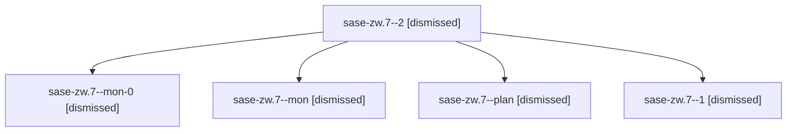

# Session: sase-zw.7

[Agent Hoods](../README.md) / [bbugyi200](../users/bbugyi200/README.md) / [athena](../users/bbugyi200/machines/athena/README.md) / [sase-zw](../users/bbugyi200/machines/athena/hoods/sase-zw/README.md) / sase-zw.7

Owner: `bbugyi200.athena` · Hood: `sase-zw` · Members: 5 · Bead: [sase-zw.7](https://github.com/sase-org/sase--beads/blob/main/pages/sase-zw/sase-zw.7.md)

## Lineage

The diagram is an optional enhancement; the ordered table below contains the same lineage in accessible text.

| Role | Agent | State | Model / provider | Timing | Commits | Prompt | Chat |
|---|---|---|---|---|---:|---|---|
| 2 | sase-zw.7--2 | dismissed | gpt-5.5 / codex | 2026-09-13T17:16:42.497955 → 2026-09-13T18:19:31.553320 | [1](../agents/bbugyi200.athena.sase-zw.7--2/README.md#commits) | [Prompt](../agents/bbugyi200.athena.sase-zw.7--2/prompt.md) | [Chat](../agents/bbugyi200.athena.sase-zw.7--2/chat.md) |
| mon-0 | sase-zw.7--mon-0 | dismissed | gpt-5.5 / codex | 2026-09-13T16:23:13.449660 → 2026-09-13T17:08:20.294384 | 0 | — | [Chat](../agents/bbugyi200.athena.sase-zw.7--mon-0/chat.md) |
| mon | sase-zw.7--mon | dismissed | gpt-5.5 / codex | 2026-09-13T16:03:14.334317 → 2026-09-13T16:18:03.724378 | 0 | — | [Chat](../agents/bbugyi200.athena.sase-zw.7--mon/chat.md) |
| plan | sase-zw.7--plan | dismissed | gpt-5.5 / codex | 2026-09-13T15:37:45.073533 → 2026-09-13T16:03:49.293112 | 0 | [Prompt](../agents/bbugyi200.athena.sase-zw.7--plan/prompt.md) | [Chat](../agents/bbugyi200.athena.sase-zw.7--plan/chat.md) |
| 1 | sase-zw.7--1 | dismissed | gpt-5.5 / codex | 2026-09-13T16:19:15.577824 → 2026-09-13T16:23:35.637549 | 0 | [Prompt](../agents/bbugyi200.athena.sase-zw.7--1/prompt.md) | [Chat](../agents/bbugyi200.athena.sase-zw.7--1/chat.md) |

## Commits

| Role | Repo | Commit | Subject | Committed |
|---|---|---|---|---|
| 2 | — | `8f7dad6` | feat(disk): add pressure footprint reporting | 2026-09-13 18:16:24 EDT |

## Neighbors

| Agent | Relation | State |
|---|---|---|
| [sase-zw.1](../agents/bbugyi200.athena.sase-zw.1/README.md) | sase-zw hood | dismissed |
| [sase-zw.2](../agents/bbugyi200.athena.sase-zw.2/README.md) | sase-zw hood | dismissed |
| [sase-zw.3](../agents/bbugyi200.athena.sase-zw.3/README.md) | sase-zw hood | dismissed |
| [sase-zw.4](bbugyi200.athena.sase-zw.4.md) (session · 3) | sase-zw hood | dismissed 3 |
| [sase-zw.5](../agents/bbugyi200.athena.sase-zw.5/README.md) | sase-zw hood | dismissed |
| [sase-zw.6](bbugyi200.athena.sase-zw.6.md) (session · 3) | sase-zw hood | completed 1, dismissed 2 |
| [sase-zw.8.1](../agents/bbugyi200.athena.sase-zw.8.1/README.md) | sase-zw hood | dismissed |
| [sase-zw.8.2](../agents/bbugyi200.athena.sase-zw.8.2/README.md) | sase-zw hood | dismissed |
| [sase-zw.8.3](../agents/bbugyi200.athena.sase-zw.8.3/README.md) | sase-zw hood | dismissed |
| [sase-zw.8.4](../agents/bbugyi200.athena.sase-zw.8.4/README.md) | sase-zw hood | dismissed |
| [sase-zw.8.5](../agents/bbugyi200.athena.sase-zw.8.5/README.md) | sase-zw hood | dismissed |
| [sase-zw.8.6](../agents/bbugyi200.athena.sase-zw.8.6/README.md) | sase-zw hood | dismissed |
| [sase-zw.8.7.1](../agents/bbugyi200.athena.sase-zw.8.7.1/README.md) | sase-zw hood | dismissed |
| [sase-zw.8.7.2](../agents/bbugyi200.athena.sase-zw.8.7.2/README.md) | sase-zw hood | dismissed |
| [sase-zw.8.7.3](../agents/bbugyi200.athena.sase-zw.8.7.3/README.md) | sase-zw hood | dismissed |
| [sase-zw.8.7.4](../agents/bbugyi200.athena.sase-zw.8.7.4/README.md) | sase-zw hood | dismissed |
| [sase-zw.8.7.5](../agents/bbugyi200.athena.sase-zw.8.7.5/README.md) | sase-zw hood | dismissed |
| [sase-zw.8.7.6](../agents/bbugyi200.athena.sase-zw.8.7.6/README.md) | sase-zw hood | dismissed |
| [sase-zw.8.7.7](bbugyi200.athena.sase-zw.8.7.7.md) (session · 13) | sase-zw hood | dismissed 13 |
| [sase-zw.8.7.8.1](../agents/bbugyi200.athena.sase-zw.8.7.8.1/README.md) | sase-zw hood | dismissed |
| [sase-zw.8.7.8.2](../agents/bbugyi200.athena.sase-zw.8.7.8.2/README.md) | sase-zw hood | dismissed |
| [sase-zw.8.7.8.3](../agents/bbugyi200.athena.sase-zw.8.7.8.3/README.md) | sase-zw hood | dismissed |
| [sase-zw.8.7.8.4](../agents/bbugyi200.athena.sase-zw.8.7.8.4/README.md) | sase-zw hood | dismissed |
| [sase-zw.8.7.8.5](../agents/bbugyi200.athena.sase-zw.8.7.8.5/README.md) | sase-zw hood | dismissed |
| [sase-zw.8.7.8.6](../agents/bbugyi200.athena.sase-zw.8.7.8.6/README.md) | sase-zw hood | dismissed |
| [sase-zw.8.7.8.7](../agents/bbugyi200.athena.sase-zw.8.7.8.7/README.md) | sase-zw hood | dismissed |
| [sase-zw.8.7.8.land](../agents/bbugyi200.athena.sase-zw.8.7.8.land/README.md) | sase-zw hood | dismissed |
| [sase-zw.8.7.land](bbugyi200.athena.sase-zw.8.7.land.md) (session · 3) | sase-zw hood | dismissed 3 |
| [sase-zw.8.land](bbugyi200.athena.sase-zw.8.land.md) (session · 3) | sase-zw hood | dismissed 3 |
| [sase-zw.land](bbugyi200.athena.sase-zw.land.md) (session · 3) | sase-zw hood | dismissed 3 |
