# Session: sase-zw.8.7.7

[Agent Hoods](../README.md) / [bbugyi200](../users/bbugyi200/README.md) / [athena](../users/bbugyi200/machines/athena/README.md) / [sase-zw](../users/bbugyi200/machines/athena/hoods/sase-zw/README.md) / sase-zw.8.7.7

Owner: `bbugyi200.athena` · Hood: `sase-zw` · Members: 13 · Bead: [sase-zw.8.7.7](https://github.com/sase-org/sase--beads/blob/main/pages/sase-zw/sase-zw.8.7.7.md)

## Lineage

```mermaid
flowchart TD
  n0["sase-zw.8.7.7--mon-3 [dismissed]"]
  n1["sase-zw.8.7.7--mon-1 [dismissed]"]
  n0 --> n1
  n2["sase-zw.8.7.7--mon [dismissed]"]
  n0 --> n2
  n3["sase-zw.8.7.7--5 [dismissed]"]
  n0 --> n3
  n4["sase-zw.8.7.7--mon-2 [dismissed]"]
  n0 --> n4
  n5["sase-zw.8.7.7--6 [dismissed]"]
  n0 --> n5
  n6["sase-zw.8.7.7--1 [dismissed]"]
  n0 --> n6
  n7["sase-zw.8.7.7--3 [dismissed]"]
  n0 --> n7
  n8["sase-zw.8.7.7--4 [dismissed]"]
  n0 --> n8
  n9["sase-zw.8.7.7--plan [dismissed]"]
  n0 --> n9
  n10["sase-zw.8.7.7--mon-4 [dismissed]"]
  n0 --> n10
  n11["sase-zw.8.7.7--mon-0 [dismissed]"]
  n0 --> n11
  n12["sase-zw.8.7.7--2 [dismissed]"]
  n0 --> n12
```

The diagram is an optional enhancement; the ordered table below contains the same lineage in accessible text.

| Role | Agent | State | Model / provider | Timing | Commits | Prompt | Chat |
|---|---|---|---|---|---:|---|---|
| mon-3 | sase-zw.8.7.7--mon-3 | dismissed | gpt-5.5 / codex | 2026-09-15T17:05:30.986568 → 2026-09-15T17:30:52.989215 | 0 | — | [Chat](../agents/bbugyi200.athena.sase-zw.8.7.7--mon-3/chat.md) |
| mon-1 | sase-zw.8.7.7--mon-1 | dismissed | gpt-5.5 / codex | 2026-09-15T15:57:28.810724 → 2026-09-15T16:22:43.360962 | 0 | — | [Chat](../agents/bbugyi200.athena.sase-zw.8.7.7--mon-1/chat.md) |
| mon | sase-zw.8.7.7--mon | dismissed | gpt-5.5 / codex | 2026-09-15T15:18:00.070495 → 2026-09-15T15:21:38.878351 | 0 | — | [Chat](../agents/bbugyi200.athena.sase-zw.8.7.7--mon/chat.md) |
| 5 | sase-zw.8.7.7--5 | dismissed | gpt-5.5 / codex | 2026-09-15T17:31:53.994682 → 2026-09-15T17:34:55.487741 | 0 | [Prompt](../agents/bbugyi200.athena.sase-zw.8.7.7--5/prompt.md) | [Chat](../agents/bbugyi200.athena.sase-zw.8.7.7--5/chat.md) |
| mon-2 | sase-zw.8.7.7--mon-2 | dismissed | gpt-5.5 / codex | 2026-09-15T16:29:15.023529 → 2026-09-15T16:58:19.037078 | 0 | — | [Chat](../agents/bbugyi200.athena.sase-zw.8.7.7--mon-2/chat.md) |
| 6 | sase-zw.8.7.7--6 | dismissed | gpt-5.5 / codex | 2026-09-15T18:00:07.809089 → 2026-09-15T18:09:50.596382 | [1](../agents/bbugyi200.athena.sase-zw.8.7.7--6/README.md#commits) | [Prompt](../agents/bbugyi200.athena.sase-zw.8.7.7--6/prompt.md) | [Chat](../agents/bbugyi200.athena.sase-zw.8.7.7--6/chat.md) |
| 1 | sase-zw.8.7.7--1 | dismissed | gpt-5.5 / codex | 2026-09-15T15:22:51.214393 → 2026-09-15T15:26:14.848036 | 0 | [Prompt](../agents/bbugyi200.athena.sase-zw.8.7.7--1/prompt.md) | [Chat](../agents/bbugyi200.athena.sase-zw.8.7.7--1/chat.md) |
| 3 | sase-zw.8.7.7--3 | dismissed | gpt-5.5 / codex | 2026-09-15T16:24:03.470821 → 2026-09-15T16:30:31.316508 | 0 | [Prompt](../agents/bbugyi200.athena.sase-zw.8.7.7--3/prompt.md) | [Chat](../agents/bbugyi200.athena.sase-zw.8.7.7--3/chat.md) |
| 4 | sase-zw.8.7.7--4 | dismissed | gpt-5.5 / codex | 2026-09-15T16:59:32.681078 → 2026-09-15T17:05:49.150932 | 0 | [Prompt](../agents/bbugyi200.athena.sase-zw.8.7.7--4/prompt.md) | [Chat](../agents/bbugyi200.athena.sase-zw.8.7.7--4/chat.md) |
| plan | sase-zw.8.7.7--plan | dismissed | gpt-5.5 / codex | 2026-09-15T15:00:23.063277 → 2026-09-15T15:18:18.413539 | 0 | [Prompt](../agents/bbugyi200.athena.sase-zw.8.7.7--plan/prompt.md) | [Chat](../agents/bbugyi200.athena.sase-zw.8.7.7--plan/chat.md) |
| mon-4 | sase-zw.8.7.7--mon-4 | dismissed | gpt-5.5 / codex | 2026-09-15T17:34:36.450415 → 2026-09-15T17:59:06.795614 | 0 | — | [Chat](../agents/bbugyi200.athena.sase-zw.8.7.7--mon-4/chat.md) |
| mon-0 | sase-zw.8.7.7--mon-0 | dismissed | gpt-5.5 / codex | 2026-09-15T15:25:52.247530 → 2026-09-15T15:52:52.389455 | 0 | — | [Chat](../agents/bbugyi200.athena.sase-zw.8.7.7--mon-0/chat.md) |
| 2 | sase-zw.8.7.7--2 | dismissed | gpt-5.5 / codex | 2026-09-15T15:54:12.753663 → 2026-09-15T15:57:46.858422 | 0 | [Prompt](../agents/bbugyi200.athena.sase-zw.8.7.7--2/prompt.md) | [Chat](../agents/bbugyi200.athena.sase-zw.8.7.7--2/chat.md) |

## Commits

| Role | Repo | Commit | Subject | Committed |
|---|---|---|---|---|
| 6 | — | `05be391` | test(disk): finish retention acceptance gate | 2026-09-15 18:06:19 EDT |

## Neighbors

| Agent | Relation | State |
|---|---|---|
| [sase-zw.8.7.1](../agents/bbugyi200.athena.sase-zw.8.7.1/README.md) | sase-zw.8.7 hood | dismissed |
| [sase-zw.8.7.2](../agents/bbugyi200.athena.sase-zw.8.7.2/README.md) | sase-zw.8.7 hood | dismissed |
| [sase-zw.8.7.3](../agents/bbugyi200.athena.sase-zw.8.7.3/README.md) | sase-zw.8.7 hood | dismissed |
| [sase-zw.8.7.4](../agents/bbugyi200.athena.sase-zw.8.7.4/README.md) | sase-zw.8.7 hood | dismissed |
| [sase-zw.8.7.5](../agents/bbugyi200.athena.sase-zw.8.7.5/README.md) | sase-zw.8.7 hood | dismissed |
| [sase-zw.8.7.6](../agents/bbugyi200.athena.sase-zw.8.7.6/README.md) | sase-zw.8.7 hood | dismissed |
| [sase-zw.8.7.8.1](../agents/bbugyi200.athena.sase-zw.8.7.8.1/README.md) | sase-zw.8.7 hood | dismissed |
| [sase-zw.8.7.8.2](../agents/bbugyi200.athena.sase-zw.8.7.8.2/README.md) | sase-zw.8.7 hood | dismissed |
| [sase-zw.8.7.8.3](../agents/bbugyi200.athena.sase-zw.8.7.8.3/README.md) | sase-zw.8.7 hood | dismissed |
| [sase-zw.8.7.8.4](../agents/bbugyi200.athena.sase-zw.8.7.8.4/README.md) | sase-zw.8.7 hood | dismissed |
| [sase-zw.8.7.8.5](../agents/bbugyi200.athena.sase-zw.8.7.8.5/README.md) | sase-zw.8.7 hood | dismissed |
| [sase-zw.8.7.8.6](../agents/bbugyi200.athena.sase-zw.8.7.8.6/README.md) | sase-zw.8.7 hood | dismissed |
| [sase-zw.8.7.8.7](../agents/bbugyi200.athena.sase-zw.8.7.8.7/README.md) | sase-zw.8.7 hood | dismissed |
| [sase-zw.8.7.8.land](../agents/bbugyi200.athena.sase-zw.8.7.8.land/README.md) | sase-zw.8.7 hood | dismissed |
| [sase-zw.8.7.land](bbugyi200.athena.sase-zw.8.7.land.md) (session · 3) | sase-zw.8.7 hood | dismissed 3 |
| [sase-zw.8.1](../agents/bbugyi200.athena.sase-zw.8.1/README.md) | sase-zw.8 hood | dismissed |
| [sase-zw.8.2](../agents/bbugyi200.athena.sase-zw.8.2/README.md) | sase-zw.8 hood | dismissed |
| [sase-zw.8.3](../agents/bbugyi200.athena.sase-zw.8.3/README.md) | sase-zw.8 hood | dismissed |
| [sase-zw.8.4](../agents/bbugyi200.athena.sase-zw.8.4/README.md) | sase-zw.8 hood | dismissed |
| [sase-zw.8.5](../agents/bbugyi200.athena.sase-zw.8.5/README.md) | sase-zw.8 hood | dismissed |
| [sase-zw.8.6](../agents/bbugyi200.athena.sase-zw.8.6/README.md) | sase-zw.8 hood | dismissed |
| [sase-zw.8.land](bbugyi200.athena.sase-zw.8.land.md) (session · 3) | sase-zw.8 hood | dismissed 3 |
| [sase-zw.1](../agents/bbugyi200.athena.sase-zw.1/README.md) | sase-zw hood | dismissed |
| [sase-zw.2](../agents/bbugyi200.athena.sase-zw.2/README.md) | sase-zw hood | dismissed |
| [sase-zw.3](../agents/bbugyi200.athena.sase-zw.3/README.md) | sase-zw hood | dismissed |
| [sase-zw.4](bbugyi200.athena.sase-zw.4.md) (session · 3) | sase-zw hood | dismissed 3 |
| [sase-zw.5](../agents/bbugyi200.athena.sase-zw.5/README.md) | sase-zw hood | dismissed |
| [sase-zw.6](bbugyi200.athena.sase-zw.6.md) (session · 3) | sase-zw hood | completed 1, dismissed 2 |
| [sase-zw.7](bbugyi200.athena.sase-zw.7.md) (session · 5) | sase-zw hood | dismissed 5 |
| [sase-zw.land](bbugyi200.athena.sase-zw.land.md) (session · 3) | sase-zw hood | dismissed 3 |
