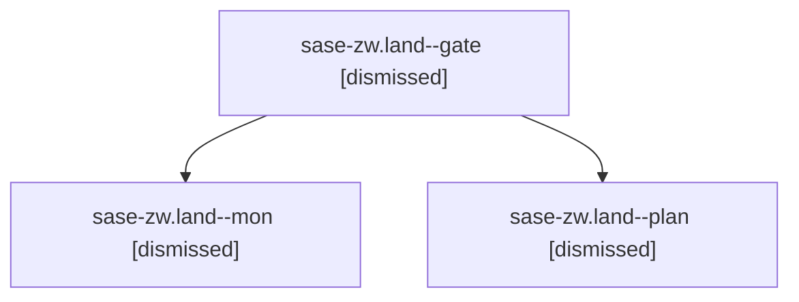

# Session: sase-zw.land

[Agent Hoods](../README.md) / [bbugyi200](../users/bbugyi200/README.md) / [athena](../users/bbugyi200/machines/athena/README.md) / [sase-zw](../users/bbugyi200/machines/athena/hoods/sase-zw/README.md) / sase-zw.land

Owner: `bbugyi200.athena` · Hood: `sase-zw` · Members: 3 · Bead: [sase-zw](https://github.com/sase-org/sase--beads/blob/main/pages/sase-zw/README.md)

## Lineage

The diagram is an optional enhancement; the ordered table below contains the same lineage in accessible text.

| Role | Agent | State | Model / provider | Timing | Commits | Prompt | Chat |
|---|---|---|---|---|---:|---|---|
| gate | sase-zw.land--gate | dismissed | gpt-6-astra / codex | 2026-09-13T18:39:48.296913 → 2026-09-13T18:40:32 | 0 | — | [Chat](../agents/bbugyi200.athena.sase-zw.land--gate/chat.md) |
| mon | sase-zw.land--mon | dismissed | gpt-6-astra / codex | 2026-09-13T18:40:31.666338 → 2026-09-13T18:43:08.765041 | 0 | — | [Chat](../agents/bbugyi200.athena.sase-zw.land--mon/chat.md) |
| plan | sase-zw.land--plan | dismissed | gpt-6-astra / codex | 2026-09-13T18:20:06.346258 → 2026-09-13T18:40:49.841845 | 0 | [Prompt](../agents/bbugyi200.athena.sase-zw.land--plan/prompt.md) | [Chat](../agents/bbugyi200.athena.sase-zw.land--plan/chat.md) |

## Neighbors

| Agent | Relation | State |
|---|---|---|
| [sase-zw.1](../agents/bbugyi200.athena.sase-zw.1/README.md) | sase-zw hood | dismissed |
| [sase-zw.2](../agents/bbugyi200.athena.sase-zw.2/README.md) | sase-zw hood | dismissed |
| [sase-zw.3](../agents/bbugyi200.athena.sase-zw.3/README.md) | sase-zw hood | dismissed |
| [sase-zw.4](bbugyi200.athena.sase-zw.4.md) (session · 3) | sase-zw hood | dismissed 3 |
| [sase-zw.5](../agents/bbugyi200.athena.sase-zw.5/README.md) | sase-zw hood | dismissed |
| [sase-zw.6](bbugyi200.athena.sase-zw.6.md) (session · 3) | sase-zw hood | completed 1, dismissed 2 |
| [sase-zw.7](bbugyi200.athena.sase-zw.7.md) (session · 5) | sase-zw hood | dismissed 5 |
| [sase-zw.8.1](../agents/bbugyi200.athena.sase-zw.8.1/README.md) | sase-zw hood | dismissed |
| [sase-zw.8.2](../agents/bbugyi200.athena.sase-zw.8.2/README.md) | sase-zw hood | dismissed |
| [sase-zw.8.3](../agents/bbugyi200.athena.sase-zw.8.3/README.md) | sase-zw hood | dismissed |
| [sase-zw.8.4](../agents/bbugyi200.athena.sase-zw.8.4/README.md) | sase-zw hood | dismissed |
| [sase-zw.8.5](../agents/bbugyi200.athena.sase-zw.8.5/README.md) | sase-zw hood | dismissed |
| [sase-zw.8.6](../agents/bbugyi200.athena.sase-zw.8.6/README.md) | sase-zw hood | dismissed |
| [sase-zw.8.7.1](../agents/bbugyi200.athena.sase-zw.8.7.1/README.md) | sase-zw hood | dismissed |
| [sase-zw.8.7.2](../agents/bbugyi200.athena.sase-zw.8.7.2/README.md) | sase-zw hood | dismissed |
| [sase-zw.8.7.3](../agents/bbugyi200.athena.sase-zw.8.7.3/README.md) | sase-zw hood | dismissed |
| [sase-zw.8.7.4](../agents/bbugyi200.athena.sase-zw.8.7.4/README.md) | sase-zw hood | dismissed |
| [sase-zw.8.7.5](../agents/bbugyi200.athena.sase-zw.8.7.5/README.md) | sase-zw hood | dismissed |
| [sase-zw.8.7.6](../agents/bbugyi200.athena.sase-zw.8.7.6/README.md) | sase-zw hood | dismissed |
| [sase-zw.8.7.7](bbugyi200.athena.sase-zw.8.7.7.md) (session · 13) | sase-zw hood | dismissed 13 |
| [sase-zw.8.7.8.1](../agents/bbugyi200.athena.sase-zw.8.7.8.1/README.md) | sase-zw hood | dismissed |
| [sase-zw.8.7.8.2](../agents/bbugyi200.athena.sase-zw.8.7.8.2/README.md) | sase-zw hood | dismissed |
| [sase-zw.8.7.8.3](../agents/bbugyi200.athena.sase-zw.8.7.8.3/README.md) | sase-zw hood | dismissed |
| [sase-zw.8.7.8.4](../agents/bbugyi200.athena.sase-zw.8.7.8.4/README.md) | sase-zw hood | dismissed |
| [sase-zw.8.7.8.5](../agents/bbugyi200.athena.sase-zw.8.7.8.5/README.md) | sase-zw hood | dismissed |
| [sase-zw.8.7.8.6](../agents/bbugyi200.athena.sase-zw.8.7.8.6/README.md) | sase-zw hood | dismissed |
| [sase-zw.8.7.8.7](../agents/bbugyi200.athena.sase-zw.8.7.8.7/README.md) | sase-zw hood | dismissed |
| [sase-zw.8.7.8.land](../agents/bbugyi200.athena.sase-zw.8.7.8.land/README.md) | sase-zw hood | dismissed |
| [sase-zw.8.7.land](bbugyi200.athena.sase-zw.8.7.land.md) (session · 3) | sase-zw hood | dismissed 3 |
| [sase-zw.8.land](bbugyi200.athena.sase-zw.8.land.md) (session · 3) | sase-zw hood | dismissed 3 |
