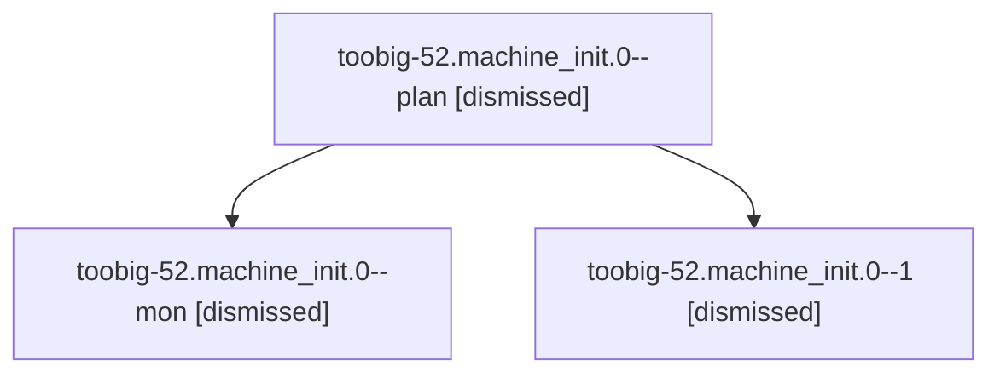

# Session: toobig-52.machine\_init.0

[Agent Hoods](../README.md) / [bbugyi200](../users/bbugyi200/README.md) / [athena](../users/bbugyi200/machines/athena/README.md) / [toobig-52](../users/bbugyi200/machines/athena/hoods/toobig-52/README.md) / toobig-52.machine\_init.0

Owner: `bbugyi200.athena` · Hood: `toobig-52` · Members: 3

## Lineage

The diagram is an optional enhancement; the ordered table below contains the same lineage in accessible text.

| Role | Agent | State | Model / provider | Timing | Commits | Prompt | Chat |
|---|---|---|---|---|---:|---|---|
| plan | toobig-52.machine\_init.0--plan | dismissed | gpt-5.5 / codex | 2026-09-09T11:33:36.845011 → 2026-09-09T12:14:03.863608 | 0 | [Prompt](../agents/bbugyi200.athena.toobig-52.machine_init.0--plan/prompt.md) | [Chat](../agents/bbugyi200.athena.toobig-52.machine_init.0--plan/chat.md) |
| mon | toobig-52.machine\_init.0--mon | dismissed | gpt-5.5 / codex | 2026-09-09T12:13:00.105712 → 2026-09-09T12:45:09.351476 | 0 | — | [Chat](../agents/bbugyi200.athena.toobig-52.machine_init.0--mon/chat.md) |
| 1 | toobig-52.machine\_init.0--1 | dismissed | gpt-5.5 / codex | 2026-09-09T12:46:43.796728 → 2026-09-09T12:50:33.873852 | [1](../agents/bbugyi200.athena.toobig-52.machine_init.0--1/README.md#commits) | [Prompt](../agents/bbugyi200.athena.toobig-52.machine_init.0--1/prompt.md) | [Chat](../agents/bbugyi200.athena.toobig-52.machine_init.0--1/chat.md) |

## Commits

| Role | Repo | Commit | Subject | Committed |
|---|---|---|---|---|
| 1 | — | `54b1d07` | refactor(dispatch): split machine init helpers | 2026-09-09 12:48:39 EDT |

## Neighbors

| Agent | Relation | State |
|---|---|---|
| [toobig-52.artifact\_link\_publication\_retry.0](../agents/bbugyi200.athena.toobig-52.artifact_link_publication_retry.0/README.md) | toobig-52 hood | dismissed |
| [toobig-52.test\_machine\_init.0](../agents/bbugyi200.athena.toobig-52.test_machine_init.0/README.md) | toobig-52 hood | waiting |
