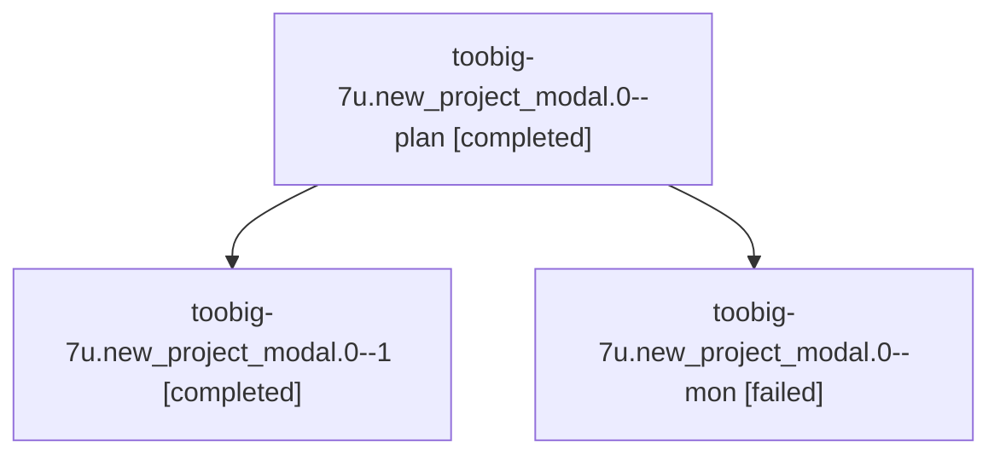

# Session: toobig-7u.new\_project\_modal.0

[Agent Hoods](../README.md) / [bbugyi200](../users/bbugyi200/README.md) / [athena](../users/bbugyi200/machines/athena/README.md) / [toobig-7u](../users/bbugyi200/machines/athena/hoods/toobig-7u/README.md) / toobig-7u.new\_project\_modal.0

Owner: `bbugyi200.athena` · Hood: `toobig-7u` · Members: 3

## Lineage

The diagram is an optional enhancement; the ordered table below contains the same lineage in accessible text.

| Role | Agent | State | Model / provider | Timing | Commits | Prompt | Chat |
|---|---|---|---|---|---:|---|---|
| plan | toobig-7u.new\_project\_modal.0--plan | completed | muse-spark-1.3-contributor / muse | 2026-10-12T19:50:20.190328+00:00 → 2026-10-12T20:25:26.954849+00:00 | 0 | [Prompt](../agents/bbugyi200.athena.toobig-7u.new_project_modal.0--plan/prompt.md) | [Chat](../agents/bbugyi200.athena.toobig-7u.new_project_modal.0--plan/chat.md) |
| 1 | toobig-7u.new\_project\_modal.0--1 | completed | muse-spark-1.3-contributor / muse | 2026-10-12T21:11:45.223224+00:00 → 2026-10-12T21:37:39.233119+00:00 | [1](../agents/bbugyi200.athena.toobig-7u.new_project_modal.0--1/README.md#commits) | [Prompt](../agents/bbugyi200.athena.toobig-7u.new_project_modal.0--1/prompt.md) | [Chat](../agents/bbugyi200.athena.toobig-7u.new_project_modal.0--1/chat.md) |
| mon | toobig-7u.new\_project\_modal.0--mon | failed | muse-spark-1.3-contributor / muse | 2026-10-12T20:23:01.589353+00:00 → 2026-10-12T21:10:35.547658+00:00 | 0 | — | [Chat](../agents/bbugyi200.athena.toobig-7u.new_project_modal.0--mon/chat.md) |

## Commits

| Role | Repo | Commit | Subject | Committed |
|---|---|---|---|---|
| 1 | sase | [`c4d84f9`](https://github.com/sase-org/sase/commit/c4d84f9a1aa08887dfb3a1aa166a2cb126841676) | refactor(tui): split new\_project\_modal into sub-500-line modules | 2026-10-12 17:31:41 EDT |

## Neighbors

| Agent | Relation | State |
|---|---|---|
| [toobig-7u.new\_project\_create.0](../agents/bbugyi200.athena.toobig-7u.new_project_create.0/README.md) | toobig-7u hood | completed |
| [toobig-7u.test\_new\_project\_create.0](../agents/bbugyi200.athena.toobig-7u.test_new_project_create.0/README.md) | toobig-7u hood | active |
