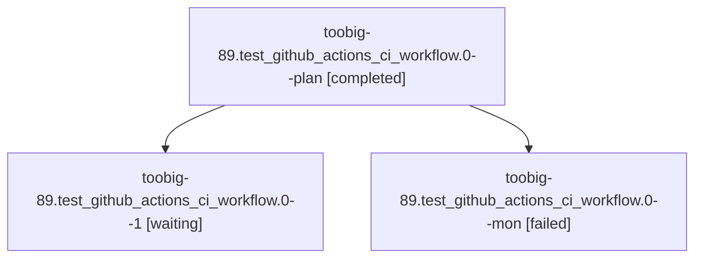

# Session: toobig-89.test\_github\_actions\_ci\_workflow.0

[Agent Hoods](../README.md) / [bbugyi200](../users/bbugyi200/README.md) / [athena](../users/bbugyi200/machines/athena/README.md) / [toobig-89](../users/bbugyi200/machines/athena/hoods/toobig-89/README.md) / toobig-89.test\_github\_actions\_ci\_workflow.0

Owner: `bbugyi200.athena` · Hood: `toobig-89` · Members: 3

## Lineage

The diagram is an optional enhancement; the ordered table below contains the same lineage in accessible text.

| Role | Agent | State | Model / provider | Timing | Commits | Prompt | Chat |
|---|---|---|---|---|---:|---|---|
| plan | toobig-89.test\_github\_actions\_ci\_workflow.0--plan | completed | gpt-6-luna / codex | 2026-10-20T11:11:52.660972+00:00 → 2026-10-20T11:21:22.222409+00:00 | 0 | [Prompt](../agents/bbugyi200.athena.toobig-89.test_github_actions_ci_workflow.0--plan/prompt.md) | [Chat](../agents/bbugyi200.athena.toobig-89.test_github_actions_ci_workflow.0--plan/chat.md) |
| 1 | toobig-89.test\_github\_actions\_ci\_workflow.0--1 | waiting | gpt-6-luna / codex | 20261020073440 | 0 | [Prompt](../agents/bbugyi200.athena.toobig-89.test_github_actions_ci_workflow.0--1/prompt.md) | — |
| mon | toobig-89.test\_github\_actions\_ci\_workflow.0--mon | failed | gpt-6-luna / codex | 2026-10-20T11:20:34.158122+00:00 → 2026-10-20T11:35:40.776307+00:00 | [1](../agents/bbugyi200.athena.toobig-89.test_github_actions_ci_workflow.0--mon/README.md#commits) | — | [Chat](../agents/bbugyi200.athena.toobig-89.test_github_actions_ci_workflow.0--mon/chat.md) |

## Commits

| Role | Repo | Commit | Subject | Committed |
|---|---|---|---|---|
| mon | sase | [`3cb4c57`](https://github.com/sase-org/sase/commit/3cb4c57ca3ea68a5eb625576620de4039be71d64) | refactor(tests): split GitHub Actions CI workflow tests | 2026-10-20 07:30:49 EDT |

## Neighbors

| Agent | Relation | State |
|---|---|---|
| [toobig-89.test\_ace\_png\_snapshots\_agents\_deck\_views.0](../agents/bbugyi200.athena.toobig-89.test_ace_png_snapshots_agents_deck_views.0/README.md) | toobig-89 hood | completed |
| [toobig-89.test\_collect\_qualification\_jobs.0](../agents/bbugyi200.athena.toobig-89.test_collect_qualification_jobs.0/README.md) | toobig-89 hood | completed |
| [toobig-89.test\_qualification\_transport\_integration.0](../agents/bbugyi200.athena.toobig-89.test_qualification_transport_integration.0/README.md) | toobig-89 hood | waiting |
| [toobig-89.test\_release\_candidate.0](../agents/bbugyi200.athena.toobig-89.test_release_candidate.0/README.md) | toobig-89 hood | waiting |
| [toobig-89.test\_release\_watch\_health.0](../agents/bbugyi200.athena.toobig-89.test_release_watch_health.0/README.md) | toobig-89 hood | waiting |
