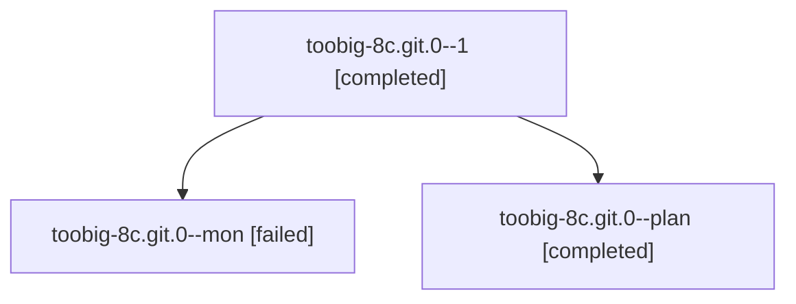

# Session: toobig-8c.git.0

[Agent Hoods](../README.md) / [bbugyi200](../users/bbugyi200/README.md) / [athena](../users/bbugyi200/machines/athena/README.md) / [toobig-8c](../users/bbugyi200/machines/athena/hoods/toobig-8c/README.md) / toobig-8c.git.0

Owner: `bbugyi200.athena` · Hood: `toobig-8c` · Members: 3

## Lineage

The diagram is an optional enhancement; the ordered table below contains the same lineage in accessible text.

| Role | Agent | State | Model / provider | Timing | Commits | Prompt | Chat |
|---|---|---|---|---|---:|---|---|
| 1 | toobig-8c.git.0--1 | completed | muse-spark-1.3-contributor / muse | 2026-10-20T23:13:25.475485+00:00 → 2026-10-20T23:21:55.201559+00:00 | [1](../agents/bbugyi200.athena.toobig-8c.git.0--1/README.md#commits) | [Prompt](../agents/bbugyi200.athena.toobig-8c.git.0--1/prompt.md) | [Chat](../agents/bbugyi200.athena.toobig-8c.git.0--1/chat.md) |
| mon | toobig-8c.git.0--mon | failed | muse-spark-1.3-contributor / muse | 2026-10-20T23:00:57.274166+00:00 → 2026-10-20T23:11:13.733307+00:00 | 0 | — | [Chat](../agents/bbugyi200.athena.toobig-8c.git.0--mon/chat.md) |
| plan | toobig-8c.git.0--plan | completed | muse-spark-1.3-contributor / muse | 2026-10-20T22:45:17.914710+00:00 → 2026-10-20T23:01:52.224127+00:00 | 0 | [Prompt](../agents/bbugyi200.athena.toobig-8c.git.0--plan/prompt.md) | [Chat](../agents/bbugyi200.athena.toobig-8c.git.0--plan/chat.md) |

## Commits

| Role | Repo | Commit | Subject | Committed |
|---|---|---|---|---|
| 1 | sase | [`fe45b86`](https://github.com/sase-org/sase/commit/fe45b86f28bfb430706b7abb9ea8a140edd5736b) | refactor(sdd): split \_git.py into config, runner, and network modules | 2026-10-20 19:18:30 EDT |

## Neighbors

| Agent | Relation | State |
|---|---|---|
| [toobig-8c.test\_deck\_split\_pilot.0](../agents/bbugyi200.athena.toobig-8c.test_deck_split_pilot.0/README.md) | toobig-8c hood | completed |
| [toobig-8c.test\_github\_actions\_ci\_master\_gate.0](../agents/bbugyi200.athena.toobig-8c.test_github_actions_ci_master_gate.0/README.md) | toobig-8c hood | active |
